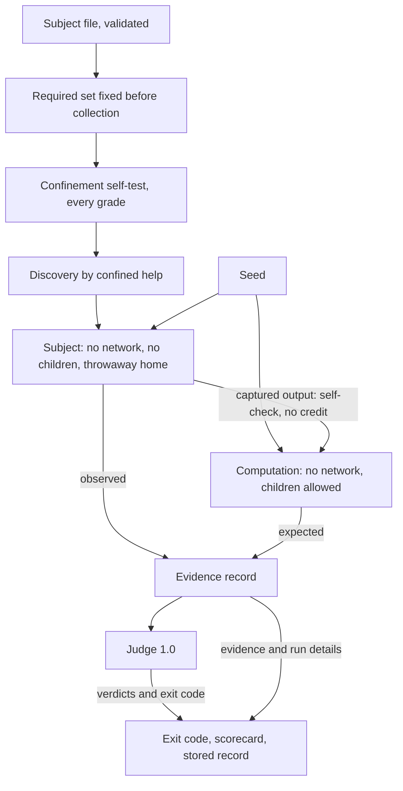
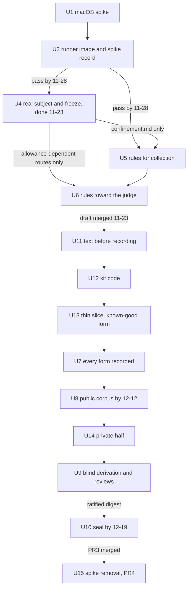
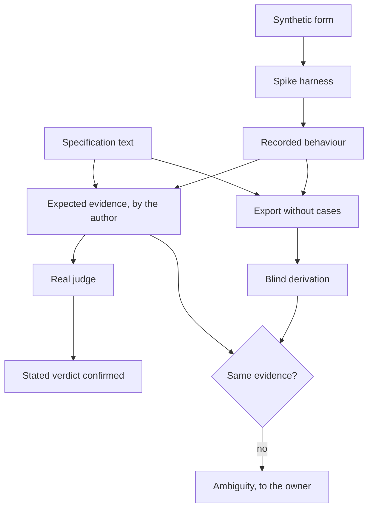
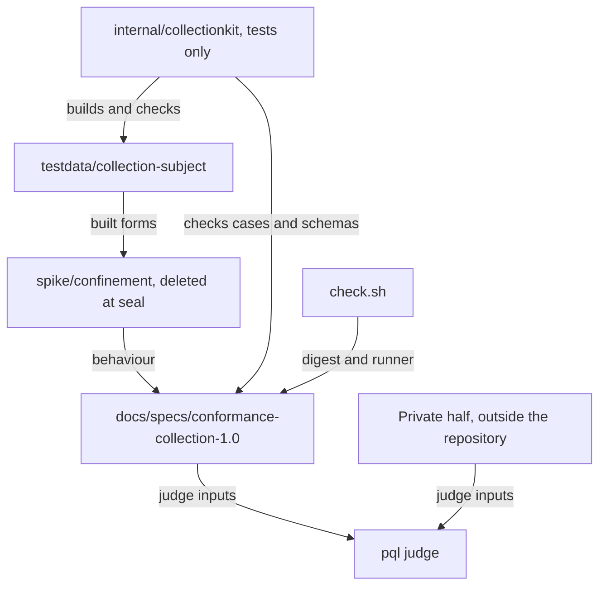
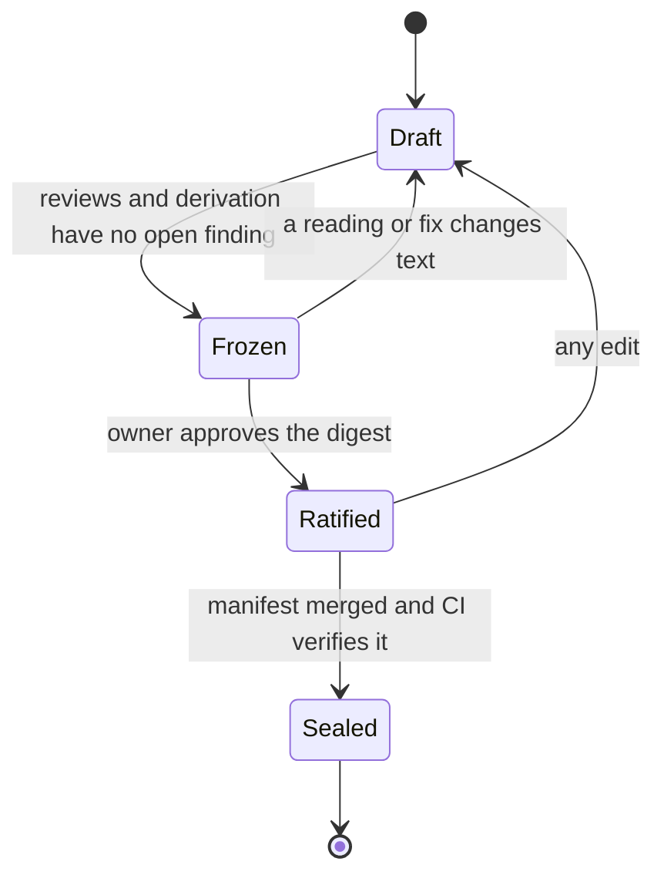
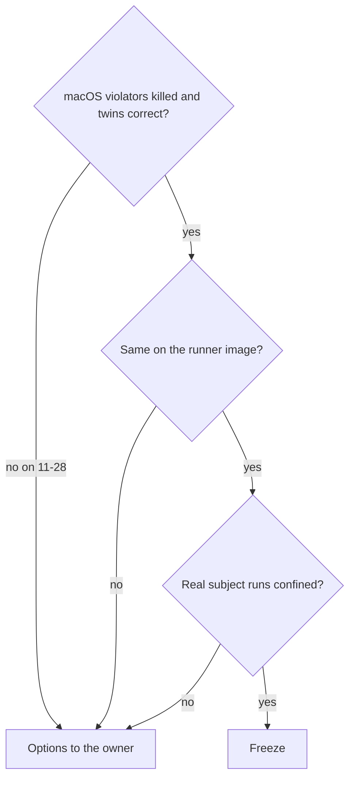

# Conformance Collection Specification - Plan

This plan covers phase 2 of the [engine plan](2026-11-21-engine-plan.md).
Its own ids start with C: CR for requirements, CF for flows, CAE for acceptance examples.
A bare R, AE, A or F number is an entry in [the requirements](../requirements.md).
The prefix is needed because the citation test reads every bare R or AE number under `docs/` as one of those entries, including one written after a hyphen.

## Goal Capsule

- **Objective:** A person who grades a printed CLI can trust that the verdict rests on what that CLI did: no green from evidence that was never observed, and no red that the engine caused.
- **Means:** A sealed conformance collection specification, gated by a no-network spike and proved by a synthetic subject and a two-sided corpus. A builder with only this repository can then build the grade command without inventing a rule (KTD1, KTD7, KTD9).
- **Authority:** The sealed judge 1.0 first, then this Product Contract, then the Planning Contract, then a unit. A requirement wins over a decision of planning. An input with two honest readings goes to the owner.
- **Stop conditions:** A failed spike gate (KTD6), a need to download, use a key or use the network for the real subject (CR4), or any change that would need judge 1.1.
- **Execution profile:** Deep. Four pull requests: the spike, the draft specification, the corpus and seal, then the spike's removal. The main session writes the specification and a coding agent writes the code (KTD16).
- **Who finishes:** The executing session opens each pull request and stops. The owner merges and ratifies.
- **Product authority:** The owner, who ratifies and seals the specification. This plan covers phase 2 only. The grade command, the first real grade and steering are not active scope.
- **Open blockers:** None for planning. PR1 and PR2 are merged (#8, #9). The spike passed for macOS 27.0.1 and 27.2 (CR6), the real subject ran offline and confined (CR4), the confinement rules froze on 2026-11-23, and the draft specification is on `main`.
- **Dates:** Spike answered by 2026-11-28, specification draft by 2026-12-05, corpus by 2026-12-12, seal by 2026-12-19. A late checkpoint moves the date and cuts nothing (CR106).

---

## Product Contract

### Summary

Specify and seal how `pql` turns a subject file and a real CLI into evidence for judge 1.0.
The CLI runs confined in a seeded throwaway home, expected answers come from known inputs, six probes are generated, and whatever cannot be verified is not-measured.

### Problem Frame

Judge 1.0 decides every verdict from a finished evidence record, and nothing specifies how that record is produced.
A collector built by guesswork would hand the judge wrong evidence, and the judge would grade it faithfully.

The engine plan's §3 lists what is missing, and that list is incomplete.
The judge also reads `crediting`, `record`, expected-failure markers and five subject facts, and §3 names a source for none of them.
Crediting matters most: the default scope has 17 dimensions, at least 14 always apply to a CLI, and each applicable one needs a held crediting check before a run exits 0.

Printed CLIs also make offline measurement harder than it looks.
The source of current ones, read for this plan, shows reads that try the network before local data, state written on read commands and fallbacks to a cache.
Blocking the network is therefore not evidence that no request was attempted.

### Key Decisions

- **The subject is strict and a doubt is not-measured.** This is what R16 asks. Governs CR1, CR18, CR19, CR20. (session-settled: user-directed — chosen over counting a blocked run as verified: a swallowed attempt that falls back to a cache would grade green.)
- **macOS only in 1.0.** The engine plan's §7 allows one supported system. Governs CR1, CR5, CR6, CR56. (session-settled: user-directed — chosen over a Linux time box, a network-only measurement or a ptrace supervisor: a seccomp filter cannot decide a file rule by path, so the time box could only end unsupported.)
- **Phase 3 proves the real verifier with local macOS runs.** GitHub's macOS runners are billed, and `AGENTS.md` now keeps CI on Linux. Governs CR56, CR61. (session-settled: user-directed — chosen over keeping CR56's macOS CI job and deciding in phase 3: the owner set the Linux-only rule on 2026-11-23.)
- **An unexplained SIGKILL is not-measured.** This reads R16 over R22 for that one input. Governs CR20, CR21. (session-settled: user-directed — chosen over red or a diagnostic re-run: the sandbox's kill cannot be told from any other.)
- **Help is not execution when confined.** This settles how R42 and AE24 meet. Governs CR25, CR26. (session-settled: user-directed — chosen over root help only or the subject's own manifest: nested commands must be counted without trusting the subject's report.)
- **One strict JSON subject file.** It needs no dependency. Governs CR8, CR9. (session-settled: user-directed — chosen over TOML, YAML and Markdown: the judge's input rules apply directly and no second grammar is needed.)
- **A computation is any executable.** It keeps `pql` a single binary. Governs CR34, CR35, CR39. (session-settled: user-directed — chosen over built-in operations, a values file and a Python contract: users bring any language without adding a runtime to the engine.)
- **A computation has its own confinement.** R16 governs the subject, and ordinary scripts need child processes. Governs CR35, CR36, CR37. (session-settled: user-approved — chosen over the subject's no-child rule: that rule kills an ordinary shell pipeline.)
- **Programs run from a private copy.** macOS starts a program only if it may read the executable's directory. Governs CR32, CR62, CR76, CR112. (session-settled: user-directed — chosen over running in place: that shows the program the names of everything installed beside it.)
- **A computation's process group is ended, and the escape is a stated limit.** macOS cannot refuse a child that leaves its group through `posix_spawn` without also refusing that call. Governs CR35. (session-settled: user-directed — chosen over tracking processes by their sandbox or forbidding `posix_spawn`: the first relies on a private call that can kill unrelated processes, and the second breaks Python, Node, `xargs` and `system()`.)
- **Two operations are refused without a kill.** macOS rejects the kill on them. Governs CR67. (session-settled: user-directed — chosen over leaving both allowed: an untested entitlement could widen the confinement.)
- **The CLI agreeing with itself can fail but cannot earn green.** Green needs a known answer. Governs CR32, CR33, CR37. (session-settled: user-directed — chosen over crediting agreement or banning self-checks: two commands can share a bug, and a disagreement is still worth reporting.)
- **Every grade runs on a seeded throwaway copy.** Known answers need known data. Governs CR14, CR15, CR16, CR17. (session-settled: user-directed — chosen over a snapshot or the real store: results must repeat and real data must not be touched.)
- **The subject file can declare how to run offline.** Live-first CLIs would otherwise have no measurable reads. Governs CR13. (session-settled: user-approved — chosen over default invocations only: those reads attempt the network and are all not-measured.)
- **Six generated probes.** They are what the requirements and restricted credit need. Governs CR27, CR28, CR31. (session-settled: user-directed — chosen over every mechanical probe or green without authoring: each probe costs cases, and proxy probes invite false greens.)
- **Bookkeeping exclusions are declared and shown.** Governs CR29, CR30. (session-settled: user-directed — chosen over any write being red or switching bookkeeping off: invocation journals are by design, and the default behaviour should be the one graded.)
- **A planted secret counts only where it would be read.** Governs CR31. (session-settled: user-approved — chosen over planting it anywhere: a secret the CLI never reads proves nothing by its absence.)
- **The needed crediting rules are restated here.** CDR spec 0.9.1 is their starting point. Governs CR43, CR44. (session-settled: user-directed — chosen over waiting for that spec's publication or writing new rules: the specification must be buildable from this repository and judge 1.0 keeps those rules unchanged.)
- **The real subject is chosen and not named here.** The engine plan's §8 item 1 is settled. Governs CR4, CR61. (session-settled: user-directed — chosen over three other candidates: it best represents current generator output with low-sensitivity data.)
- **Some cases stay private.** Governs CR54. (session-settled: user-approved — chosen over publishing every case: builds are scored against cases they have not seen.)
- **The corpus is checked before a collector exists.** Governs CR51, CR52. (session-settled: user-approved — chosen over waiting for the grade command: a wrong corpus would train a wrong collector.)
- **A rejected record is the engine's failure.** Governs CR47. (session-settled: user-approved — chosen over reporting a verdict: the judge gave none.)
- **A confinement refusal is never red.** The objective rules out a red the engine caused. Governs CR20, CR67. (session-settled: user-approved — chosen over letting the subject carry on after a refusal: its failure would look like its own defect.)
- **A planted secret's read is proved.** An author's declaration is not an observation. Governs CR31, CR68. (session-settled: user-approved — chosen over trusting the declared location: a place never read gives a green that proves nothing.)
- **A read takes two signals.** macOS kills at open, so the control run alone counts a file that was opened and never read. Governs CR31. (session-settled: user-directed — chosen over calling an open a read or using the access time alone: the first credits an unread secret, and the second has nothing to catch another reader.)
- **Version 1.0 supports only the macOS 27 versions the spike's record names as passed, 27.0.1 and 27.2.** macOS 26.7.2 rejects the profile, which names operations that version does not know, and a later 27 release may add operations the profile does not refuse. Each further version is supported once the record names it as passed. Governs CR6, KTD5. (session-settled: user-directed — chosen over building and testing a second profile for macOS 26, and over supporting every 27 release, which the owner confirmed on 2026-11-23: every other system already falls under CR23.)
- **Any write to the planted file is refused.** The spike showed four ways to move its access time without a read under the home's write grant. Governs CR31. (session-settled: user-directed — chosen over allowing writes and refusing time changes across the home: a CLI that rewrites its credential file during the probe is then not observed, which never gives false credit.)
- **Synthetic programs decide the spike's pass.** The real subject's run gates the seal. Governs CR6, CR66. (session-settled: user-approved — chosen over making that run part of the 2026-11-28 pass: a late approval would stop the work for a reason that is not evidence.)
- **A test run is scripted at every level.** Nothing verified that it was offline. Governs CR49, CR73. (session-settled: user-approved — chosen over labelling its evidence offline: that would claim what a fake verifier cannot show.)
- **A malformed command line and a rejected request have different codes.** Both existing contracts are kept. Governs CR71, CR72. (session-settled: user-approved — chosen over one code for both: the rulebook gives a rejected request 2 and the command already gives a malformed line 64.)
- **The store cannot be excluded.** This bounds the declared exclusions. Governs CR100, CR101. (session-settled: user-directed — chosen over unbounded exclusions or no credit with any exclusion: an excluded store gave a false green, and CLIs with journals must still be able to reach green.)
- **A runbook stops at the first step not held.** This reads R33 for a step that was not observed. Governs CR40. (session-settled: user-directed — chosen over stopping only after a failure: later steps would go red on state the sandbox left half written.)
- **A timeout is red only on a healthy host.** R22 stands where the host kept up. Governs CR98. (session-settled: user-directed — chosen over always red: a loaded host would cause reds that are not the subject's.)
- **A check's id follows its meaning.** The judge compares by id alone. Governs CR99. (session-settled: user-directed — chosen over fixed author names: two different measurements must not compare as the same.)
- **Records are minimized and cleaned up.** Captured output can hold secrets and personal data. Governs CR102, CR103. (session-settled: user-directed — chosen over location only or adding retention and pruning now: it closes the leak without another command to specify.)
- **An independent reader derives evidence before the seal.** The specification and corpus have one author. Governs CR104. (session-settled: user-directed — chosen over reviews alone: the judge's ambiguities were found by independent case writers.)
- **A late phase 2 moves its date.** Quality is kept and the risk to the 2027-01-25 halfway check is accepted. Governs CR105, CR106. (session-settled: user-directed — chosen over cutting breadth first or deciding at the time: nothing is cut.)
- **A local bind or listen is a network attempt.** This reads R16 strictly. Governs CR109. (session-settled: user-directed — chosen over allowing a loopback bind: a local relay could carry requests out of the sandbox.)
- **The user retires ids, from the engine's list.** This keeps R26 when a change of meaning renames checks. Governs CR114. (session-settled: user-directed — chosen over retiring automatically: a dropped check must not vanish silently.)

<!-- ce-section: work-relationships -->
### How This Work Fits Together

This plan covers phase 2. The rest is the engine plan's current understanding and is not scope here.

- Phase 3, the grade command. Depends on this plan's sealed specification and reviewed corpus.
- Phase 4, the first real conformance grade. Depends on phase 3, and shares the real subject chosen here.
- Phase 5, the steering collection specification. Shares the subject file, and extends the test entry this plan specifies.
- Phases 6 and 7, steering built and run. Depend on phase 5.

### Actors

The requirements' A1 (user), A2 (operator agent) and A4 (subject CLI) apply unchanged. Three roles act in this phase:

- **Owner:** decides readings, approves runs of the real subject, ratifies and seals.
- **Specification author:** writes the specification and the expected evidence, and does not build the collector.
- **Builder and reviewers:** the builder sees only this repository. A reviewer did not write what it reviews.

### Key Flows

- CF1. Phase 2, from spike to seal
  - **Trigger:** This plan is approved.
  - **Steps:** Answer the spike. Write the specification. Build the synthetic subject. Write the corpus and check it against the judge. Review, ratify and seal.
  - **Outcome:** Phase 3 can start, or the owner has been told why it cannot.
  - **Covered by:** CR1 to CR7, CR49 to CR61, CR65, CR66, CR73, CR97, CR104 to CR106
- CF2. Collection, as the specification must describe it
  - **Trigger:** A1 or A2 asks for a grade.
  - **Steps:** Read and validate the subject file. Fix the required set. Test the confinement. Discover commands by confined help, as a check. Run the subject on fresh seeded copies. Run computations separately. Build the record and call the judge.
  - **Outcome:** One judge document gives the exit code and every verdict. The scorecard and stored record add the run's evidence and details, per CR69.
  - **Covered by:** CR8 to CR48, CR109 to CR115, CR62 to CR64, CR67 to CR72, CR74 to CR92, CR94, CR98 to CR103, CR107, CR108



### Requirements

**The no-network spike**

- CR1. On macOS, the spike shows that a run with no attempt is verified as such, and that a run with an attempt or one that cannot be verified never is.
- CR2. The spike tests swallowed errors, DNS, child processes, replacing the process image, local sockets, and delegation to system daemons.
- CR3. The spike tests that the confinement of files and computations required by CR16, CR17, CR35 to CR37, CR62 to CR64, CR67, CR78 and CR80 to CR82 can be enforced, and that the read proof in CR31 works.
- CR4. The spike includes a confined offline run of the real subject, after the owner separately approves its build and that run.
- CR5. Linux is unsupported in version 1.0, and the spike's record gives the reason: a seccomp filter cannot decide by path, Landlock refuses without ending the process, and a ptrace supervisor was not attempted.
- CR6. macOS passes when CR1, CR2 and CR3 hold on synthetic programs, and if it has not passed by 2026-11-28, specification work that depends on confinement stops and the owner is told that the milestone is in doubt.
- CR7. The spike's answer is recorded in this repository with what was tested, on which system versions, and each limit left open, and holds no captured output, local path or name of the real subject.
- CR65. The spike's synthetic programs also run once on a pinned GitHub macOS runner image, whose version is recorded.
- CR97. The spike also runs under an already-sandboxed parent, tests delegation from a computation, and judges each clean program by its output as well as its exit status.
- CR66. The results of CR4 and CR65 are required before the seal, and a failure in either goes to the owner.

**The subject file**

- CR8. One versioned strict JSON file registers a subject and holds its facts, command classes, declared commands and bounds, seed, offline settings, bookkeeping paths, secret location, runbooks and expected-failure markers, with a versioned place for phase 5's prompts.
- CR9. The file follows the input rules of the judge contract's §3 for repeated keys, number forms, depth and encoding.
- CR10. The file supplies the judge's five subject facts, and an unstated fact is an unfilled placeholder, never a "no".
- CR11. `create` writes placeholders that explain themselves without comments, and a grade of an unfilled file names each one.
- CR12. Each command is declared safe or destructive or is unclassified, with the consequences R16 states.
- CR13. The file can declare arguments and environment for offline invocation, and every scorecard shows them, with environment values masked.
- CR87. Offline settings state which invocations they apply to, never apply to discovery, and cannot be a help or version request.
- CR86. Any unfilled placeholder, including a declared or discovered command with no safety class, makes a required check on an always-applicable dimension `placeholder_unfilled`, so the run cannot exit 0.
- CR76. The seed and every declared file resolve inside the subject file's directory, which is neither the user's home nor above it, and a declared executable grants a read of that one executable file and, as CR112 says, of the private directory its copy runs from.
- CR112. Each declared file and executable is a regular file, and a grant covers that one file and never a directory, with one exception. The subject and a computation's executable each run as a byte-identical copy in its own throwaway directory that holds nothing else, which is not writable by them and which each may list, because macOS starts no program without that read. The specification states that a program sees the copy's path and finds nothing installed beside the original.
- CR77. The seed is copied by content, and a seed holding a link or special file is rejected before collection.

**State and confinement**

- CR14. Each runbook and each probe gets a fresh copy of the declared seed in a throwaway home, and an ordered runbook's steps share that copy.
- CR15. The run records the seed's digest, and with no seed the home is empty.
- CR16. The subject cannot write outside its throwaway home.
- CR17. The subject cannot read the user's real state for that CLI.
- CR62. The subject can read file contents only from its binary and the listing CR112 allows, the system paths a process needs to run, and its throwaway home.
- CR63. The engine builds the environment of the subject and of each computation from an allow-list and the subject file's literal declarations, and passes no other variable through.
- CR67. Any operation the confinement refuses ends the subject's process, so the check is not-measured and never red. The specification names the only exceptions: `exception-entitlement` and `process-exec-update-label`, which macOS cannot refuse with a kill, are refused without one, and a computation executing a setuid or setgid program fails with EPERM and no kill. It states that each such refusal is silent.
- CR78. The profile is a fixed template that receives every path as a canonical parameter, never as profile text.
- CR80. The subject can reach only an allow-list of system services, and can neither read another process's environment or arguments nor signal another process.
- CR81. CR80 binds a computation too, except toward processes in its own sandbox.
- CR82. The engine fixes home, temporary directory, search path, locale and time zone, gives no terminal, input or inherited descriptor, and rejects a declaration that overrides these or sets a loader variable.
- CR115. The engine refuses to run as root.
- CR83. The specification lists the allowed system paths and services, and states which file metadata stays visible.

**What the subject's run means**

- CR18. A check is observed only when the engine verified that the subject attempted no network request during it.
- CR109. Binding or listening on any socket, loopback included, is a network attempt.
- CR19. A check in which the subject starts a child process is not-measured under CR20.
- CR20. A SIGKILL the engine cannot attribute is `network_unverifiable`, and its next action names the possible causes: network, child process, confinement refusal and external kill.
- CR21. A timeout under CR98 and every other crash remain subject failures and red, as R22 says.
- CR98. A timeout is red when the engine saw the process still running as it ended it and a known-fast control kept within its bound on that host; with an overrun control it is `harness_fault`.
- CR22. `network_attempted` is reported only when the attempt itself was evidenced.
- CR74. Before any check runs the subject, each grade runs self-test programs under that grade's confinement: one for each kind of refused operation must be killed, and a clean one must finish with the right output.
- CR111. The self-test's program takes the subject's place in the profile, and the computation's confinement is self-tested and never bypassed in the same way.
- CR75. A confinement that cannot be applied is detected apart from the subject's exit status, and the subject is never then run unconfined.
- CR23. When CR74 fails, CR75 applies, or the system has no verifier that passed the spike, every check that runs the subject is `network_unverifiable` and never red.
- CR24. A binary that cannot be started is `could_not_start`.

**Discovery and generated probes**

- CR25. Discovery may ask any command for help, only under the subject's full confinement with an empty home and with no other arguments.
- CR26. The specification states the limit that a CLI which ignores a help request runs that command's action inside the confinement.
- CR70. A declared command that discovery does not find leaves discovery and the other generated checks not-measured, never red, with a reason from the rulebook's §13 and both counts and the missing names shown.
- CR85. The specification defines how help is requested and read and which built-in commands are left out, and discovery compares command names as well as the count R42 asks for.
- CR27. Version 1.0 generates exactly six probes: discovery, bare invocation, byte bound, declared exit codes, planted secret and store unchanged.
- CR28. Each probe names the one dimension it feeds, whether it credits and when it is not-measured, and at least one dimension can be judged from generated checks alone.
- CR29. The store-unchanged probe compares the whole throwaway home except declared bookkeeping paths, which every scorecard lists.
- CR30. The store-unchanged probe is not-measured as `empty_target` when nothing non-empty is left to compare.
- CR100. An exclusion cannot cover the declared store or any path the seed supplied, so a seed is prepared without bookkeeping files.
- CR101. The store-unchanged probe credits only after its comparison detected a change made in a control copy, compares names and contents only, and follows a stated rule for database side files.
- CR31. The planted-secret probe is observed only when an invocation finishes with its declared successful exit and moved the planted file's access time, which it cannot set, and an otherwise identical control run, which kills on opening that file for reading, is killed. The subject cannot set that access time because any write to the planted file, and any unlink or create on the throwaway home and on every directory below it on the file's path, kills it, so a subject that rewrites the file is not observed. The self-test first shows that the volume records a read's access time, or the probe is not-measured. The specification states two limits: another process reading the file during such an invocation looks like the subject's read, and a read that returns no bytes at the end of the file moves its access time and counts as a read.
- CR107. The planted file is a credential file, or a seeded-state file for which the specification says why reading it proves the secret was read, which a multi-record database never is.
- CR84. A leak is the planted secret, in any listed encoding, in a captured stream or in any file of the used home other than the planted one, excluded paths included. The specification states the limits that a leak through the system's unified log, which the allowed logging service reaches, is not seen, and that on a Mac bound to a directory server a user or group lookup can reach that server.
- CR110. The engine inspects a used home without following a link, opening a special file or reading past a bound, and reports a link or special file the subject created as a change.
- CR113. A leak scan stopped by any bound, on a stream or in the home, is not-measured and never held.
- CR68. With no proved read the planted-secret probe is not-measured as `input_missing`, as it is for a secret that only an environment variable can carry.

**Authored checks and expected values**

- CR32. Every observed value comes from the engine running the subject's binary, as the copy CR112 describes, under its confinement.
- CR33. A check whose expected value uses the subject's captured output is non-crediting, as fixed from its declared inputs before collection.
- CR34. An expected value is a literal or the one JSON value printed by a user's executable, which is named as an argument list and run without a shell.
- CR35. A computation runs with no network and a time budget, may start child processes, is killed on `setsid` or `setpgid` in the process that calls it, and has its whole process group ended with it. The specification states that a child which leaves the group through `posix_spawn` escapes that ending and stays in the computation's confinement.
- CR36. A computation cannot execute or read the subject's binary or be given a file with the same content, and the specification states that any other copy escapes this.
- CR37. A computation receives only the pristine seed and the captured outputs its check declares, never the subject's used home.
- CR64. A computation can read file contents only from its executable and declared files, system paths and what CR37 gives it, and can write only to its own scratch directory, never to the seed.
- CR38. A computation that fails, is absent, runs out of time or prints anything other than one JSON value that the judge contract's §3 accepts inside a record is `computation_failed`.
- CR39. The specification and the engine's documentation warn that grading someone else's subject file runs their code.
- CR40. Runbook steps run in order with time budgets, as R33 states, and every step after the first one not held is `earlier_step_failed`.
- CR41. The destructive-refusal check is authored and runs only in a scope that includes `destructive`, as R12 states.

**What the engine gives the judge**

- CR42. Check ids follow CR99, and the required set is fixed from the subject file, the rulebook and the requested scope before discovery or any other check runs.
- CR99. A check's id is made from its kind, dimension, predicate and parameters, invocation and declared environment, earlier runbook steps, seed digest, exclusions, expected-value source and collection specification version, and from nothing else, so a changed subject binary keeps it.
- CR114. The engine lists a baseline's missing ids with the cause of each, in a form the user passes back whole to `anchor` as retired, and retires none by itself.
- CR91. The collection specification has a version string, a definition of a breaking change and a dated errata note outside the sealed folder.
- CR92. The specification holds a table of every conformance dimension with its route to credit, the independent source of its expected value, and the subjects that have no route.
- CR94. The specification holds a table of each known false-pass and false-fail route with its positive control, including that a green speaks only for the declared invocation and exclusions.
- CR43. The specification restates, in its own words and under its own rule ids, the crediting and routing rules it uses, with no text or fixtures copied from CDR spec 0.9.1.
- CR44. Only the planted-secret probe credits `pii-secret-hygiene`, and only the store-unchanged probe credits `side-effect-integrity`.
- CR45. A rule defines how each required-check and evidence field is produced, including `record`, target size, observed precondition, tier and evaluator, and how markers reach the judge.
- CR90. Every not-observed check reaches the judge with its reason and at least one target, and a normal run claims `live` while its offline evidence carries `offline`.
- CR79. Captured output is drained, bounded and encoded, and literals are bounded, so that nothing a user or subject supplies can make the engine's record fail the judge contract's §3.
- CR89. JSON Schemas for the subject file, stored record, baseline and case format are sealed with the specification, which also says which record fields must be equal for a collector to conform.
- CR46. Every not-measured reason conformance can produce has a next action.
- CR71. Before collection the engine validates the subject file and has the judge check the request and required set without evidence, and the specification states for each rejection rule whether user or engine caused it.
- CR88. The specification has a closed table of engine exit codes, in which every engine fault, a panic included, is 70 and none can exit 1, and which states the limit that a fatal error of the Go runtime cannot be caught and exits 2.
- CR72. A malformed command line exits 64, and a well-formed request rejected for its content or scope exits 2, as the rulebook's §8 says.
- CR47. When the judge rejects the engine's record, the engine exits 70, gives no verdict and keeps that record for diagnosis.
- CR48. The specification defines where run records and baselines live and in what form, consistent with R27.
- CR69. For every record the judge decided, the exit code and every verdict are read only from the judge's output, while the scorecard and stored record add the evidence and run details the engine recorded.
- CR102. Records are readable only by the user and live outside any repository, and every record, a rejected one included, and every scorecard mask the planted secret and declared environment values in every encoding CR84 lists.
- CR103. Throwaway homes and scratch directories are removed on every exit, a killed check included.
- CR108. The scorecard and documentation meet the errata's E-4, so a successful anchor is never shown as a green run.

**The test entry, synthetic subject and corpus**

- CR49. The specification defines the test entry for a scripted network verifier: the default build is the released one and rejects it with exit 2, only a non-default build contains the scripted verifier, and its runs cannot be anchored.
- CR73. A test run is `scripted` in its claimed tier, targets and evidence, and the corpus's baseline cases for it use scripted baselines supplied as files.
- CR50. The synthetic subject is a small CLI in test data, with a known-good form that can make all 17 default-scope dimensions green, and `destructive-guard` in its scope, and other forms that each carry one seeded defect.
- CR51. Expected evidence is written from the specification, and each case's record is run through the real judge to confirm the stated verdict and exit code.
- CR52. Each form of the synthetic subject is run directly and under the spike's profile without collector code, and what it did is recorded as the source of its expected evidence.
- CR104. Before the seal, a reader who did not write the specification, on a different model, derives expected evidence for a sample of cases from the text alone, and each disagreement is treated as an ambiguity.
- CR53. The corpus is language-neutral and two-sided: every rule has a case, every not-measured case has a repaired twin that grades green, and every defect is red on its named check.
- CR54. A privately kept set of cases scores builds, and nothing from it reaches a builder except a rule id.
- CR55. The corpus states which cases need the real verifier, including every anchor case except the refusal as a test run, and which run through the test entry, and a skipped case is reported as skipped, never passed.

**CI, review and seal**

- CR56. The specification and the engine plan assign phase 3's real verifier to local macOS runs on a machine the owner controls, stated in each pull request as `AGENTS.md` requires. The scripted verifier runs in Linux CI, which stays required on `main`.
- CR57. CI verifies the new sealed folder's digest and file set as it does judge 1.0's.
- CR58. An input that can honestly be read two ways goes to the owner with both readings.
- CR59. The specification lists each reading or departure from the requirements, including those in CR20, CR25, CR40, CR67, CR70, CR72, CR73 and CR98.
- CR60. A standards reviewer and a different model review the specification, the synthetic subject and corpus are reviewed, and the owner then ratifies and seals `docs/specs/conformance-collection-1.0/`.
- CR105. Progress is reported to the owner at each checkpoint in the Goal Capsule.
- CR106. A missed checkpoint moves the phase's date and cuts no scope, case or review, and the owner is told what that does to the 2027-01-25 halfway check.
- CR61. The engine plan is updated, without naming the real subject, for:
  - the decisions settled here;
  - the items missing from its §3;
  - the earlier test entry;
  - phase 3's local macOS evidence;
  - §4's rule on what is read from the judge's output;
  - any date moved under CR106.

### Acceptance Examples

- CAE1. **Covers CR18, CR20.** Given a subject that tries the network, ignores the error and would serve its cache, when the check runs on macOS, then it is not-measured and the network is named among the possible causes.
- CAE2. **Covers CR19, CR20.** Given a subject that starts a harmless child, when the check runs, then it is not-measured and the next action names child processes as a possible cause.
- CAE3. **Covers CR20, CR21.** Given three subjects, one killed by an unexplained SIGKILL, one that segfaults and one past its budget on a host where the control kept up, when each is checked, then the first is not-measured and the other two are red.
- CAE4. **Covers CR33.** Given a subject whose `list` and `count` both report 9 of 10 seeded items, when a self-check compares them, then it holds without credit. When a check expects the literal 10, it is red.
- CAE5. **Covers CR33.** Given `list` reporting 10 and `count` reporting 9, when a self-check compares them, then the dimension is red.
- CAE6. **Covers CR35, CR36.** Given a computation that pipes its declared input through another program, then it returns its value. Given one that invokes the subject's binary, then the subject does not run.
- CAE7. **Covers CR29, CR30.** Given a read command that appends only to an excluded journal, then the probe holds and the exclusion is shown. Given a write to any other file, then it is red. Given a home with nothing non-empty outside the excluded paths, then it is not-measured as `empty_target`.
- CAE8. **Covers CR31, CR68.** Given a subject with no file it reads a secret from, or a declared file that the proof shows it never reads, a file it only opens included, when it is graded, then the probe is not-measured and the run does not exit zero.
- CAE9. **Covers CR12, CR25.** Given a nested command with no safety class, when the subject is graded, then its help may be read, its action is not requested, and the run is not-measured naming that command.
- CAE10. **Covers CR13, CR18.** Given a live-first read, when it runs with no offline declaration and attempts the network, then it is not-measured. When a declared offline invocation avoids the attempt, then it is judged and the declaration is shown.
- CAE11. **Covers CR16, CR17.** Given a subject that ignores the redirected home, when it runs, then the user's real state is neither read nor changed.
- CAE12. **Covers CR23.** Given a grade on an unsupported system, then every check that runs the subject is not-measured as `network_unverifiable` and the run does not exit zero.
- CAE13. **Covers CR47.** Given a record the judge rejects, when `grade` ends, then it exits 70, shows no verdict and keeps the record.
- CAE14. **Covers CR49, CR55.** Given a green run through the test entry, when it is anchored, then it is refused as a test run. The successful-anchor case runs on the real verifier.
- CAE15. **Covers CR67.** Given a subject that writes a cache outside its home and would carry on or crash when refused, when the write is refused, then the process ends and the check is not-measured.
- CAE16. **Covers CR62, CR63, CR64.** Given a real API key in the engine's environment and a private file in the user's home, when a subject or computation tries to read either, then it gets neither.
- CAE17. **Covers CR70.** Given 40 declared commands and 3 found, when the subject is graded, then the generated checks are not-measured and both counts are shown.
- CAE18. **Covers CR71, CR72.** Given an unknown flag, then the exit code is 64. Given a marker on a Safety dimension in the subject file, then the request is rejected with 2 before collection and is not reported as an engine failure.
- CAE19. **Covers CR23, CR74, CR75.** Given a nested sandbox, a broken profile or a profile whose kill does not fire, when a grade runs, then every check that runs the subject is not-measured and none is red.
- CAE20. **Covers CR76, CR77, CR78.** Given a declared path that holds profile syntax, climbs out of its directory or is a link to a private file, when the subject is graded, then that file is never read or copied.
- CAE21. **Covers CR38, CR79.** Given a subject that prints 17 MB, invalid UTF-8 or a 33-digit number, then the check is judged and the exit is not 70. Given a computation that prints such a number, then it is `computation_failed`.
- CAE22. **Covers CR40.** Given a first step killed by the confinement, when the runbook continues, then each later step is `earlier_step_failed` and none is red.
- CAE23. **Covers CR98.** Given a subject past its budget, then it is red. Given the same on a host where the control also overran, then it is `harness_fault`.
- CAE24. **Covers CR100.** Given a subject file that lists its store as bookkeeping, when it is graded, then it is rejected before collection.
- CAE25. **Covers CR99, CR114.** Given a baseline and an edited seed, then the old checks are missing, they are listed for retirement, and re-anchoring with that list is the next action. Given the same file and a worse binary, then the check is regressed.
- CAE26. **Covers CR84.** Given a subject that writes the planted secret, plain or in a listed encoding, to its excluded journal, when it is graded, then the probe is red.
- CAE27. **Covers CR80, CR81.** Given another process with a key in its environment, when a subject or computation tries to read or signal it, then it gets nothing and that process is unharmed.
- CAE28. **Covers CR70, CR85, CR86.** Given as many discovered commands as declared but one different name, when the subject is graded, then the missing and the unclassified command are named and the run is not-measured.
- CAE29. **Covers CR110.** Given a subject that leaves a link to a private file in its home, when the engine inspects that home, then the private file is never read and the link is reported as a change.
- CAE30. **Covers CR99.** Given two probes on one command, when the required set is built, then their ids differ and the judge accepts the set.
- CAE32. **Covers CR113.** Given a subject that writes the planted secret past the scan's bound, when it is graded, then the probe is not-measured and never held.
- CAE31. **Covers CR109.** Given a subject that listens on a loopback port, when the check runs, then it is killed and not-measured.

### Success Criteria

- The engine plan's phase 2 "Done when" holds: the spike is answered, the specification is sealed, and the synthetic subject and corpus exist and are reviewed.
- A builder given only this repository can implement each slice of phase 3 without asking what a rule means.
- No collector code was written before the corpus and synthetic subject were reviewed.
- The owner hears of a late checkpoint when it is missed, and nothing was cut to meet a date.

### Scope Boundaries

**Deferred for later**

- All collector and grade-command code, which is phase 3.
- Phase 3's local macOS runs of the real verifier, under CR56.
- Proving that a secret was read from an environment variable.
- More generated probes, including help on every command as a check, unknown flags, error text, JSON parsing and repeat-run determinism.
- The MCP surface.
- Steering, including its part of the test entry.
- Linux verification, which CR5 puts outside version 1.0.
- Verifying subjects that need child processes.
- A command to prune stored records, and retention rules.

**Not in this product**

- A green run without authored checks in version 1.0. A single dimension can be green from a probe alone.
- Reading a subject's store in place of running the subject.
- Compatibility with the predecessor's runbook or manifest files.

### Dependencies / Assumptions

- The trust in CR16 to CR20, CR62, CR64, CR67, CR80 and CR81 rests on one platform control: a kill-on-refusal sandbox profile, enforced on macOS by `sandbox-exec`. The hardened profile passed a live check on test programs on 2026-11-22, with clean runs judged by their output.
- `sandbox-exec` is deprecated. The spike passed on macOS 27.2 and on GitHub's macOS 27.0.1 image, and macOS 26.7.2 rejects the profile. Other versions are untested.
- A kill-on-attempt sandbox works for a real printed CLI with a local SQLite store: one ran under it, offline, on 2026-11-23, with the allowances the spike record names.
- From 2026-11-23, GitHub Actions run on Linux only, and macOS evidence comes from local runs on macOS 27.2. Recording or rerunning anything on macOS 27.0.1 needs a machine that runs it, or the owner's approval of a runner.
- Every default-scope dimension other than `side-effect-integrity` and `pii-secret-hygiene`, so including `idempotency`, is assumed to have an authored route to credit. A review of the routing tables supports this, and the specification's author confirms it dimension by dimension.
- A subject that reads no secret from a file has no route to a green run in version 1.0, because `pii-secret-hygiene` can be neither N/A nor credited.
- Someone prepares a seed for the real subject before phase 4. A seed made by the subject is only as independent as its author's check of it.
- The schedule assumes the owner is available for readings and ratification before 2026-12-19.
- No test, probe or subject run in this phase calls a model or a subject's live API.

### Outstanding Questions

**Resolve Before Planning**

None.

**Deferred to Planning**

Planning schedules each of these. Any that changes a verdict reaches the owner under CR58 before the seal.

- Which system and device paths must be allowed so that clean subjects are not killed, and can every kind of refusal be made to end the process?
- Which system services must be allowed for a real printed CLI to run, and does any of them delegate network or file access?
- Can a network kill be told from a child-process or confinement kill, so that `network_attempted` can ever be reported on macOS?
- Does binding or listening on a local port count as a network request?
- Which dimension does each of discovery, bare invocation, byte bound and declared exit codes feed?
- Which surface and which commands does the declared count in R42 count: groups, hidden commands, built-in help and completion?
- How does a subject file mark a command as free of writes, which is not the same as safe to run?
- How are database side files and first-open initialisation compared by the store-unchanged probe?
- Where does the store live by default?
- How large is the private set of cases, and is a catalogue of seeded collection mistakes kept with it?

### Sources / Research

- [Engine plan](2026-11-21-engine-plan.md): §3, phase 2, §7 and §8.
- [Requirements](../requirements.md): R10, R12, R16, R21, R22, R32, R33, R34, R42, AE8, AE24.
- [Rulebook](../specs/judge-1.0/rulebook.md): §3 scopes, §6 exclusions and credit, §12 anchoring, §13 closed lists, §14 what is kept from CDR spec 0.9.1.
- [Evidence record](../specs/judge-1.0/evidence-record.md), [judge contract](../specs/judge-1.0/judge-contract.md) and [errata](../specs/judge-1.0-errata.md), whose E-4 binds the engine.
- [A test's expected value must not come from the code under test](../solutions/best-practices/test-oracle-must-not-come-from-code-under-test.md).
- `check.sh` checks judge 1.0's sealed folder and the draft collection kit, and `.github/workflows/ci.yml` has only Linux jobs.

Feasibility probes on 2026-11-21 and 2026-11-22 used throwaway test programs on macOS 27.2 as an ordinary user. They orient the spike and do not answer it.

| Probe | Result |
|---|---|
| Kill on any network operation or fork: nine network scenarios, 25 runs each | 225 of 225 killed |
| The same profile: two ways of starting a child | 50 of 50 killed |
| The same profile: two scenarios with no network or child | 50 of 50 finished normally |
| SIGSTOP as the signal for a network denial | No signal seen. Subjects exited 0 after their attempts, so it is unusable |
| Plain network denial, then searching the system log | No denial found, so a swallowed attempt left no trace |
| Killing on every system-daemon lookup, with no allow-list | Also killed a harmless current-user lookup |
| Shell pipeline under the subject's profile, then with the network blocked only | Killed, then worked |
| Computation denied the subject's binary | Direct run, symlink and copying refused. An existing copy or hardlink ran |
| File writes confined to a throwaway home, with a protected store | Outside write and protected read both refused |
| Kill on a refused write or protected read, with device paths allowed | 25 of 25 killed in each case, clean runs untouched |
| The same, without allowing device paths | Every run killed, clean ones included |
| Secret file as a tripwire in a control run | 25 of 25 readers killed, 0 of 25 non-readers |
| Inherited environment under the sandbox | The subject printed the inherited key in 25 of 25 runs |
| Refusing daemon lookups without a kill | A user lookup failed and the program still exited 0, so exit status alone does not show a clean run |
| A profile without process rules | A subject read another process's environment and killed another process |
| Hardened profile: 14 kinds of violation, 25 runs each | 350 of 350 killed |
| The same profile: file write, two kinds of user lookup, a Go CLI's help, SQLite in WAL mode, each judged by output | 125 of 125 correct |
| The same rules for a computation | Pipeline correct 25 of 25. Reading another process's environment and a daemon lookup were killed |
| A path spliced into profile text, and a seed link followed on copy | Each exposed a protected file. A path parameter and a link-preserving copy did not |
| Nested sandbox, broken profile, Go panic | Exit 71, 65 and 2, none of them from the subject's check |
| A plain read of a WAL database, process ended before close | Main file unchanged, two side files created |
| A 33-digit number, deep nesting or 17 MB in `observed` | The judge rejected the record by X12 |
| Linux | Not tested |

---

## Planning Contract

**Product Contract preservation:** PR3's units were revised on 2026-11-23 with the merged draft specification, the frozen confinement rules and the repository's patterns. Requirement changes, newest first: CR56 and CR61 amended on 2026-11-23, with the matching scope line, after the owner moved CI to Linux only and chose local macOS runs as phase 3's evidence for the real verifier; one line under Dependencies / Assumptions records the real subject's run and one the new policy. PR2's units were revised on 2026-11-23 with the spike's results, the repository's patterns and the owner's choice of seed; that planning revision changed no requirement. Requirement changes, newest first: CR31, CR67 and CR84 amended and CR115 added on 2026-11-23, after the spike's second review found forgeries of the read proof and further limits, and the owner chose to refuse any write to the planted file and to state the limits; the owner also passed the gate for the macOS 27 versions the record names as passed. Two Key Decisions added and one line under Dependencies / Assumptions updated with them. CR32, CR62, CR76 and CR112 amended on 2026-11-22, after the spike showed that a program needs a read of its executable's directory and the owner chose a private copy. CR31 and CAE8 amended on 2026-11-22, after the spike's review found that the control run kills at open and the owner required both signals. CR67 amended on 2026-11-22, after the spike found two operations that cannot carry a kill and the owner chose to refuse both and state the limit. CR35 amended on 2026-11-22, after the spike showed that not every descendant can be ended and the owner chose the stated limit. Earlier: CR5, CR6, CR56, CR88 and CAE25 amended, CR113, CR114 and CAE32 added, and Linux taken out of 1.0, after the owner's answers to the review before publication. Earlier: CR31, CR55, CR99, CR100, CR102, CR107, CAE3 and CAE7 corrected, and CR109 to CR112 and CAE29 to CAE31 added, after the owner approved the plan review's fixes and settled local ports on 2026-11-22. Also one line under Dependencies / Assumptions, reworded to cover what it meant, the phase's tests, probes and subject runs. The owner decided on 2026-11-22 that agents' model calls are not tracked as part of the work. The Linux time box is the one earlier decision the owner reversed.

### Key Technical Decisions

**The spike**

- KTD1. **The profile denies by default and kills on refusal.** The surveyed sandboxes deny by default, and an allow-by-default profile cannot kill what it does not list. Each allowance is added for a named clean program that needs it. Implements CR62, CR67, CR80, CR83. (session-settled: user-approved — chosen over extending the allow-by-default profile of the feasibility probes: unlisted operations would pass unseen.)
- KTD2. **Spike code is throwaway.** It lives in `spike/confinement/`, serves the spike and the recording of the synthetic subject's behaviour, is never imported by `cmd/` or `internal/`, is not given to the phase 3 builder, and is deleted in the seal's pull request. The profile's authority is the specification's text. (session-settled: user-approved — chosen over keeping the harness: it would become a collector built before the corpus was reviewed.)
- KTD3. **The real subject runs by 2026-12-03 and the confinement rules freeze on 2026-12-04.** Both happened on 2026-11-23. A later change to the rules re-records every behaviour that depends on them. Implements CR4, CR66. (session-settled: user-approved — chosen over running it any time before the seal: a late surprise would invalidate the recorded corpus.)
- KTD5. **Supported means tested.** A macOS version is supported when the spike's record names it as passed, and CR23 covers every other.
- KTD6. **A failed gate brings options within a day.** The owner gets the options and a recommendation, and only chapters that do not depend on confinement continue. Implements CR6, CR66. (session-settled: user-approved — chosen over stopping all work without a next step: the Product Contract names no choice for the owner at that point.)
- KTD22. **The real subject's seed is written by a helper that calls the CLI's own store code.** It lives in the scratch copy only, never in the subject's library checkout, and runs at a fixed time so dated output repeats. Implements CR4. (session-settled: user-directed — chosen over raw SQL after a first run, whose typed columns must match the CLI's by hand, and a loopback mock API with the CLI's sync, which needs HTTP calls the approval may not cover.)

**The specification and its corpus**

- KTD7. **The text lands as a draft, the seal comes last.** The specification is merged at its final path with a draft notice and no `KIT.sha256`. Reviews finish, the text freezes, the owner ratifies the manifest's digest, and only then is the manifest committed. An edit after ratification needs a new ratification. Implements CR60. (session-settled: user-approved — chosen over one pull request at the seal: the owner could not read the text apart from several hundred case files.)
- KTD8. **Rule ids begin with Q and a family letter.** The families are QS subject file, QH home and confinement, QO outcome, QD discovery, QP probes, QA authored checks, QE engine to judge and QT test entry. The judge uses single letters, and the citation test claims every bare R and AE number.
- KTD9. **Each case says what checks it.** Every case carries its input: subject file, request and scope, form or recorded behaviour, baseline and fixture descriptions. A case that yields a record is `judge-checked` from record to verdict. A case that ends before any record is `derivation-only`. The runner also counts the behaviour-to-record step of every case as unchecked, and never adds it to passes. Implements CR51, CR55. (session-settled: user-approved — chosen over one kind of case: the judge can confirm record to verdict and nothing before it.)
- KTD11. **The blind reader works from an export.** Amended 2026-11-23: the sample is every judge-checked public case and every private case, re-derived whole after any change, because agents' model calls are not tracked and a 20-case sample sees about one case in seven (conflict call-out on the settled sample size; U9 carries the amended rule). It holds the frozen text, the schemas, and each sampled case's input with its recorded behaviour, and no expected evidence, verdict, cited rule or worked example. The sample is drawn once, with the first frozen text's digest as the random seed, with at least one case per rule family and 20 in all. Later rounds keep that sample, add a case for any changed rule it lacks, and derive again only cases of changed rules. Implements CR104. (session-settled: user-approved — chosen over a reader in the repository: committed cases would give it the answers.)
- KTD12. **The private half is one case per rule and a catalogue of seeded collection mistakes.** It stays outside the repository, is checked through the judge locally, and the seal note publishes only its count and digest. Implements CR54. (session-settled: user-approved — chosen over an unsized set: a count and digest let the seal name what it was scored against.)
- KTD13. **The kit copies the judge kit's pattern and its runner.** `runner.py` and `common.py` are copied and extended, because one kit cannot import another's modules. The judge's folder is not touched.
- KTD14. **Fixtures that cannot be tracked are described and built at run time.** The case format describes links, special files, oversized output, invalid bytes and planted secrets. No symlink, secret-shaped string or home path is committed, and no gitleaks allowlist is added.
- KTD15. **The synthetic subject is standard-library Go under test data, one build per form.** A test builds every form explicitly, because the gate's wildcards skip test data. A form is fixed at build time, so no argument or variable reveals it to a check.
- KTD16. **The author of the text does not write the code.** The main session writes the specification. A coding agent writes spike programs, the synthetic subject and the runner, from briefs that hold nothing private. Someone else reviews each.
- KTD18. **The spike's tests run only when asked.** They carry the `confinementspike` build tag, so the gate neither runs a sandbox nor depends on the operating system. Violators and twins live under the spike's `testdata/`, because they ignore errors on purpose and `errcheck` would fail the gate. A run in which no scenario executed fails.
- KTD20. **A violator can reach only a decoy.** Whether confined, unconfined or under a deliberately broken profile, its file targets are in a temporary root, its process target is a victim the harness started, its network target is loopback or a `.invalid` name, and its secrets are random canaries whose values are never printed. Binds U1, U3, U4 and U7, and the specification's self-test.
- KTD21. **The real subject's name is checked mechanically.** Before each push, its identifiers, kept outside the repository, are searched for in tracked files, the commit range, the branch name and the pull request's text.
- KTD19. **A draft kit can be checked and says so.** The copied runner has a draft mode that needs no manifest, prints `UNSEALED`, and is refused once a manifest exists.
- KTD17. **The judge's pre-check is an ordinary call with no evidence.** It uses the run's own request kind and carries the baseline. Only an anchor's carries retirements and accepted regressions, because the judge rejects them on a grade. Where one rejection rule covers both causes, the engine first excludes its own by validating the store and its generated checks, so that a pre-check rejection is the user's. Only whether it rejects, and by which rule, is read. Implements CR71.
- KTD23. **The draft kit carries a byte-identical copy of the judge's output schema.** Its runner validates the judge's output with it, and a test compares the copy with the sealed file. Chosen over reading it from the judge's folder, because a sealed kit must verify on its own (KTD13).
- KTD24. **The collection gives each reason a next action in its own table.** The judge's rulebook lists reasons with no next action, so the new folder defines them. Implements CR20, CR46.

**The corpus and the seal**

- KTD25. **Behaviour is recorded once, locally, by the main session, under a contract the text defines.**
  - **The contract.** A recording's fields are specified in `collection-contract.md` §8 and `schema/behaviour.schema.json` (U11). Recordings are sealed data, and phase 3's scripted verifier reads them.
  - **Who runs it.** The main session or the owner runs each recording outside any agent sandbox, because `sandbox-exec` exits 71 under a sandboxed parent. It uses the spike's harness, which stays byte-identical. A need to change it stops the work (KTD6).
  - **How.** Each violating form runs unconfined first against KTD20's decoys, as the positive control that its act happens. Every form then runs five times under the frozen profile. Each form is built once and reused after an unchanged check (see Research).
  - **What it names.** Each recording names its form's source digest, the digest of the rendered profile template and launcher, the system and build, and the commit.
  - **Drift.** The gate rebuilds every form on Linux and fails when a digest differs from its recording's, so a changed form is re-recorded on macOS before it merges.
  - **What it never keeps.** No absolute path, and no canary: a leak is recorded by place and encoding.
  - **When it writes.** The recording test writes recordings only when asked explicitly. Otherwise it checks against them.

  Implements CR52, CR66. (Follows the owner's Linux-only decision of 2026-11-23: recordings are local evidence under `AGENTS.md`.)
- KTD26. **The collection runner gains a case mode.**
  - **A judge-checked case** holds `input.json`, a judge input that `schema/judge-input.schema.json` validates. Its `expect` holds the judge's full output and the engine's exit code. The runner runs `pql judge` twice and compares the whole output and exit code.
  - **A derivation-only case** holds the engine's exit code and the deciding rule id. The runner validates it and counts it unchecked, never passed.
  - **Before the seal**, `--unsealed` runs case mode without a manifest, prints `UNSEALED`, and is refused once `KIT.sha256` exists. `--schema-root <kit>` validates a case directory outside the kit against the kit's schemas.
  - **When the judge disagrees with a hand-written output**, the case is re-derived from the rulebook and the deciding rule named. The judge's output is never copied in.
  - **Corpus-level rules** live in `internal/collectionkit/cases_test.go`, so the gate enforces them.

  Implements CR51, CR53, CR55. Chosen over the judge kit's partial-expect format: a builder's record is scored against the whole output.
- KTD27. **The case format is revised before any case is written.**
  - **`input` replaces `entry`.** It holds the subject file's name, the form, the request and scope, the `host` facts, `verifier` (`real` or `scripted`), the baseline and the fixture descriptions.
  - **Fields outside `input`** are `named_check` (a check id), `twin` and `rules`. The export can then drop them.
  - **A derivation-only reason** is a rule id, not free text.
  - **PR #9's two minors are closed:** a `probe` discriminator on the stored preimage's `parameters`, and `examples/invalid/`. Each file there is named `<schema>-<rule>-NN.json` and breaks one schema-detectable rule, and the draft mode must reject it.
  - **Acceptance examples are not tagged in cases.** They are the plan's own ids and stay out of the folder; U8's review log maps them.
- KTD28. **A small generator writes check ids and digests, and nothing else.**
  - **What it is.** `scripts/collection_ids.py` reads hand-written preimages and seed directories and prints ids and digests per QE2. It builds no required set.
  - **Its tests** use RFC 8785's test vectors (non-BMP key order, number forms), the specification's worked ids, and every example.
  - **Its cross-check.** A `check.sh` step recomputes every case's ids from the preimages the case stores, and every seed digest from its seed.
  - **Everything else in a case is written by hand** from the text and the recordings, and no expected value comes from `pql` output (see Research).
  - **Where it lives.** Outside the sealed folder: a builder computes ids from the text.
- KTD29. **A scripted host makes the engine-side controls scorable.**
  - **What it scripts.** Under the `scripted` build tag, the test entry takes a scripted-host input that forces each control's result: confinement applied, the self-test, the known-fast control, the read calibration, the store comparator's control, the read proof's control and the private-copy check.
  - **Its cases** run on the scripted verifier, so a collector that ignores a failed control fails them.

  Implements CR49, CR55. Chosen over labelling those cases as record-only: a collector could then ignore every control and still score fully.
- KTD30. **A case is assembled from its form's canonical directory.**
  - **The canonical directory.** Each form has `subjects/<form>/`, holding its canonical subject file, its seed and its computations.
  - **Assembly.** A case names its form, and the runner, the cross-check and a phase 3 collector assemble one temporary directory before applying §1. It holds the case's subject file, a copy of the form's seed at `seed/`, the built form at `bin/subject`, and the form's computations under `computations/`. A case's subject file uses those fixed names, so QS8 and QS9 hold.
  - **The planted secret's token** is a plain marker string such as `PLANTED-TOKEN-0001`, so the secret scan passes with no allowlist.

### High-Level Technical Design

**Order of work and its gates**



**What produces and checks a case**



**Where each part lives**



**States of the specification folder**



**The spike's decisions**



### Output Structure

```text
spike/confinement/                  deleted at the seal
  profile/  harness
  testdata/programs/
testdata/collection-subject/        one program, one build per form
internal/collectionkit/             tests only
docs/spikes/
  2026-11-28-confinement.md
docs/specs/
  conformance-collection-1.0/
    collection-rules.md
    collection-contract.md
    confinement.md
    credit-and-routes.md
    CASES.md
    schema/
    examples/  examples/invalid/
    subjects/<form>/                canonical subject file, seed, computations
    behaviour/<form>.json
    cases/<id>/
    runner.py  common.py
    KIT.sha256                      added at the seal
  conformance-collection-1.0-errata.md
  conformance-collection-1.0-seal.md
scripts/collection_ids.py           check ids and digests only (KTD28)
scripts/collection-export.py        the blind reader's export (U9)
```

### Where each deferred question is answered

| Question from the Product Contract | Answered in | Route |
|---|---|---|
| Paths and devices to allow, and whether every refusal can kill | U1, U4 | Measured, then frozen |
| System services a real CLI needs, and whether any delegates | U1, U4 | Measured, each allowance named |
| Can a network kill be told from other kills | U1 | Measured. If not, CR22 is stated unreachable on that system |
| Is a local bind or listen a network request | Settled | CR109 |
| The dimension each generated probe feeds | U6 | Proposed in the credit table, ratified |
| What the declared command count counts | U5 | Owner's reading under CR58 |
| How a command is declared free of writes | U5 | A field separate from the safety class |
| Database side files and first-open writes | U1, U5 | Measured, then a rule under CR101 |
| The store's default location | U6 | Chosen within CR48 and CR102 |
| The private half's size and catalogue | U8 | KTD12 |

### System-Wide Impact

- **CI:** Linux only. The temporary macOS workflow was removed in PR2, and the second kit runs in the `cases` job. The job names stay, because the ruleset requires them by name. macOS evidence, U7's recording among it, is a local run stated in the pull request.
- **Citation test:** it walks every file under `docs/`, so the draft folder is checked from its first commit and gets a coverage floor.
- **Phase 3:** its builder receives the sealed folder and never the spike, the private half or the review briefs.
- **Phase 5:** the subject file keeps a versioned place for prompts, and the test entry is extended there.

### Risks

| Risk | Response |
|---|---|
| Deny by default needs allowances that reopen delegation | Each allowance gets its own violator. One that cannot be closed is a stated limit or a failed gate |
| A macOS release the spike did not test | KTD5 supports only the versions the record names as passed; macOS 26.7.2 failed and is unsupported |
| A workflow started by hand must already be on `main` | The spike's workflow runs on its pull request and is deleted before that merge |
| A spike or test is silently skipped on Linux | macOS-only results come only from a macOS run, and a skip is reported as a skip |
| An operator agent's own sandbox stops nesting, so its grades are all not-measured | U3 records it, and the next action names a sandboxed parent |
| Inherited descriptors bypass the profile | A violator with an inherited descriptor is part of U1 |
| The real subject's build needs downloads | Stop and ask. The approval covers an offline build only |
| Review changes outdate earlier derivations | KTD7 freezes the text and KTD11 repeats only changed rules |
| An empty store reads as success for the real subject | U4 judges each read by its output against the seed, and an empty result is not-measured |
| A form changes after its behaviour was recorded | KTD25: the gate compares each form's source digest with its recording's |
| The corpus and the generator share a misreading of QE2 | KTD28: the generator does ids only, and its test recomputes the specification's worked id; U9's reader computes ids from the text |
| One author writes the specification, the corpus and the private half | U9's blind reader on a different model, and the corpus review |
| The spike's harness is gone after PR4, so a form cannot be re-recorded | Re-recording waits for phase 3, whose verifier reads the recording contract U11 defines; the recordings stay in the sealed folder |
| A form's violation never happens, so its recording proves nothing | KTD25's unconfined positive control must show the act before the confined run counts |
| A recording run inside an agent's sandbox fails everywhere | KTD25: the main session or the owner runs it, outside any agent sandbox |
| U7 needs a profile or harness change, which voids macOS 27.0.1's support | U13 and U7 stop and go to the owner (KTD6) |
| A Go crash ends by `SIGKILL` under the profile, so a red crash cannot be built | U13 checks it first; a `SIGKILL` goes to the owner under CR58 |
| Recorded output trips the citation test | U7's subject test rejects a bare requirement number in any recording |

Considered and not built: checking that every CR and CAE cited in the new folder is defined in this plan. The plan's requirements are amended often and live outside `docs/specs/`, so a pinned check would fight that. A cited CR found undefined in review would change this.

### Planning Assumptions

- U7 records on macOS 27.2 alone, under the frozen profile that passed on both supported versions. macOS 27.0.1 stays supported because the profile is unchanged since its passing run (`docs/spikes/2026-11-28-confinement.md`).
- The ruleset's required checks are still `gate`, `cases` and `scan`.
- The owner can ratify on 2026-12-19.
- The blind reader and the reviewers are agents. Their model calls are not tracked as part of the work (owner's decision, 2026-11-22).

### Research that shaped these decisions

- [A clean control must assert on its output](../solutions/best-practices/clean-control-must-assert-on-output.md) shapes every spike scenario.
- [A test's expected value must not come from the code under test](../solutions/best-practices/test-oracle-must-not-come-from-code-under-test.md) shapes KTD2, KTD11, KTD16 and KTD28.
- [A fresh executable for every run stalls a parallel macOS sandbox suite](../solutions/test-failures/fresh-executable-per-run-stalls-parallel-sandbox-suite.md) shapes KTD25: each form is built once and reused.
- [In a macOS sandbox profile the later matching rule decides](../solutions/best-practices/sandbox-profile-later-rule-decides.md) holds for reading the frozen profile; U13 and U7 change none of it.
- `docs/specs/judge-1.0/` is the kit pattern. Its `common.py` refuses symlinks and unlisted files.
- [GitHub-hosted runners](https://docs.github.com/en/actions/reference/runners/github-hosted-runners) and [manually run workflows](https://docs.github.com/en/actions/how-tos/manage-workflow-runs/manually-run-a-workflow) shape U3.
- [seccomp filters](https://www.kernel.org/doc/html/latest/userspace-api/seccomp_filter.html) cannot dereference pointers, so they never see a path. This is why CR5 leaves Linux out.
- Deny by default is the practice of the sandboxes in Chromium, Nix and current agent harnesses, which is the ground for KTD1.

---

## Implementation Units

The work ships as four pull requests. Each merge is the owner's.

| Unit | Title | Key paths | Depends on |
|---|---|---|---|
| U1 | macOS confinement spike | `spike/confinement/` | none |
| U3 | Runner image and spike record | `.github/workflows/`, `docs/spikes/` | U1 |
| U4 | Real subject run and freeze | `docs/spikes/`, `spike/confinement/` | U3 |
| U5 | Collection rules | `docs/specs/conformance-collection-1.0/` | U3, and U4 for confinement |
| U6 | Rules toward the judge, schemas and tables | `docs/specs/conformance-collection-1.0/` | U5, and U4 for routes that depend on an allowance |
| U11 | Specification additions before any recording | the new folder's text, `schema/` | U6 |
| U12 | Kit code: case mode, generator and corpus tests | the new folder's runner, `scripts/`, `internal/collectionkit/` | U11 |
| U13 | Thin slice: known-good form end to end | `testdata/collection-subject/`, `subjects/`, `behaviour/` | U12 |
| U7 | Synthetic subject and behaviour | `testdata/collection-subject/`, `subjects/`, `behaviour/` | U13 |
| U8 | Public corpus | `docs/specs/conformance-collection-1.0/cases/` | U7 |
| U14 | Private half | outside the repository | U8 |
| U9 | Blind derivation and reviews | `docs/agent-reviews/`, `scripts/` | U14 |
| U10 | Seal and plan update | `check.sh`, `docs/specs/` | U9 |
| U15 | Remove the spike | `spike/`, `AGENTS.md` | U10 |

### PR1: The spike, by 2026-11-28

Waits on: nothing.

### U1. macOS confinement spike

- **Goal:** Show on synthetic programs that each refusal is killed and each clean twin works.
- **Requirements:** CR1, CR2, CR3, CR16, CR17, CR18, CR19, CR31, CR35 to CR37, CR62 to CR64, CR67, CR74, CR75, CR78, CR80 to CR82, CR97, CR109, CR111. KTD1, KTD2.
- **Dependencies:** None.
- **Files:** Create `spike/confinement/` with the profile template, the harness, the programs under `spike/confinement/testdata/programs/` and `spike/confinement/confinement_darwin_test.go`.
- **Approach:**
  1. Start from a profile that refuses everything with a kill.
  2. Add an allowance only when a named clean program fails without it.
  3. Give every violator a clean twin that differs by that one operation.
  4. Build a second profile for computations from the same template.
  5. Read the wait status for the signal, and run each scenario 25 times.
  6. Use the system's SQLite for that clean program, so no dependency is added.
  7. Tag the tests as KTD18 says, and give every violator the targets KTD20 allows.
- **Execution note:** Write each violator and its twin before the allowance that concerns them, and watch the assertion fail under a broken profile.
- **Patterns to follow:** The plan's probe table, and the clean-control learning.
- **Test file:** `spike/confinement/confinement_darwin_test.go` catches a wrong profile on the machine it runs on. It proves nothing about Linux or an untested macOS.
- **Test scenarios:**
  - Covers CAE1. A TCP, UDP, HTTP, DNS, Unix-socket or local-bind attempt that ignores its error is killed before it prints its fallback.
  - Covers CAE2. A child start and a replaced process image that then uses the network are killed.
  - Covers CAE11 and CAE15. A read or write outside the home, including by a program that ignores the redirected home, is killed and changes nothing.
  - Covers CAE16 and CAE27. Reading another process's environment or signalling it is killed, each tested by its own route, and an inherited variable is absent.
  - Covers CAE19. A nested parent, an unparsable profile and a profile with its kill removed each fail the self-test and are never counted as a subject exit.
  - Covers CAE20. A path holding profile syntax grants nothing.
  - Covers CAE6. A computation's pipeline returns the right value, and its attempt to execute or read the subject fails.
  - A computation's `setsid` or `setpgid` is killed, a child left in its group is ended with it, and a child that left through `posix_spawn` is recorded as the limit and is still confined.
  - A lookup of each system service outside the allow-list is killed, from a subject and from a computation.
  - Covers CAE31. A loopback bind and a listen are each killed.
  - A program starts from its private copy, lists only itself there, cannot write there, and is killed listing the directory above.
  - The self-test's programs fail only for the operation each tests, under the subject's profile and the computation's.
  - An inherited descriptor and an attempt at delegation through an allowed service are refused, or recorded as an open limit.
  - The read proof holds for a read, a mapping and a copy, and not for an open without a read, a stat or an attempt to set the access time.
  - File write, user lookup, Go help and SQLite with a write-ahead log each finish with the known output.
  - A plain database read records which side files it creates.
- **Verification:** Every violator is killed and every twin is correct in 25 of 25 runs, and deleting any one deny or kill makes a named test fail.

### U3. Runner image and spike record

- **Goal:** Answer the spike in the repository.
- **Requirements:** CR5, CR6, CR7, CR23, CR65, CR105. KTD5, KTD6.
- **Dependencies:** U1.
- **Files:** Create `docs/spikes/2026-11-28-confinement.md`. Create `.github/workflows/confinement-spike.yml` on the branch and delete it before merge.
- **Approach:**
  1. Run U1 once on a pinned macOS image from the pull request, without `gate.sh`. The workflow copies `ci.yml`'s posture: the `pull_request` trigger only, read-only contents, no persisted credentials, actions pinned by SHA, no secrets.
  2. Record versions, scenario counts, allowances, limits and the run's link, with Linux unsupported and CR5's reason.
  3. Delete the workflow, then report the checkpoint to the owner.
- **Test scenarios:**
  - The run fails when one violator's kill is removed.
  - The record passes `scan.sh` and holds no output, path or subject name.
- **Verification:** The record states pass or fail against CR1 to CR3 for each system tested.

### PR2: The draft specification, by 2026-12-05

Waits on: PR1, needed before this group can start, because its rules rest on the recorded spike.

This is separate because the owner must read and ratify the text, and one pull request with the code and several hundred cases is too large to read well.

### U4. Real subject run and freeze

- **Goal:** Learn what a real printed CLI needs, then freeze the confinement rules.
- **Requirements:** CR4, CR31, CR66, CR112. KTD3, KTD5, KTD6, KTD22.
- **Dependencies:** U3.
- **Files:** Modify `docs/spikes/2026-11-28-confinement.md`. Modify `spike/confinement/` only to add a violator and twin for a new allowance. Restore `.github/workflows/confinement-spike.yml` from its last version on the PR1 branch, and delete it before merge. The subject's scratch copy, seed helper, seed and run notes stay outside the repository.
- **Approach:**
  1. Copy the subject's checkout to a scratch directory outside the repository and build it there with an allow-listed environment, `GOPROXY=off`, checksum lookups off, `GOFLAGS=-mod=readonly`, `GOTOOLCHAIN=local` and a read-only module cache. Every module it needs is already in the local cache. A missing one stops the unit.
  2. Write the seed with a helper program in the scratch copy that calls the CLI's own store code at a fixed time (KTD22). Each run gets a fresh copy of that seed.
  3. Set `HOME` itself to the throwaway home, not only the CLI's home setting, because the CLI also reads a legacy config file from the operating system's home lookup.
  4. Pass the self-test before every run, including each run after a new allowance.
  5. Run confined, with no network, key or real store: help, the local-only reads with explicit dates, and each live-first read both with and without its offline setting.
  6. Record what each command writes during a read, such as the store and its journal, for the store-unchanged probe.
  7. Add an allowance only with a new violator and twin in U1's suite.
  8. Run U1 again under the final rules on macOS 27.2 and on the `xcode-27` image (macOS 27.0.1), with the liveness budgets scaled as on PR1's last run.
  9. Record counts, allowances and the subject's behaviours, then mark the rules frozen on 2026-12-04.
- **Execution note:** The owner's approval covers this one offline build and confined run, with the seed helper in the scratch copy only. A download, a key or a network need stops the unit (KTD6).
- **Patterns to follow:** The spike harness's fixture, invocation and private-copy reuse in `spike/confinement/`, the clean-control learning, and the learning on fresh executables.
- **Test scenarios:**
  - Help prints its known text and writes nothing outside the throwaway home.
  - A local-only read with explicit dates returns exactly the seeded rows.
  - The same read against an empty store prints an empty list with exit 0, and is judged not-measured, never correct.
  - A live-first read without its offline setting is killed.
  - The same read with its offline setting returns the seeded rows.
  - After any new allowance, every scenario of U1 passes 25 of 25 on both tested systems.
  - The subject's library checkout and the user's real state are unchanged.
- **Verification:** The record marks the rules frozen. It holds the counts, the allowances and what each read writes, and neither the subject's name nor its output.

### U5. Collection rules

- **Goal:** Write the rules from the subject file to each observation.
- **Requirements:** CF2. CR8 to CR41, CR58, CR62 to CR64, CR67, CR68, CR70, CR74 to CR78, CR80 to CR87, CR98, CR100, CR101, CR107, CR109 to CR113, CR115. KTD1, KTD5, KTD8.
- **Dependencies:** U3. Only `confinement.md` waits for U4's freeze, so the rest is drafted beside U4.
- **Files:** Create `collection-rules.md` and `confinement.md` in `docs/specs/conformance-collection-1.0/`.
- **Approach:**
  1. Give every requirement above a rule id and closed lists, with the order in which rules are tried.
  2. State when each control runs and what its absence yields: self-test, read proof, comparator and timeout.
  3. Map a failed computation confinement as well as a subject's.
  4. Say which required check carries a command found only by discovery.
  5. Write the spike's findings in `confinement.md` as rules or stated limits:
     - every refusal is listed explicitly, because refusing by default does not cover every operation;
     - the profile belongs to one macOS version, and a grade on any version the record does not name as passed falls under CR23;
     - a profile that `sandbox-exec` rejects means confinement was not applied, never a subject's result;
     - the private copy is made once per grade and checked unchanged before each reuse;
     - a kill counts only after the launcher's marker and the operation's readiness marker;
     - the volume's calibration decides whether the read proof can be measured;
     - every limit and every refusal checked by text only in the spike record.
  6. Take each two-way reading to the owner before writing it as settled.
- **Patterns to follow:** The opening paragraphs, rule lists, closed lists and settlement tables of `docs/specs/judge-1.0/rulebook.md`.
- **Test expectation:** none -- specification text. U8 gives each rule a case and U9 tests the text by blind derivation.
- **Verification:**
  - Every cited requirement maps to a rule.
  - Every limit in the spike record is a rule or a stated limit.
  - The profile's text needs nothing from the spike's code.

### U6. Rules toward the judge, schemas and tables

- **Goal:** Write how observations become a record, an exit code and stored state.
- **Requirements:** CF2. CR42 to CR49, CR59, CR69, CR71 to CR73, CR79, CR88 to CR92, CR94, CR99, CR102, CR103, CR108, CR114. KTD7, KTD8, KTD13, KTD17, KTD19, KTD23, KTD24.
- **Dependencies:** U5, drafted alongside it. Only the routes that depend on an allowance wait for U4.
- **Files:** Create `collection-contract.md`, `credit-and-routes.md`, `schema/` and `examples/` in the new folder, and `docs/specs/conformance-collection-1.0-errata.md`. Create `runner.py` and `common.py` in the new folder, `internal/collectionkit/doc.go` and `internal/collectionkit/schema_test.go`. Modify `check.sh`, `internal/docrefs/docrefs_test.go` and `docs/specs/README.md`.
- **Approach:**
  1. Place every engine ending in the closed exit table, including an unreadable subject file and an unwritable store. Use the existing usage and software exit codes of `cmd/pql`.
  2. Assign each clause of each judge rejection rule to user or engine, as KTD17 separates them.
  3. Give the 18 dimensions of the conformance scopes a route, the independent expected value and who has no route, and list `cli-mcp-parity` as in no scope.
  4. Give each false-pass and false-fail route a positive control.
  5. Define cleanup after the engine itself is killed.
  6. Give every not-measured reason the collection can produce a next action, in the folder's own table (KTD24).
  7. Mark the folder a draft in the specifications' README, with the notice on its own line so the seal can remove it.
  8. Copy the runner and give it KTD19's draft mode. It needs no manifest, no cases and no judge, prints `UNSEALED`, checks each schema against the examples with the validator it already pins, and refuses once a manifest exists.
  9. Copy the judge's output schema into the new folder byte for byte (KTD23).
  10. Run each kit's steps in `check.sh` in its own subshell. The judge kit runs as now. The draft folder must hold no manifest and passes the draft mode, so the `cases` job, which has uv, tests the runner and the Go gate never calls Python.
  11. Write the errata note in the shape of the judge's.
- **Patterns to follow:** `docs/specs/judge-1.0/` for layout, schema style and the errata note's shape. Tests follow the table-driven style of `internal/docrefs/docrefs_test.go`, and the learning that a test's oracle must not come from the code under test.
- **Test file:** `internal/collectionkit/schema_test.go` catches drift between schemas, examples and the judge's enumerations. It reads the enumerations from the sealed judge's input schema, not from the judge's code, and runs each example through the real judge. It cannot tell whether a rule is right. The runner's own scenarios run in `check.sh`.
- **Test scenarios:**
  - The runner rejects an unknown field, a wrong type and a missing required field at every schema location.
  - The runner's draft mode passes with no cases and no judge, and prints `UNSEALED`.
  - The draft mode refuses to run once a manifest exists.
  - `check.sh` fails when the draft folder holds a manifest before U10.
  - The copied output schema differs from the sealed judge's by one byte, and a test fails.
  - Every reason, failure kind and tier in the new schemas is in the judge's input schema, read from that file.
  - Covers CAE30. Two probes on one command give two ids in the example required set.
  - Each example record is accepted by the real judge, with the exit code the text states.
  - Covers CAE13 and CAE18. The exit table gives 70, 64 and 2 for those three inputs and holds no path to 1 except a judged red.
  - The citation test fails on an undefined requirement number planted in the new folder.
- **Verification:** The owner has the draft to read, with each open reading listed with both readings, and every not-measured reason has a next action.

### PR3: Corpus and seal, by 2026-12-19

Waits on: PR2, merge order only. PR2 is merged.

This is separate because ratification reviews a large corpus and a digest, which one reviewer cannot read well together with the specification's first draft.

The units run in this order: U11, U12, U13, U7, U8, U14, U9, U10.

### U11. Specification additions before any recording

- **Goal:** Write the text the recordings, the cases and phase 3 depend on, before any form is recorded or any case written.
- **Requirements:** CR50, CR52, CR53, CR55, CR56, CR104. KTD16, KTD25, KTD27, KTD29, KTD30.
- **Dependencies:** U6.
- **Files:**
  - Modify the new folder's `collection-contract.md`, `credit-and-routes.md`, `confinement.md` and `collection-rules.md`.
  - Create `schema/behaviour.schema.json`.
  - Modify `schema/case.schema.json`, `schema/baseline.schema.json` and `examples/`.
- **Approach:**
  1. **Recorded behaviour (KTD25).** Add a section to `collection-contract.md` §8 defining each recording's fields, keyed by invocation: words, offline arguments, environment names, runbook and step position, or computation. For each invocation it records:
     - the markers seen, and the end: exit code, or signal and its attribution;
     - each stream as its byte count, its SHA-256 over the kept bytes, whether it was cut, and its head, the whole stream for any invocation a predicate reads;
     - the home's changes, by name and content digest, with the control copy's detected change;
     - the planted file's access-time move, device and inode, and the control invocation's end;
     - each leak as `{place, encoding, bound_reached}`, never the canary;
     - each decoy's state, and a computation's printed value;
     - the unconfined positive control's result for a violating form.

     Write `schema/behaviour.schema.json` to match it, and one example.
  2. **Scripted host (KTD29).** Add a scripted-host input to the test entry. Under the `scripted` build tag, it forces the result of each control a form cannot make fail: whether confinement was applied (with `sandbox-exec`'s exit), the self-test, the known-fast control, the read-calibration, the store comparator's control, the read proof's control and the private-copy check. Its cases run on the scripted verifier.
  3. **Credit conditions.** Make a route a binding credit condition wherever it states a mechanical property. `graceful-failure` credits only with an accepted code that is not 0. `output-conformance` credits only with `stdout_json_equals`, `json_path_equals` or `row_count`. Any other dimension with no condition is stated as a limit: a check routed there by its author credits.
  4. **Worked ids.** Add three hand-verified worked ids to QE2: an authored literal check, a computation with a precondition, and a planted secret.
  5. **The deleted suite.** Reword QH9 and the `credit-and-routes.md` §3 self-test row to cite the spike record, by commit, as the one-time demonstration that each self-test program is necessary.
  6. **CR56.** Add CR56's statement to §8 as an informative note, marked as not binding a collector.
  7. **The case format (KTD27, KTD30).** Revise it with the rule for assembling a case, and close PR #9's two minors.
- **Test scenarios:**
  - The draft mode reaches every subschema of the new behaviour schema through its example.
  - Each new worked id recomputes from the printed preimage.
  - The citation and secret scans pass on every new file.
- **Verification:** The draft kit passes in `check.sh`, and a review on a different model finds no open Blocker or Major in the additions.

### U12. Kit code: case mode, generator and corpus tests

- **Goal:** Give the corpus its runner, its id cross-check and its gate tests, written by the coding agent from U11's text.
- **Requirements:** CR51, CR53, CR55. KTD13, KTD19, KTD26, KTD28.
- **Dependencies:** U11.
- **Files:**
  - Modify the new folder's `runner.py` and `common.py`, `check.sh`, and `scripts/check-draft.py`.
  - Create `scripts/collection_ids.py`, `scripts/test_collection_ids.py` and `internal/collectionkit/cases_test.go`.
- **Approach:**
  1. **Case mode (KTD26).** Add it, with `--unsealed`. That flag prints `UNSEALED`, skips the manifest, still refuses stray files, and is refused once `KIT.sha256` exists. Add `--schema-root <kit>`, so a case directory outside the kit validates against the kit's schemas.
  2. **The generator (KTD28).** It reads hand-written preimages and seed directories, and prints ids and digests. Its tests use RFC 8785's test vectors (non-BMP key order, number forms), the specification's worked ids, and every example.
  3. **`check.sh` steps:** run the generator's tests; recompute every case's ids from its stored preimages and its seed digest from its seed; and compare stream counts and digests with the case's recording.
  4. **`cases_test.go`.** It enforces structure from the start. It enforces coverage only from the commit in which `CASES.md` declares the corpus complete (U8); before that it lists what is uncovered and fails on structural errors alone. It checks:
     - every rule id, every table row of `credit-and-routes.md` §2, §4 and §5 and of QA9, both sides of each credit condition, and each adjacent pair of §2's reason order has a case, with judge-checked coverage reported per rule;
     - every not-measured case has a twin whose counterpart check is held and crediting, and which differs in one input;
     - every defect is red on its named check only;
     - every invocation a case's subject file declares is in its form's recording.
- **Execution note:** Write each corpus rule's failing test before the rule. Show each guard failing on a broken scratch copy.
- **Test scenarios:**
  - A changed expected field, exit code or id fails the runner or the cross-check.
  - `--unsealed` beside a manifest is refused, and a stray file in a case directory is refused.
  - A case citing an unrecorded invocation fails `cases_test.go`.
  - A table row with no case fails `cases_test.go`, and so does a credit condition covered on one side only.
- **Verification:** The gate and `check.sh` pass on the example cases, and each guard has been shown to fail on a broken copy.

### U13. Thin slice: known-good form end to end

- **Goal:** Prove the whole chain on one form before scaling: form, canonical subject file, recording, one judge-checked case, case mode and every cross-check.
- **Requirements:** CR50, CR51, CR52. KTD25, KTD26, KTD30.
- **Dependencies:** U12.
- **Files:**
  - Create `testdata/collection-subject/` (the known-good form only), `internal/collectionkit/subject_test.go`, `spike/confinement/subject_record_darwin_test.go`, the new folder's `subjects/known-good/`, `behaviour/known-good.json` and one case under `cases/`.
- **Approach:**
  1. **Go crash check.** Before writing forms, run a one-off local check of whether a Go program with traceback mode `crash` ends by its own signal or by `SIGKILL` under the frozen profile. A `SIGKILL` stops the unit: CR21's red crash would then be unreachable for a confined Go subject, and that reading goes to the owner under CR58.
  2. **The form and its subject file.** Build the known-good form and author its canonical subject file, with offline settings, a seeded-state secret, bookkeeping, runbooks for all 17 default dimensions and their computations.
  3. **The recording run** (KTD25):
     - unconfined first, as the positive control, then under the frozen profile;
     - five runs per invocation;
     - by the main session, outside any agent sandbox, with the log attached to the pull request.
  4. **The case.** Write one judge-checked case from the text and the recording, then run case mode and every cross-check on it.
- **Execution note:** The recording test adds one file and changes nothing else under `spike/`. Any need to change the profile, the launcher or the harness stops the unit and goes to the owner (KTD6), because macOS 27.0.1 stays supported only while they are unchanged.
- **Test file:** `internal/collectionkit/subject_test.go`.
  - **What it catches:**
    - a form that does not build, or that imports outside the standard library;
    - a digest that differs from its recording;
    - a recording that fails its schema, or that holds an absolute path, a bare requirement number or a canary-shaped string;
    - a benign invocation whose Linux output, with the launcher's marker stripped, differs from the recording. A benign invocation is the help tree, the bare binary, or a read with its offline setting on the known-good seed.
  - **What it misses:** whether a recording is true for a violating form. Only the positive control and the confined recording show that.
- **Test scenarios:**
  - The known-good form's output equals the literal values its seed implies, for a route to each of the 17 default dimensions.
  - Five recordings of each invocation have the same outcome class and equal digests for benign streams.
  - The slice's case passes case mode and every cross-check, and fails when one expected field is changed.
- **Verification:** The slice passes the gate and `check.sh`. Any format change it forced is made before U7 starts.

### U7. Synthetic subject and behaviour

- **Goal:** Build and record every defect form and computation the corpus needs.
- **Requirements:** CR50, CR52, CR66. KTD2, KTD15, KTD16, KTD20, KTD25, KTD30.
- **Dependencies:** U13.
- **Files:**
  - Extend `testdata/collection-subject/` and `internal/collectionkit/subject_test.go`.
  - Create `subjects/<form>/` and `behaviour/<form>.json` in the new folder for every form.
- **Approach:**
  1. **The closed form list.** Each entry names the case it serves:
     - one form per row of `credit-and-routes.md` §3 that a subject's own act decides;
     - one form per defect a probe or credit route can catch: a wrong count, a self-agreeing pair (CAE4, CAE5), and one writer for each of the store-unchanged outcomes (CAE7);
     - leaks of the canary plain and in each listed encoding (CAE26), and past the scan's bound (CAE32);
     - an open-only reader (CAE8);
     - forms that hide, rename and add a command (CAE9, CAE28);
     - a printer of 17 MB, invalid UTF-8 and a 33-digit number (CAE21);
     - forms that kill themselves, crash by another signal, and overrun (CAE3);
     - forms for these acts:
       - CAE1: tries the network and ignores the error;
       - CAE2: starts a harmless child;
       - CAE10: is live-first;
       - CAE11: ignores the redirected home;
       - CAE15: writes a cache outside its home;
       - CAE16: reads a decoy key file and its environment;
       - CAE27: signals a decoy process;
       - CAE29: leaves a link to a decoy;
       - CAE31: listens on loopback;
     - the CAE6 computations: one pipes its declared input, one invokes the subject's binary.

     The §3 rows that only the engine or host can make fail need no form: the scripted host covers them (KTD29).
  2. **The canonical subject file.** Author one per form, declaring every invocation the corpus cites.
  3. **Recording.** Record every form as U13 did: positive control unconfined, then five confined runs per invocation.
- **Execution note:** The same stop rule as U13 holds for any change under `spike/`.
- **Test scenarios:**
  - Each violating form's positive control shows its act: a decoy touched, a connection seen, a signal delivered, a link present.
  - Each violating form's confined recording shows the kill, or the refusal the text states, paired with that act.
  - The crashing form's end is a signal other than `SIGKILL`.
  - Every defect form differs from the known-good form in its named behaviour and no other, on a shared invocation list.
- **Verification:**
  - Every form is recorded from one local macOS 27.2 session on a commit whose later changes leave the forms, the subject files and `spike/` untouched.
  - The gate's digest check passes for every form.

### U8. Public corpus

- **Goal:** Give every rule, table row and acceptance example a case, and report the corpus checkpoint.
- **Requirements:** CR51, CR53 to CR55, CR105. KTD9, KTD14, KTD26, KTD27, KTD29, KTD30.
- **Dependencies:** U7.
- **Files:** Create `cases/<id>/` and `CASES.md` in the new folder.
- **Approach:**
  1. Write each case from the text and the recordings alone, using only recorded invocations.
     - A judge-checked case holds `input.json`, a judge input, and `expect`, the full judge output and the engine's exit code.
     - A derivation-only case holds the engine's exit code and the deciding rule id.
     - Each case also holds its hand-written preimages, so U12's cross-check can recompute its ids.
  2. **Placing the acceptance examples:**
     - **Judge-checked:** CAE12 and CAE19, through scripted-host facts; CAE30, as a pre-check the judge accepts; and CAE23, through scripted-host facts for the control.
     - **Derivation-only:** CAE13, because the engine's 70 differs from the judge's exit; CAE18, CAE20 and CAE24, which end before any record exists.
     - **Scripted baselines** cover QT2's baseline cases.
  3. When the real judge disagrees with a hand-written output, re-derive from the rulebook and name the deciding rule. Never copy the judge's output into the case.
  4. Add one case per stated limit, labelled as a known false pass.
  5. Report to the owner by 2026-12-12 whether the corpus checkpoint was met, and what a moved date does to the 2027-01-25 halfway check (CR105, CR106).
- **Test scenarios:**
  - Covers CAE8, CAE12, CAE17, CAE19 and CAE22. Those records give the stated not-measured results through the judge, and none is red.
  - Covers CAE14. A scripted anchor is refused as a test run, and every other anchor case is tagged `real`.
  - The known-good record exits 0 in the default scope and in the destructive scope.
  - Each defect's record is red on its named check, and on no other.
- **Verification:**
  - `cases_test.go` and the case mode pass.
  - A table in the review log maps all 32 acceptance examples to cases. Acceptance examples are the plan's own ids, which stay out of the folder.

### U14. Private half

- **Goal:** Build the private set that scores builds, and check that it can catch collection mistakes.
- **Requirements:** CR54. KTD12.
- **Dependencies:** U8.
- **Files:** None in this repository. The private directory sits outside every repository.
- **Approach:**
  1. **The cases.** Write one case per rule from public forms and recordings only, in the public format.
  2. **The catalogue.** Each seeded collection mistake is an entry `{rule, case, wrong record}`. The runner shows the wrong record differs from the case's expected judge input on QE19's fields, and gives a different verdict. Some entries are proposed by the blind reader on a different model.
  3. **The checks.** Run case mode with `--unsealed` and `--schema-root` over the private directory, locally.
  4. **The scoring rule.** State it in the private directory's notes. A build scores on QE19's fields. A build that disagrees with a private case makes the case a hypothesis, checked against the text before the build is marked wrong.
- **Verification:** Every private case passes through the judge, and every catalogue entry is shown to differ and to change the verdict.

### U9. Blind derivation and reviews

- **Goal:** Show that a reader with only the text reaches the same evidence.
- **Requirements:** CR58 to CR60, CR104. KTD11, KTD16.
- **Dependencies:** U14.
- **Files:**
  - Create `scripts/collection-export.py` and a dated log in `docs/agent-reviews/`.
  - Modify `check.sh` for the export's scenarios, and the four text files and `schema/case.schema.json` to remove the draft notices.
- **Approach:**
  1. Remove the draft notices from the four text files and the case schema's title. Then freeze the text, whose digest is the SHA-256 over the four `.md` files in sorted name order, and export it.
     - **The export holds:** the frozen text and schemas; each case's input with forms renamed to opaque ids; and the recordings.
     - **It leaves out:** `examples/`, `CASES.md`, expected evidence, verdicts, rule ids, and the fields `named_check`, `twin` and `verifier`.
     - **QE2's worked ids stay**, because they are normative text.
  2. The blind reader, a different model run through `dispatch-worker`, derives the expected judge input for every judge-checked public case and every private case. It also computes every id from the text.
  3. **Comparison.** Compare each derivation on QE19's fields, the required set's fields and the ids. Each disagreement goes to the owner with both readings.
  4. **After a change.** After any rule change, re-derive the whole set.
  5. **Reviews.** Run the standards, different-model and corpus reviews. The corpus review reads the forms against their recordings.
- **Test scenarios:**
  - A grep of the export finds no rule id, check-family word, form label or expected value.
  - A changed rule makes every case derive again.
- **Verification:** The last derivation round has no disagreement, and the reviews have no open Blocker or Major.

### U10. Seal and plan update

- **Goal:** Seal what the owner ratified.
- **Requirements:** CF1. CR57, CR60, CR61, CR106. KTD7, KTD12.
- **Dependencies:** U9.
- **Files:**
  - Create `KIT.sha256` in the new folder, and `docs/specs/conformance-collection-1.0-seal.md`.
  - **Modify:**
    - `check.sh`, replacing the draft steps with sealed ones and keeping the generator's tests and the id cross-check;
    - `scripts/check-draft.py`, `docs/specs/README.md` and `docs/plans/2026-11-21-engine-plan.md`.
- **Approach:**
  1. Put the manifest's digest, over the text U9 froze, to the owner. The text is not edited after the freeze; an edit returns it to U9.
  2. After ratification, commit the manifest. The seal note holds the private directory's manifest digest and count, taken now.
  3. Make `check.sh` verify both kits' digests and file sets, and run both runners. `shasum -c` alone does not see an extra file.
  4. Update the engine plan for every item of CR61:
     - the decisions settled here;
     - §3's specified items;
     - §4's rule on what is read from the judge's output;
     - the phase 2 line that still names Linux;
     - phase 3's test entry and local macOS evidence;
     - a new §7 risk row for the deprecated sandbox;
     - phase 3's duty to repeat the self-test necessity demonstration;
     - any date moved under CR106.
- **Test scenarios:**
  - Changing, adding or removing one file in the sealed folder fails `check.sh`.
  - Judge 1.0's digest still verifies, and all 383 of its cases pass.
- **Verification:** CI is green on the pull request, and the sealed digest is the one the owner ratified.

### PR4: Spike removal, after PR3

Waits on: PR3, merge order only.

This is separate because `AGENTS.md` lets a local macOS run count as a pull request's evidence only when every later commit leaves the tested paths unchanged. Deleting the harness inside PR3 would void U7's recordings.

### U15. Remove the spike

- **Goal:** Leave nothing of the spike behind.
- **Requirements:** CF1. KTD2.
- **Dependencies:** U10.
- **Files:**
  - Delete `spike/confinement/` and `scripts/draft-guard.sh`.
  - Modify `AGENTS.md`, whose checks section names the spike's command, and the two learnings in `docs/solutions/` that point at spike paths, to say the code was removed after the seal.
- **Test scenarios:**
  - No file imports, runs or names the deleted spike as a current source.
  - The gate and `check.sh` pass with the folder sealed.
- **Verification:** CI is green, and the sealed digest is unchanged.

---

## Verification Contract

| Gate | Command or evidence | Applies to | Done when |
|---|---|---|---|
| Go gate | `./gate.sh` | every pull request | exits 0 with go1.27.4 |
| Kits and cases | `./check.sh` | every pull request | judge 1.0 passes 383 of 383, and from U10 the collection kit verifies |
| Secrets and paths | `./scan.sh` on tracked files and the commit range | every pull request | exits 0 with no allowlist |
| macOS spike | `go test -count=1 -tags confinementspike ./spike/confinement/...` on each tested macOS | U1, U3, U4 | 25 of 25 in every scenario, judged by output |
| Behaviour recording | U13's and U7's tagged recording runs, local on macOS 27.2 outside any agent sandbox, with the log, system, command and commit stated in the pull request as `AGENTS.md` requires | U13, U7 | every violating form's positive control shows its act, five confined runs agree, and every digest matches |
| Subject's name | KTD21's search | every push | no hit |
| Sealed judge | `shasum -a 256 -c KIT.sha256` in `docs/specs/judge-1.0` | every pull request | unchanged |
| Collection cases | the new folder's runner in case mode, with `--unsealed` until U10, against the built judge, from `check.sh` | U12 to U10 | every judge-checked case passes, and the other count is shown apart |
| Corpus rules | `internal/collectionkit/cases_test.go` in the gate; the generator's tests and the id cross-check from `check.sh` | U12 to U10 | every rule, table row and credit-condition side covered once the corpus is declared complete; twins present; defects red on their named check; every case's ids recompute |
| Blind derivation | U9's export and the different-model reader | U9 | no disagreement in the last round |
| Mutation by hand | break the guarded rule in a scratch copy | every test added | the named test fails |
| Review | a reviewer who did not write it, and one different model for the specification | each pull request | no open Blocker or Major |
| CI | the pull request's own `gate`, `cases` and `scan` checks | every merge | green |

---

## Definition of Done

- The Product Contract's Success Criteria hold.
- U1 and U3 to U15 each meet their Verification line.
- The spike record says pass or fail for each system, and the real subject's run is recorded without its name or output.
- The sealed folder's digest is the ratified one, and CI verifies it beside judge 1.0.
- Every rule and acceptance example has a case, and no derivation-only case is reported as passed.
- The private half's count and digest are in the seal note, and none of its content is in the repository.
- The engine plan is updated and names no real subject.
- After PR4, `spike/confinement/`, the draft-only guard and any abandoned attempt are gone from the tree. The temporary workflow went in PR2.
- Each lesson that corrected a wrong belief went through `ce-compound` in the pull request that produced it.
