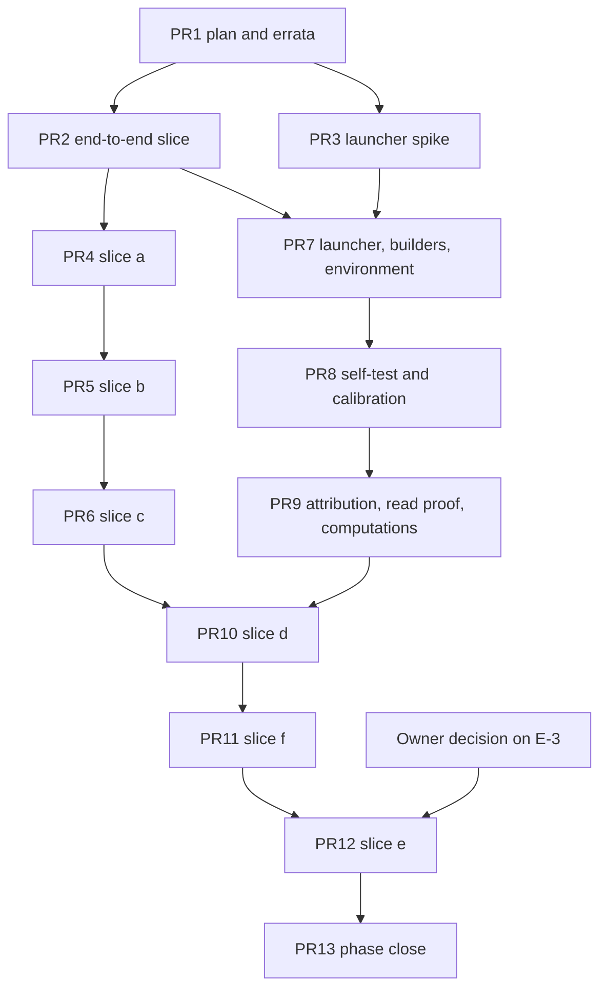

# Grade Command - Plan

This plan covers phase 3 of the [engine plan](2026-11-21-engine-plan.md). Its own ids start with G: GR for requirements, GKD for product decisions. A bare R, AE, A or F number is an entry in [the requirements](../requirements.md). Q ids are clauses of the sealed conformance collection specification, `docs/specs/conformance-collection-1.0/`; X, N, E and R ids after "judge rule" are the judge rulebook's.

## Goal Capsule

- **Objective:** A person can grade a subject with `pql grade` and trust the result as far as the synthetic subject proves it: every case of the sealed collection corpus gives the record and exit code the specification fixes, and the known-good subject is green and exits zero.
- **Means:** six slices on an end-to-end slice, each its own pull request, a darwin track that starts with a launcher spike and runs beside slices a to c, and a corpus runner that drives every case through the real `grade` command (KTD1, KTD2, KTD14).
- **Authority:** the sealed judge specification 1.0 and conformance collection specification 1.0 with its errata note, then `AGENTS.md` and `CODING_STANDARDS.md`, then this plan. An input the sealed text can honestly read two ways goes to the owner with both readings (GR6).
- **Stop conditions:** a change that would need judge 1.1 or collection 1.1, including a launcher that cannot start under the unchanged QH11 template (U21); a corpus case the engine cannot meet without departing from the text; a confinement rule that fails on macOS 27.2.
- **Execution profile:** Deep. Thirteen pull requests (Implementation Units). A coding agent writes the code and the Linux-runnable tests from a brief per unit; the main session writes briefs, reviews, and runs every macOS test outside any sandbox (KTD19).
- **Who finishes:** the executing session opens each pull request and stops. The owner merges, or the session merges on the owner's say-so.
- **Dates:** phase 3 done by 2027-01-16, ahead of the halfway check on 2027-01-25 (engine plan §6). Launcher spike by 2026-12-04; end-to-end slice by 2026-12-09, which is not thin; slices a and b by 2026-12-18; slice c by 2026-12-29; the darwin track by 2026-12-31; slice d by 2027-01-08; slices f and e and the close by 2027-01-16. If the owner adopts a collection 1.1 under E-3, slice e waits for its seal and the close moves with it.

---

## Product Contract

### Summary

`pql grade` reads a subject file, fixes the required set, collects evidence under confinement, builds the evidence record, calls the judge through the same function `pql judge` uses, stores the run, prints a scorecard and exits with the code the judge's output gives. It is built in the six slices the engine plan names, on an end-to-end slice that runs scripted cases through the whole pipeline, with a darwin track that proves the confinement launcher early and builds the real verifier beside the first slices. A Go corpus runner assembles every corpus case and runs it through the scripted build in CI; the three real-verifier cases and the confinement evidence run on a local macOS 27.2 machine. The build is then scored against the private half of the corpus.

### Problem Frame

The judge decides a finished evidence record, and phase 2 sealed how that record is produced. Nothing yet produces one, so the engine cannot grade anything, and phase 4's first real grade cannot start until it can. The trial behind the engine plan found every judge build wrong at its JSON boundary and nowhere else, and the engine plan's largest risk is a collector that is weaker than the judge because its corpus is new: wrong evidence that the judge then grades faithfully (engine plan §7). Phase 4 then runs a real, untrusted CLI on the owner's machine, so the confinement, and everything the engine does unconfined around it, must hold before it does.

### Requirements

**Outcome**

- GR1. Every public case of the collection corpus passes through `pql grade` or `pql anchor` as QE19 defines a conforming collector, with the exit code the case expects: the scripted cases in CI on Linux, and `case-069`, `case-070` and `case-143` in a local run on macOS 27.2.
- GR2. The known-good synthetic subject grades green and exits zero (`case-001` scripted, `case-069` real).
- GR3. The exit code, the scorecard and the stored record of every run are read from the judge's one output document, through the bytes-in, bytes-out function `pql judge` exposes (engine plan §4 rule 1, QE14, AE21).
- GR4. A record the judge rejects ends the run with exit 70 and is kept (QE15).
- GR5. The build is scored against the private half of the corpus with zero wrong records, and, as the private harness measures it, no seeded collection mistake survives the build's own CI tests. Feedback to the builder names a rule id only.

**Specification authority**

- GR6. Every rule is built from the sealed text for every input its schemas allow. An input the text can honestly read two ways is reported to the owner with both readings, and the settled reading goes in the errata note or a new version, never in a workaround.
- GR7. The test entry is QT1 to QT6: a scripted verifier and host exist only in a build made with the `scripted` tag, and the released build rejects the scripted flags with the exit codes QT1 gives.

**The slices** (engine plan §5, phase 3)

- GR8. Slice a: the subject file, `pql create` and placeholders, proved by AE20.
- GR9. Slice b: command discovery and the six generated probes, proved by AE27.
- GR10. Slice c: authored checks, ordered runbooks, time budgets and computed expected values, proved by AE8, AE22 and AE23.
- GR11. Slice d: safety classes, scope and the no-network check with the real macOS verifier, proved by AE9 for conformance, AE24 and AE30.
- GR12. Slice e: the store's baselines, comparison and anchoring, proved by AE16 to AE19, AE31 and AE33 as the owner's decision on E-3 settles.
- GR13. Slice f: the scorecard, and agreement of exit code, scorecard and stored record, proved by AE21 and by the naming halves of AE8, AE20, AE23, AE24 and AE27.

**Confinement evidence**

- GR14. Each self-test program is shown necessary on macOS: a profile that grants only that program's operation makes the self-test fail. This runs as a test, never in a grade (QH9).
- GR15. Every rule a scripted run cannot break is proved by a local macOS run, stated in its pull request as `AGENTS.md` requires.
- GR16. Nothing the engine does unconfined around a subject (cleanup, inspection, scanning, rendering) acts on anything outside the throwaway directories it made, whatever the subject or a computation leaves in them.

### Key Decisions

- GKD1. **A thin end-to-end slice comes before slice a.** It runs `case-004` through `grade`, so every later slice changes outcomes on a pipeline that already runs. Governs GR1, GR3. (session-settled: user-approved — chosen over starting at slice a as the engine plan's table does.)
- GKD2. **The corpus runner runs inside the existing CI checks.** It adds no new required check on `main`. Governs GR1. (session-settled: user-approved — chosen over a new CI job the owner would make required.)
- GKD3. **The harness assembles each case**, and `grade` takes only what QT1, the specification and GKD8 name (errata E-2). Governs GR1, GR7. (session-settled: user-directed — chosen over a scripted-build `grade` that takes a case directory.)
- GKD4. **The acceptance examples the corpus does not reach go to the owner first** (errata E-3); slice e is not built until the owner decides on a collection 1.1. Governs GR12. (session-settled: user-directed — chosen over proving them with engine tests and macOS runs alone, and over dropping them from the proof.)
- GKD5. **The build is scored against the private half, as phase 1 was.** Governs GR5. (session-settled: user-directed — chosen over the public corpus alone.)
- GKD6. **The launcher, the self-test programs and the known-fast control are hidden modes of the `pql` binary, written in Go,** and copied once per grade. Governs GR11, GR14, GR15. (session-settled: user-directed — chosen over embedding the spike's C programs.)
- GKD7. **Darwin-only code may use `golang.org/x/sys` as one reviewed dependency, with raw syscalls where it falls short, and no cgo,** so the Linux gate compiles and lints all of it. Governs GR11, GR15. (session-settled: user-directed — chosen over cgo and over the standard library alone.)
- GKD8. **The command line:** `pql grade <subject-file> [--scope conformance[,destructive]] [--baseline <file>]`; `pql anchor <subject-file> [--retired <file>] [--accept <file>]`; the QT1 flags on both; the missing-id list written to the run's store directory; a subject-file or pre-check rejection prints one stable line `pql: rejected: <rule id>: <cause>` on standard error; a malformed command line exits 64 before any exit 2. Governs GR1, GR7. (session-settled: user-directed — chosen over deciding the command line at PR2's review.)
- GKD9. **macOS evidence is taken on 27.2 only.** The phase close states 27.0.1 as unverified for phase 3, and the owner decides whether that stands. Governs GR1, GR15. (session-settled: user-directed — chosen over evidence on both supported versions.)

### Scope Boundaries

- Phase 4's real CLI, steering (phases 5 to 7) and any edit to a sealed folder are out.
- Writing a collection 1.1 is the owner's specification work, outside this plan; if adopted under E-3, slice e builds against it.
- AE9's steering half and AE18's steering entries belong to phase 6; collection 1.0's `prompts` holds only a version.
- Linux confinement is out: version 1.0 supports macOS only. On any other system, the real verifier gives every check that runs the subject `network_unverifiable` (QH1).
- No macOS runner is added to CI; macOS evidence comes from local runs (`AGENTS.md`).
- Stated limits from `CASES.md` and the specification, such as QH19 and QP14, are named as limits in the pull request that meets them, never given a test that cannot fail.
- Considered and not built: a store-location flag. QE17 fixes the store under the user's application-support directory, and tests isolate it through the home directory instead (KTD5). Build one only if a released-build user needs a second store.
- Considered and not built: comparing a case's whole judge input. QE19 leaves `expected` and `observed` to the collector, so the runner compares the fields QE19 names, the top-level fields and the whole judge output (KTD2).
- Considered and not built: a JSON Schema library in Go. Schema validation runs in `check.sh` through the pinned Python `jsonschema` the repository already uses (KTD15); build one only if a Go-side validation is needed at run time.
- Stated limit: with the launcher being the whole `pql` binary (GKD6), a computation that guessed the private launcher copy's random path could run that copy; the plan states this in slice d rather than building around it.

### Deferred to Follow-Up Work

- Extending `internal/docrefs` to plan and spec citations of Q ids under `docs/`.

---

## Planning Contract

### Key Technical Decisions

- KTD1. **Thirteen pull requests in dependency order, with a darwin track.** The end-to-end slice, then slices a, b and c on Linux; beside them, the launcher spike and three darwin pull requests; then slice d, which integrates the real verifier; then slices f and e and the close. A case leaves the pending list when the last rule it needs lands, and 100 of the 121 judge-checked cases carry runbooks, so most cases pass only from slice c on. Each slice's design note predicts its ratchet set; its pull request traces every case that passed outside the prediction to the rule that produced it, and diagnoses every predicted case still pending. The store's run records (QE17) come with the end-to-end slice, because the stored record is the only place `grade` exposes a case's judge input and output. The engine plan requires at least one pull request per slice.
- KTD2. **The corpus runner is a Go test behind the `scripted` tag, with a two-sided ratchet and guards against vacuous passes.**
  1. It finds the cases, asserts their number, and derives the real-verifier exclusions from `input.verifier`, asserting they are exactly `case-069`, `case-070` and `case-143`.
  2. It assembles each case as QT6 and E-2 say, asserting the assembled directory holds exactly QT6's entries and never a case's `case.json`, `input.json` or `preimages.json`, with the run's home and working directory outside it (QS8), and runs the scripted `pql grade` or `pql anchor` as `input.request` says.
  3. For a judge-checked case it requires a stored record, compares the QE19 fields, the judge input's top-level fields other than `required` and `evidence` (compared under the order the judge contract fixes, and as sets where it says input order carries no meaning), `required` and `evidence` as QE19 says after sorting by check id, the process's exit code and the whole judge output, and re-judges the stored input with `pql judge` to confirm the stored output. A compared field absent on both sides is a failure, and so is a judge-checked case with no stored record.
  4. For a derivation-only case it requires the process's exit code, no stored record, no invocation requested and no per-run home made, and the rejection line's rule (GKD8) equal to `expect.rule`.
  5. A checked-in list names the cases not yet expected to pass: every case off it must pass and every case on it must still fail. A separate layer requires every judge-checked case's `required` array to match from PR2 on. A `check.sh` step compares the list with its version at the base commit as a set and fails on any entry added; the `cases` job fetches full history and is given the pull request's base, or the push's previous commit on `main`, and a missing base is a failure.
  6. A mismatch is first a hypothesis about the case: re-derive the record from the text, the recording and the case's preimages before changing code (`docs/solutions/best-practices/judge-agreement-does-not-validate-a-case-record.md`).
  7. In its macOS mode it builds the released `pql`, builds the known-good form and checks its source digest against the recording (QT6, as `internal/collectionkit/subject_test.go` does), runs the three real-verifier cases, and reports them not run on a system QH1 does not name.

  The list is empty when phase 3 is done.
- KTD3. **The strict reader, value types, exact equality and the contract writer move into a leaf package, `internal/strictjson`, which the judge imports.** One reading path and one number parser then serve the judge input, the subject file (QS2), host and recording (QT1), computation output (QA6) and the predicates (QA9), each with its own document bound. QA9 compares with the exact-decimal `equalJSON` and `normalize`, never canonical bytes. The contract writer is not RFC 8785; it writes any validated number by its written form, so an integer beyond 64 bits never panics, and it offers a length function for QE10's bounds. `internal/judge` exports `ScopeIncludes` and `AlwaysApplicable`, built on its existing exhaustive switches and used by the judge itself. The move changes no judge output; the judge's published cases and a re-run of its private scoring guard it (U3).
- KTD4. **RFC 8785 lives in `internal/jcs`, above `internal/strictjson`,** used for QE2's check ids and seed digest and for QS11's canonical-form size and round-trip rules. Its oracles are QE2's four worked ids, each case's `preimages.json`, and vectors generated once by `scripts/collection_ids.py` and checked in, so `go test` needs no Python.
- KTD5. **Durable store and per-run workspace are separate.** The durable store (QE17) is the user's configuration directory, resolved only in `cmd/pql` after QH3's root refusal and passed down; on macOS that is the application-support directory. Records, baselines and missing-id lists are written there by temporary file and rename at mode 0600, keyed by a digest of the subject file's canonical path, and an existing store directory's mode is checked. QE20's per-run workspace (homes, scratch, private copies) lives under the canonicalised system temporary directory, in a user-owned 0700 parent checked with `Lstat`, published atomically by renaming in a process-id file. The startup sweep matches only that name pattern, never follows a link, and checks the process id and start time. Tests give each run its own home and `XDG_CONFIG_HOME`, and a guard fails if a test reaches the developer's real store. A record is stored only once one exists.
- KTD6. **The real-verifier cases run on the released build.** QT1 puts the scripted verifier only in a scripted build, and the real path is the released build's.
- KTD7. **The necessity demonstration renders its one-grant profiles behind a separate test-only build tag.** `grade` renders only QH11's fixed template from a closed set of variants with no free-text hook; the gate checks that no released or scripted binary holds the test-only renderer.
- KTD8. **A scripted run records the host it actually ran on.** `record.schema.json` requires the host fields and QT3 checks no version, so a Linux run writes Linux's values.
- KTD9. **A pre-check refusal does not stop collection; a rejection does.** QE5 stops a run on a rejection, and `case-071` fixes that an anchor's refusal (judge rule N1) still gives full evidence and exit 5.
- KTD10. **A scripted run's tiers are all `scripted` (QT2), so QE9's offline and live tiers are proved by unit tests and the real-verifier cases.** `case-148` fixes that QT2 takes precedence.
- KTD11. **Packages follow engine plan §4, with leaves added, and the import direction is enforced.** `internal/strictjson`, `internal/jcs`, `internal/observe` (the seam's types), `internal/subject`, `internal/record` (required set, resolver, builder, masking), `internal/collect` (the untagged driver and the adapters), `internal/store`, `internal/scorecard`, and `internal/grade`, which owns the run's one path and its one exit funnel; `create`, `grade` and `anchor` sit on the existing Cobra root and call `internal/grade`. `collect` imports `observe` and never `store` or `judge`. `record`'s resolver decides each check's outcome and reason in the order of `collection-rules.md` §2, from PR2 on; a step not yet built gives `not_observed` with `harness_fault`, so a record always exists and never claims a pass. These are the collection specification's evidence rules, not verdicts: the judge still decides requiredness, rollups, comparison and every verdict.
- KTD12. **The gate checks tagged and macOS code on Linux, within its time limit.** `gate.sh` adds `-tags scripted` passes of vet, staticcheck, errcheck and exhaustive across the module and of test across the packages with tagged files, and `GOOS=darwin` passes of build, vet, staticcheck, errcheck and exhaustive with and without the `scripted` tag and KTD7's tag. A step fails on any darwin file that imports `"C"`, found by `CGO_ENABLED=1 GOOS=darwin go list -f '{{.CgoFiles}}'` and a search of darwin files, since a Linux cross-build drops such files silently (GKD7). The import guard itself runs `go list -deps -test` for each of Linux and darwin and each tag set, with its environment set explicitly, and enforces Cobra only under `cmd/`, `golang.org/x/sys` only in darwin builds, and the KTD11 directions. A check confirms no scripted-only or test-only symbol is in the released binary. `GOFLAGS` keeps `-mod=readonly` beside each tag. The run time is measured in PR2 and the limit raised only if needed.
- KTD13. **The seam between the scripted and real paths is an interface, and every decision is untagged.** An untagged driver in `collect` owns all sequencing: QD2's walk, runbook order, fresh homes, the controls, the planted canary from `crypto/rand` (QP10) and QP9's control copy. It calls `Invoker.Run(key, spec)`, which returns raw facts. The scripted invoker looks the key up in the recording; the darwin invoker only spawns, waits on kqueue, kills the group and reads files. Every function from raw facts to `observe` values is untagged and tested on Linux with fakes, including QH5 and QH7's marker parsing, QH8's copy comparison, QH24's bound, QA6's parse, and QH21 and QO5's kill attribution from the raw end (signal, marker seen, engine-sent kill and when, exit detail, still running at the budget). The scripted invoker maps the recording's attributed end and the host's override into those raw facts. A type-based guard fails on any tagged, darwin or unsupported-system real file that refers to an outcome, reason or attribution value, and a projection test checks that the scripted invoker's facts for every corpus recording and host serialise back to the recording's run and the host object field for field.
- KTD14. **The launcher and the self-test programs are hidden modes of `pql` (GKD6).**
  1. A reserved first argument selects a hidden mode at the top of `main`, before Cobra; its arguments are positional and fixed in number, so no subject word is read as a launcher option.
  2. No package in `pql`'s import graph does work at initialisation that the frozen profile kills. A Linux gate test compares `GODEBUG=inittrace=1` output for the launcher mode with a checked-in list, and a guard fails if `crypto/x509`, `crypto/tls` or `net/http` enter `cmd/pql`'s darwin dependencies. Any pull request that adds an import to `cmd/pql` or changes the pinned Go re-runs U21's launcher check on macOS.
  3. The marker is drawn from `crypto/rand` per invocation and passed in the arguments, since QH12 allows nothing else through the environment. The launcher writes it as the first line of standard error, strips its own arguments, closes every descriptor above 2 (QH13), and replaces itself with the program, keeping its process id (QH4).
  4. If the replacement fails, the launcher writes the could-not-start marker, which carries the same per-invocation value, as the line directly after the marker, then exits with its reserved code and writes nothing more (QH7). The engine honours it only there; both marker lines are stripped before any count, digest, keep or scan.
  5. The self-test programs make raw `golang.org/x/sys/unix` calls (socket, connect, sendto, bind, kill, sysctl and the like), never the `net` or `os/exec` packages, whose option calls the profile kills, and print each call's result. Their targets are decoys only, with a process id above 0.
  6. The hidden modes are part of the released command surface U2 tests.
- KTD15. **Schema oracles come from the specification, not the code.** Each reader rejects every file in `examples/invalid/` that targets its schema, with the rejection line naming the rule in the example's file name; boundary tests take each limit ± 1 from the schema files. The corpus runner copies each stored record and baseline into a directory `check.sh` names through an environment variable and writes a manifest; a `check.sh` step validates exactly the manifest's records against `record.schema.json` and `baseline.schema.json` with the pinned Python `jsonschema`, fails unless it validated as many as the manifest lists and more than zero, and fails on any record the judge rejected, since no corpus case leads to one (`CASES.md`). The step sits outside the span `scripts/check-draft.py` reads.
- KTD16. **A run's bytes take one path, owned by `internal/grade`.** Build, mask (QE18), bound (QE10, using the contract writer's length function), serialise once, judge, then store those exact bytes; the scorecard renders from the stored record. One §4 encoder serves masking and the leak scan. Until U18, the stored record's `next_actions`, `offline_settings` and `bookkeeping_excluded` are empty lists, which no case compares (QE12). Every value from the subject or the subject file that reaches a terminal passes one escaping function for C0, DEL, C1, ESC and bidirectional controls, and no subject-file value is quoted in a rejection line's cause.
- KTD17. **Every panic and every interruption ends in the one exit funnel.** The grade and anchor commands recover a panic on the main goroutine, and every goroutine the engine starts recovers its own, as an engine defect, exit 70, because an unrecovered panic exits 2, the code for a rejected request (`CODING_STANDARDS.md`, Judge and evidence code). SIGINT and SIGTERM end every live process group, then clean up. The funnel ends live groups (QH23) and runs QE20's cleanup on every exit.
- KTD18. **macOS evidence runs on 27.2 with automatic updates off (GKD9).** Each run records the commit, the version and build, the command and the result; the pull request carries the summary and the log's SHA-256, and a log attached in full first passes `scan.sh`'s home-path and secret rules and has the host name removed. Each pull request takes its macOS evidence once, on its head after every unit lands. Scenarios that depend on timing or access times repeat 25 times and pass only 25 of 25, as the spike's did; a repeat that is not evaluated fails. The full evidence suite and the self-test checks run again at the close on the exact commit phase 4 will use.
- KTD19. **Coding agents never run macOS tests.** Codex runs inside a macOS sandbox, where every confined run exits 71 (QH6). A darwin unit's brief has the agent write the code and the Linux-runnable tests only; the main session runs the macOS tests outside any sandbox, and a brief that meets exit 71 reports it as an environment fault.
- KTD20. **Unconfined handling of subject-made files never follows a link.** Cleanup, inspection (QH25) and scanning walk each throwaway directory relative to an open directory, opening each directory with `O_DIRECTORY|O_NOFOLLOW`, changing the mode only of directories by their descriptor, removing with `unlinkat` or `os.RemoveAll`, and never opening a special file. This code is untagged and tested in CI (GR16).
- KTD21. **Until the darwin track lands, the released real path never starts a subject or a computation.** From PR2, a released `grade` or `anchor` gives every subject-running and computation-running check `network_unverifiable` (QO1) and still reaches the judge, as it must on any system QH1 does not name. Slice d replaces this with the real verifier once the self-test (U29) and the computation profile (U31) have landed.

### Sequencing

### Assumptions

- The private half and its scoring harness are reachable on the owner's machine, as they were for phase 1, and the harness can score a collector build (Open Questions).
- A machine running macOS 27.2 with automatic updates off is available for each pull request that needs local evidence.

---

## Implementation Units

Each pull request from PR2 to PR12 first gets a short design note reviewed through the measurement lens in design mode, naming its evidence rules, its predicted ratchet set and its controls; its build waits on that review. Each then runs the peer-review gate on its diff. Each unit brief gives the exact `go test` command for its tests, written to fail first, and the test seams it injects (effective user id, system version, clock).

### PR1: plan and errata

Waits on: nothing.

### U1. Errata entries E-2 and E-3

- **Goal:** the owner's reading of case assembly, and the coverage finding behind GKD4, are on record beside the sealed folder.
- **Requirements:** GR6, GR12.
- **Dependencies:** none.
- **Files:** `docs/specs/conformance-collection-1.0-errata.md`.
- **Approach:** E-2 states both readings of QT6 and the owner's choice; E-3 lists AE16, AE19's anchoring parts, AE31 and AE33 and leaves the 1.1 decision to the owner.
- **Test expectation:** none -- a documentation note; the citation test checks its ids.
- **Verification:** the gate passes, and the note changes no case's record.

### PR2: end-to-end slice

Waits on: PR1, merge order only. Not thin: it builds the whole required set and the whole pipeline.

### U2. The command line and the tagged gate

- **Goal:** `grade` and `anchor` exist with the command line GKD8 fixes, the scripted build adds only the QT1 test entry, and the gate checks tagged and darwin code.
- **Requirements:** GR7.
- **Dependencies:** none.
- **Files:** `cmd/pql/main.go`, `cmd/pql/main_test.go`, `gate.sh`, `internal/importguard/importguard_test.go`.
- **Approach:** GKD8 and KTD12; scripted files behind `//go:build scripted`, released-only tests behind `!scripted`; KTD14's reserved first argument routed to the hidden-mode file U21 owns.
- **Test scenarios:**
  - a released `grade` or `anchor` given any of `--verifier scripted`, `--host` or `--behaviour` exits 2, and an unknown `--verifier` value exits 64 (QT1);
  - a malformed command line exits 64 even with a scripted flag present (GKD8);
  - a scripted build given one or two of the three exits 2;
  - an unknown hidden-mode argument exits 64;
  - a planted unvetted line in a tagged file and in a darwin-only file, a cgo file under darwin, a Cobra import in a darwin file and `golang.org/x/sys` in an untagged file each fail the gate in Linux CI;
  - the released binary holds no scripted-only or test-only symbol.
- **Verification:** the gate's tagged and darwin passes run within its limit, and each planted defect turns them red.

### U3. The strict JSON leaf, exact equality and the judge's tables

- **Goal:** every input read under the judge contract's §3 uses one reader, QA9 compares exactly, the writer is total over valid values, and the judge's scope and applicability rules are exported once.
- **Requirements:** GR6.
- **Dependencies:** none.
- **Files:** `internal/strictjson/` (new), `internal/judge/json.go`, `internal/judge/statistics.go`, `internal/judge/requests.go`, `internal/judge/results.go`, their tests.
- **Approach:** KTD3.
- **Test scenarios:**
  - a document over its size bound, with a repeated key, a lone surrogate, too deep, or with trailing content is refused exactly as `pql judge` refuses it, and a caller's own bound applies (QA6's 1 MiB);
  - `9007199254740993` and `9007199254740992` compare unequal, and `1`, `1.0` and `1e0` equal;
  - a 21-digit integer and a 32-digit one serialise without a panic and read back equal;
  - `ScopeIncludes` and `AlwaysApplicable` match the rulebook's §6 text, written as literals.
- **Verification:** the `cases` step and the judge's tests pass with no judge output changed, and phase 1's private judge scoring and seeded-mistake catalogue, re-run on this build, show zero wrong outputs and no surviving mistake; the pull request reports counts only.

### U22. RFC 8785 canonicalisation

- **Goal:** one RFC 8785 implementation serves check ids, the seed digest and QS11.
- **Requirements:** GR1.
- **Dependencies:** U3.
- **Files:** `internal/jcs/` (new), its tests and checked-in vectors.
- **Approach:** KTD4.
- **Test scenarios:** key order by UTF-16 code units; number spelling; `\b` and `\f` escapes; each against the checked-in vectors.
- **Verification:** QE2's four worked ids are reproduced.

### U34. Case assembly for tests

- **Goal:** one test helper assembles a case's directory as QT6 and E-2 say, for U5 and the corpus runner alike.
- **Requirements:** GR1.
- **Dependencies:** none.
- **Files:** a test-only package behind the `scripted` tag.
- **Approach:** QT6's entries, including `seed/`, `computations/`, `bin/subject` and `case-112`'s fixture; the run's home and working directory outside the directory (KTD2.2).
- **Test scenarios:** an assembled directory holds exactly QT6's entries; a case file never appears in it.
- **Verification:** every case assembles.

### U4. Subject file model and parse

- **Goal:** `grade` reads a subject file into the model the required set needs.
- **Requirements:** GR1.
- **Dependencies:** U3, U22.
- **Files:** `internal/subject/` (new), its tests.
- **Approach:** the shape of `schema/subject-file.schema.json` by hand on the shared reader (KTD15); a version that is not `1.0` names QS1, and a named rule takes precedence over QS2 where a file's schema also rejects it (QT6); the other rules wait for U9.
- **Test scenarios:** every judge-checked case's subject file parses; `case-100` is refused as QS2 says and `case-129` as QS1 says; each `examples/invalid/` subject-file example is refused naming its rule.
- **Verification:** the model holds every field the required set needs.

### U5. Preimages and check ids

- **Goal:** the engine builds every check's preimage and id as QE2 says.
- **Requirements:** GR1.
- **Dependencies:** U4, U22, U34.
- **Files:** `internal/record/` (new), its tests.
- **Approach:** every preimage kind, the seed digest and the `files` digests over the assembled directory, the bare binary's defaults, and QS7's offline arguments in preimages.
- **Test scenarios:** QE2's worked ids; for every judge-checked case, each preimage equals `preimages.json`.
- **Verification:** `go test` of `internal/record` passes on all 121 judge-checked cases' preimages.

### U33. The required set and its entries

- **Goal:** the engine fixes the whole required set and every required-entry field (QE3, QE7).
- **Requirements:** GR1.
- **Dependencies:** U5.
- **Files:** `internal/record/`, its tests.
- **Approach:** QP1's probes and their placement; QS5's candidate checks; QA7's exclusion of destructive runbooks outside that scope; QA3's crediting with `credit-and-routes.md` §2's credit conditions; QA9's `empty_satisfiable` and `asserts_emptiness`; scope through `ScopeIncludes`.
- **Test scenarios:** for every judge-checked case, the required set equals `input.json`'s `required`.
- **Verification:** `go test` of `internal/record` passes on all 121 required arrays.

### U23. The seam, the driver and the resolver

- **Goal:** KTD13's seam and driver and KTD11's resolver exist before any collector does.
- **Requirements:** GR1, GR6.
- **Dependencies:** U33.
- **Files:** `internal/observe/` (new), `internal/collect/`, `internal/record/`, their tests.
- **Approach:** the `observe` types holding raw facts; the `Invoker` interface and the untagged driver; the resolver's steps in the order of `collection-rules.md` §2, with QO1 and the QS5 override filled in and every other step giving `harness_fault`; KTD13's guard and projection test.
- **Test scenarios:**
  - each `order:` pairing the corpus tags, from fixtures written from §2;
  - a tagged or darwin file that assigns a reason, or names an attribution value, fails the guard;
  - an unbuilt step gives `harness_fault`, never a pass.
- **Verification:** `case-004`'s 29 checks resolve to `network_unverifiable` through the shared path.

### U6. The scripted invoker

- **Goal:** a scripted run turns its host and recording into raw facts (QT3 to QT5).
- **Requirements:** GR7.
- **Dependencies:** U3, U23.
- **Files:** `internal/collect/` (scripted files behind the tag), its tests.
- **Approach:** hand shapes for the `host` subschema and `schema/behaviour.schema.json` (KTD15); QT4's attribution and QT5's agreement mapped into raw facts; a recording that lacks an invocation the record needs is an engine fault (exit 70).
- **Test scenarios:** every corpus host and recording reads, and the projection test holds for each; each `examples/invalid/` host and behaviour example, and a host or recording that is unreadable, §3-refused or breaks QT4 or QT5, exits 2; a missing invocation exits 70.
- **Verification:** every scripted case's host and recording load.

### U17. The durable store and the workspace

- **Goal:** every run's record is stored as QE17 says, and the per-run workspace is made, published and cleaned up safely.
- **Requirements:** GR3, GR4, GR16.
- **Dependencies:** U3.
- **Files:** `internal/store/` (new), its tests.
- **Approach:** KTD5, KTD16 and KTD20; QE17's modes and R27; a rejected record kept (QE15); QE20's workspace and sweep; the stored record's own fields (`record_version`, `spec_version`, `subject_file_digest`, `binary_digest`, `seed_digest`, `judge_rejected`) as `record.schema.json` and QS4 give them.
- **Test scenarios:**
  - file and directory modes; an existing store directory with a wrong mode;
  - a stale run directory swept, and a link, a foreign directory and a directory without its published process-id file left alone;
  - a link inside a home to an outside directory of mode 0555 holding a file leaves that target unchanged; a home swapped for a link mid-cleanup deletes nothing outside it; a mode-0000 directory and a FIFO inside a home are removed without the FIFO being opened;
  - a test that would resolve the developer's real store fails;
  - a store write that fails after the judge has decided exits as Open Questions settles.
- **Verification:** every run the corpus runner makes that reaches a record leaves a stored record under that run's home.

### U7. Record builder

- **Goal:** the engine builds the judge input from the resolver's results.
- **Requirements:** GR3.
- **Dependencies:** U23.
- **Files:** `internal/record/`, its tests.
- **Approach:** QE7 to QE10: required entries, evidence, targets in QE8's order with errata E-1, tiers with KTD10, QE10's bounds through the length function, and an unfittable record ending the run with exit 70; the top-level fields (`request`, `scope`, `claimed_tier`, `subject_facts`, `markers`, `baseline`, `retired`, `accepted_regressions`, `trials`) as QE9, QE11 and QS4 give them.
- **Test scenarios:** each target kind; QE10's bounds at their limits; an unfittable record exits 70; each top-level field for `case-004`.
- **Verification:** `case-004`'s judge input matches `input.json` under KTD2.3.

### U24. Masking

- **Goal:** the store, the streams and every scorecard carry no canary or declared value QE18 masks.
- **Requirements:** GR3.
- **Dependencies:** U7.
- **Files:** `internal/record/`, `internal/grade/`, their tests.
- **Approach:** QE18 with KTD16's one §4 encoder; a process-wide masking writer over standard output and error that knows each invocation's canary and the declared values and masks across write boundaries. The planted file and QA4's capture files are the only places a plain value may sit, and QE20 removes them.
- **Test scenarios:** a fresh random canary and a declared value of 8 bytes or more are injected at the seam into stream heads, home-change paths and error text; the test shows each is present before masking and absent from the store, the streams and the scorecard after, in each §4 encoding; the per-run directory holding the planted file is gone after the run.
- **Verification:** the test finds no unmasked value.

### U25. The grade pipeline, pre-check, judge call and exit code

- **Goal:** `internal/grade` runs the pre-check, collects, calls the judge, stores and exits with QE16's code, through one exit funnel.
- **Requirements:** GR3, GR4.
- **Dependencies:** U6, U7, U17, U24.
- **Files:** `internal/grade/` (new), `cmd/pql/main.go`, their tests.
- **Approach:** QE5 and QE6 with KTD9; KTD16's path; the judge called through `judge.Safe(judge.Judge, …)` for the pre-check and the final call; QE14 and QE16; QH3's root refusal before the store or the sweep; KTD17; KTD21's released real path; GKD8's rejection line, a pre-check rejection naming QE6 with the judge's rule in its cause.
- **Test scenarios:**
  - a rejected record exits 70 and is stored (QE15), shown by a record the test makes the judge reject;
  - a pre-check rejection the user caused exits 2 and one the engine caused exits 70 (QE6);
  - running as root exits 70 before any store is resolved;
  - a panic on the main goroutine and one in a collector goroutine each exit 70;
  - a released `grade` on any system starts no subject or computation process (KTD21).
- **Verification:** `case-003` and `case-004` pass through `grade`.

### U8. The corpus runner

- **Goal:** every corpus case runs through the scripted `grade` or `anchor`, with KTD2's ratchet and guards.
- **Requirements:** GR1, GR2.
- **Dependencies:** U2, U25, U34.
- **Files:** a new test package behind the `scripted` tag, its pending-case list, `check.sh` (KTD15's validation step and the growth check), `.github/workflows/ci.yml` (full history and the base commit for the `cases` job).
- **Approach:** KTD2, KTD5 and KTD15.
- **Test scenarios:**
  - a case off the list that fails, and a case on it that passes, each fail the runner; a list with one entry added or swapped fails the growth check, and so does a missing base;
  - one planted mutation per QE19 field (`outcome`, `reason`, `failure_kind`, `target_size`, `precondition_observed`, `tier`, a target's kind, id and tier, the `required` array) and an extra and a missing evidence piece, each caught;
  - an empty case directory, a deleted stored record, a renamed field, a wrong rejection rule and a derivation-only case that requested an invocation each fail the runner;
  - an empty manifest fails the validation step;
  - two cases run back to back never share a store.
- **Verification:** `case-129`, `case-003` and `case-004` pass, with the other cases the slice's design note predicts; every judge-checked case reaches a stored record and its `required` array matches; the runner runs in the gate and in `check.sh`.

### PR3: the launcher spike

Waits on: PR1, merge order only. Runs beside PR2.

### U21. The launcher spike on macOS

- **Goal:** before any slice builds on it, a Go launcher in `pql` is shown to start under the unchanged QH11 template, and Go self-test programs are shown able to witness their operations.
- **Requirements:** GR11, GR14, GR15.
- **Dependencies:** none.
- **Files:** `cmd/pql/hidden.go` (new, the hidden-mode dispatch), `internal/collect/` (darwin files), `go.mod`, `go.sum`, a darwin test behind KTD7's tag.
- **Approach:** time-boxed to four days. KTD14's launcher mode and markers; QH11's template as fixed text; the private copy once per grade (`docs/solutions/test-failures/fresh-executable-per-run-stalls-parallel-sandbox-suite.md`); kqueue's end (QH21); one clean program judged by its output (`docs/solutions/best-practices/clean-control-must-assert-on-output.md`); one violator; the not-executable form; the known-fast control, run after the self-test so a timed run is never the copy's first launch; the first launch's latency measured; the one-grant necessity check for UDP send, TCP connect and a child start. If the launcher needs an allowance the template lacks, it is first rebuilt with a minimal import graph to tell the runtime's needs from `pql`'s imports; if it still does, the stop condition fires and the owner is told the same day.
- **Test scenarios:** the clean program's output equals its known value; the violator is killed by the confinement; the not-executable form gives both markers and reads as could not start; each one-grant profile fails the self-test while its granted program succeeds; the marker differs between invocations.
- **Verification:** the spike passes on macOS 27.2, stated in the pull request as KTD18 says, with its first-launch latency.

### PR4: slice a, the subject file and placeholders

Waits on: PR2, merge order only.

### U9. Subject file rules

- **Goal:** every rule of QS1 to QS12 rejects what it must before anything runs, and names itself.
- **Requirements:** GR8.
- **Dependencies:** U4, U25.
- **Files:** `internal/subject/`, its tests.
- **Approach:** QS1 to QS12; QS11's size and depth checked on each parsed literal with `internal/jcs`; QS7's names with QH12's; QP7's and QP10's rejections; QA4's capture names; QA9's type and path rules; QA5's warning on the terminal and in the help of `grade` and `anchor`, and in the README.
- **Test scenarios:** one fixture per rejecting rule, each exiting 2 with GKD8's line naming that rule, from the specification's text, with no subject-file value in the cause; QS8's containment and QS9's seed-link rejection; a literal near QS11's 64 KiB in RFC 8785 form, on each side; the QA5 warning's text.
- **Verification:** the derivation-only cases still pending leave the pending list, each rejected by the rule its case names. A file that breaks two named rules is reported to the owner as a GR6 finding rather than resolved in the engine.

### U10. Placeholders and `pql create`

- **Goal:** `pql create` writes a subject file with a placeholder for every value it cannot know, and each placeholder gives the outcomes QS5 states.
- **Requirements:** GR8.
- **Dependencies:** U9.
- **Files:** `cmd/pql/main.go`, `internal/subject/`, their tests.
- **Approach:** QS5's skip and nothing-runs rules as resolver steps; QS5's candidates are U33's. What `create` takes as input is not specified (Open Questions); the plan's choice is the smallest input QS5 needs, stated in the pull request.
- **Test scenarios:**
  - `create` then `grade` on its output gives `placeholder_unfilled` exactly where QS5 says, the expected side written from QS5, never from `create`'s code (AE20);
  - each kind of placeholder gives QS5's outcomes in a unit test where its corpus case needs a later slice.
- **Verification:** `case-060` leaves the pending list. `case-061` to `case-066` carry runbooks and pass from U27.

### PR5: slice b, discovery and probes

Waits on: PR4, merge order only.

### U11. Command discovery

- **Goal:** the discovery check walks help as QD1 to QD6 say.
- **Requirements:** GR9.
- **Dependencies:** U23.
- **Files:** `internal/collect/`, its tests.
- **Approach:** QD2's walk in the untagged driver, its bounds and order; QD3 and QD4; QD5; `credit-and-routes.md` §5's headings; QO7's combination for discovery.
- **Test scenarios:** each framework's headings; the depth and cycle bounds; a missing declared command (AE27); help on stderr; a hidden command.
- **Verification:** unit tests cover QD1 to QD6. Every discovery case carries runbooks, so those cases pass from U27.

### U12. The six probes

- **Goal:** the bare, byte-bound, exit-code, fresh-state, store-unchanged and planted-secret probes collect as QP1 to QP13 say.
- **Requirements:** GR9, GR16.
- **Dependencies:** U23.
- **Files:** `internal/collect/`, `internal/record/`, their tests.
- **Approach:** QP1 to QP13 in the untagged driver: QS7's appended arguments and environment, QO2 for a binary that could not start, QO5's exit-code rules, QO7, QP9's control copy, QP10's per-invocation canary; QE8's targets with errata E-1; QE10's stream bounds; the §4 encoder for the leak scan; QH25's inspection (KTD20).
- **Test scenarios:**
  - one test per §4 encoding, written from the table;
  - a store-unchanged check that runs no command has no artifact target (E-1);
  - QP7's and QP8's exclusions; a 17 MB stream, invalid UTF-8 and a 33-digit number;
  - a link or FIFO the subject made is reported as a change without being followed or opened.
- **Verification:** the runbook-free cases this slice's rules complete leave the pending list, among them `case-012` to `case-015`, `case-074`, `case-088`, `case-095`, `case-096` and `case-151`. Those that time out or end by a signal wait for U27 and U14.

### PR6: slice c, authored checks

Waits on: PR5, merge order only.

### U13. Predicates

- **Goal:** each of QA9's ten predicates decides as QA9 says.
- **Requirements:** GR10.
- **Dependencies:** U12.
- **Files:** `internal/collect/`, `internal/record/`, their tests.
- **Approach:** QA1, QA2 and QA9, comparing with `internal/strictjson`'s exact equality.
- **Test scenarios:** each predicate and its type rules; `stdout_json_equals` on two integers that round to one double; invalid UTF-8 and a big number in predicates.
- **Verification:** unit tests cover every predicate; the corpus cases pass from U27.

### U26. Computations

- **Goal:** computed expected values are produced and checked as QA4, QA6 and QO6 say.
- **Requirements:** GR10.
- **Dependencies:** U13.
- **Files:** `internal/collect/`, its tests.
- **Approach:** QA4's substitutions (`{SEED}`, `{SUBJECT_DIR}`, `{CAPTURE:<step>}`), capture files in the scratch directory, and the scratch directory as working directory and home; QA6 with its 1 MiB bound; QO6; a cut capture is never run (QE10).
- **Test scenarios:** each QA6 failure mode; each substitution; a computation that pipes its input; one that runs the subject.
- **Verification:** unit tests cover QA4, QA6 and QO6; the corpus cases pass from U27 (AE23).

### U27. Runbooks, budgets and markers

- **Goal:** ordered runbooks with their budgets and markers collect as QA7, QO4 and QE11 say.
- **Requirements:** GR2, GR10.
- **Dependencies:** U26.
- **Files:** `internal/collect/`, `internal/record/`, their tests.
- **Approach:** QA7's shared home and `earlier_step_failed` in the driver; QO4 with QH24's known-fast control from the host; QA8; QE11's markers.
- **Test scenarios:**
  - a runbook's second step failing, and every later step `earlier_step_failed` (AE22);
  - a step over budget, and a known-fast control over budget giving `harness_fault`;
  - a known defect's marker giving exit 3.
- **Verification:** the cases with runbooks leave the pending list, including `case-001` green with exit 0 (GR2, AE8), the discovery cases and `case-061` to `case-066`.

### PR7: darwin track, launcher, builders and environment

Waits on: PR2 and PR3, needed before this group can start, since it builds on the driver and the spike.

### U15. Launcher and private copies

- **Goal:** U21's launcher becomes the released build's, with the private copy and both markers as QH4 to QH8 say.
- **Requirements:** GR11, GR15.
- **Dependencies:** U21, U23.
- **Files:** `cmd/pql/hidden.go`, `internal/collect/` (darwin files and untagged marker parsing), their tests.
- **Approach:** KTD14; QH4 to QH8; the copy made once per grade and checked before each use, never silently remade; the launcher's fixed argument layout.
- **Test scenarios:**
  - on Linux: a forged marker, a could-not-start line without the per-invocation value, and a could-not-start line not directly after the marker are each not honoured;
  - on macOS: a subject that execs the launcher copy with its own marker and a missing program does not read as could not start; subject words such as `--`, `-D` and the mode token pass through unchanged; a copy changed between uses fails its invocations.
- **Verification:** the Linux tests pass in CI and the macOS tests on 27.2.

### U28. Profile, environment and descriptors

- **Goal:** the subject and each computation run with exactly QH10 to QH15's profile, environment, descriptors and home.
- **Requirements:** GR11, GR15.
- **Dependencies:** U15.
- **Files:** `internal/collect/` (darwin files and untagged builders), their tests.
- **Approach:** QH10 to QH15 with KTD7's closed variants; paths only as `-D` parameters, canonical with every link resolved (`docs/solutions/best-practices/sandbox-profile-later-rule-decides.md`); `/usr/bin/sandbox-exec` by absolute path; an argument list too long for the system an engine fault, never a fallback.
- **Test scenarios:**
  - the template and its blocks, extracted from the code fences of `confinement.md`, equal the engine's fixed text byte for byte for both variants;
  - the lines added per invocation (`PLANTED_DIR_n`, QH27's control line, `DECLARED_n`, `SEED_n`) in count and order, and paths under a symlinked temporary root made canonical;
  - seed, declared and secret names holding quotes, parentheses and profile syntax leave the profile bytes unchanged and appear only as `-D NAME=value`;
  - with sentinel variables (`PQL_SENTINEL`, `DYLD_X`, `XDG_CONFIG_HOME`) in the engine's environment, the built environment equals QH12's table plus the declared values, in order; stdin is `/dev/null`; a new session is set; `__CF_USER_TEXT_ENCODING` is the uid in uppercase hex;
  - on macOS, with a descriptor opened without close-on-exec and sentinels in `pql`'s own environment, a probe program under the real launcher sees neither, and a knock-out run with the closing disabled fails.
- **Verification:** the builder tests pass in CI and the probe passes on macOS 27.2.

### PR8: darwin track, self-test and calibration

Waits on: PR7, needed before this group can start.

### U29. Self-test, calibration and the known-fast control

- **Goal:** the self-test programs run as QH9 says, with the calibration and the known-fast control.
- **Requirements:** GR11, GR15.
- **Dependencies:** U28.
- **Files:** `internal/collect/` (darwin files), their tests.
- **Approach:** QH9's programs for both profiles as hidden modes with raw calls (KTD14), clean programs judged by their output; QH24; QH26's calibration.
- **Test scenarios:** every self-test program, with a clean program whose wrong output fails the self-test; a failed self-test gives every subject check `network_unverifiable`.
- **Verification:** the self-test passes on macOS 27.2.

### PR9: darwin track, attribution, read proof and computations

Waits on: PR8, needed before this group can start.

### U30. Ends, draining, attribution and the read proof

- **Goal:** each invocation's end, streams, budget and planted file are observed as QE10, QO4 and QH21 to QH28 say.
- **Requirements:** GR11, GR15.
- **Dependencies:** U29.
- **Files:** `internal/collect/` (darwin files), their tests.
- **Approach:** the darwin invoker's raw facts: kqueue's exit detail, the budget timer and whether the program was still running, the process group's end (QH23), non-blocking draining with the byte count past 1 MiB and the cut flag (QE10), and QH26 to QH28's two-signal read proof; attribution itself is KTD13's untagged function.
- **Test scenarios:** a kill by the confinement, a budget kill and a crash told apart; the `huge-output` form drained and cut; an atime forgery and a real read each read as the proof says.
- **Verification:** these tests pass on macOS 27.2.

### U31. Computation confinement

- **Goal:** each computation runs under its own profile as QH16 to QH20 say.
- **Requirements:** GR11, GR15.
- **Dependencies:** U28.
- **Files:** `internal/collect/` (darwin files), their tests.
- **Approach:** QH16 to QH20's computation variant; QA4's working directory and home from U26.
- **Test scenarios:** a computation's child runs and its `setsid` or `setpgid` is killed (QH18); a computation that runs the subject; whether a QH19 survivor can reach a later computation's sandbox.
- **Verification:** these tests pass on macOS 27.2.

### PR10: slice d, safety and the no-network check

Waits on: PR6 and PR9, needed before this group can start.

### U14. Scope, safety classes, outcomes and the real path

- **Goal:** scope fixes which checks run, the outcome rules decide each invocation's end, and the released build's real verifier replaces KTD21's interim path.
- **Requirements:** GR11.
- **Dependencies:** U27, U30, U31.
- **Files:** `internal/collect/`, `internal/record/`, `internal/grade/`, their tests.
- **Approach:** QS6, QA7, QA8 and QE3 for scope; QO1 to QO3 and QO5's signal rules as resolver steps; QE12 and QE13; QE9's tiers (KTD10); the real verifier wired into `grade`; on a system QH1 does not name, Linux included, every check that runs the subject is `network_unverifiable` and the run still reaches the judge (QH1).
- **Test scenarios:**
  - a destructive command runs only with `destructive` in scope (AE30 with `case-001`);
  - an unclassified command is never invoked (AE24);
  - a released build on Linux, or with the version check reporting 27.1, grades `case-069`'s subject with every subject-running check `network_unverifiable` and exit 4, and a sentinel `bin/subject` shows the subject never started;
  - QE9's tiers on a record built from real-verifier observations.
- **Verification:** the scope, kill, violator and could-not-start cases leave the pending list, and `case-069` and `case-070` pass through the runner's macOS mode (KTD6).

### U16. The necessity and allowance evidence

- **Goal:** a local macOS suite proves each self-test program's necessity and each allowance's role, with no vacuous pass.
- **Requirements:** GR14, GR15.
- **Dependencies:** U14.
- **Files:** a darwin test behind KTD7's tag.
- **Approach:**
  1. For each self-test program, a profile granting only that program's operation makes the self-test fail, the granted program completes its operation as its output shows, and no other program's result changes (GR14).
  2. Each allowance removed in turn breaks the clean program's own operation at the step that allowance governs, judged by its output, never an incidental failure.
  3. A run that should start shows the launcher's marker and then the expected end; a run with no marker there is not evaluated.
  4. A run that should not start (`sandbox-exec` exiting before the marker, a profile it rejects, an allowance the launcher needs to start removed) shows no marker and the expected exit or kill, beside a control in the same session whose unmodified profile does write the marker (QH6).
  5. Every rule a scripted run cannot break has a test: each QH rule `CASES.md` lists as not expressible or not cited, and QE18, except stated limits such as QH19, which the pull request names.
  6. Any run not evaluated, and any repeat under KTD18 not evaluated, fails the suite.
  7. Commit 490d650's spike suite is reference only; nothing is copied without checking it against the sealed text.
- **Test scenarios:** each program's one-grant profile fails the self-test while the granted program succeeds; each allowance's removal breaks its own step; a run with no marker where one was due fails the suite.
- **Verification:** the suite passes on macOS 27.2 as KTD18 says.

### U32. The form replay

- **Goal:** the real observation path is proved on defective forms as well as the known-good one.
- **Requirements:** GR15.
- **Dependencies:** U14.
- **Files:** a darwin test behind KTD7's tag, with a decoy harness and an invocation driver.
- **Approach:**
  1. Each form is built and its source digest checked against `form_sha256`; the build is recorded beside the recordings' 27.2 build.
  2. The decoys QT5 names are prepared in an owner-only directory checked with `Lstat`, restricted to the spike's decoy set.
  3. Each invocation's context comes from the cases whose `invocations` field names it: the subject file, the declared values and the captures. A runbook's steps run in order in one shared home.
  4. Each invocation runs five times through the released build's real invoker; every field QT5's agreement clause lists, the planted file and each decoy's state included, is compared with the recording, the canary replaced in every encoding first.
  5. A violating form's unconfined positive control must touch its decoy, or the form is not evaluated.
- **Test scenarios:** a form whose observed invocation differs from its recording fails; a missing decoy, or a positive control that touched nothing, fails as not evaluated.
- **Verification:** every form agrees with its recording on macOS 27.2. A disagreement fails until it is diagnosed; only one the owner rules a specification matter is waived, by name.

### PR11: slice f, the scorecard

Waits on: PR10, merge order only.

### U18. The scorecard and the agreement check

- **Goal:** the scorecard renders the stored record, and the exit code, scorecard and stored record agree for every case (AE21).
- **Requirements:** GR3, GR13.
- **Dependencies:** U25.
- **Files:** `internal/scorecard/` (new), the corpus runner, the README, their tests.
- **Approach:** KTD16 and its escaping; QE12's next actions per reason; everything the scorecard must show, each the naming half of an acceptance example: QS5's placeholders by location (AE20), QS7's offline settings and their commands, QP7's bookkeeping exclusions, QD2's bound when reached, QD3's undeclared commands and the command named (AE24), QD4's counts and missing names (AE27), the defect's check named (AE8), a computation's stderr (QA4, AE23), QE18's note for a declared value too short to mask, and QE21's anchor exit never shown as green, in the scorecard and the README; the judge errata's display rules where conformance reaches them.
- **Test scenarios:** a judge output that recomputing would contradict is rendered as the judge wrote it; each display item has a fixture; each escaped character class has a fixture.
- **Verification:** the agreement check passes for every case, and a private scoring run on the build so far shows zero wrong records on a subset of the private cases the scoring party fixes before the run, reported as counts only.

### PR12: slice e, baselines and anchoring

Waits on: PR11, merge order only; and the owner's decision on E-3 before it starts (Open Questions).

### U19. Baselines, comparison and anchoring

- **Goal:** `grade` compares against a baseline and `pql anchor` saves one, as QE4, QE5 and QE21 say.
- **Requirements:** GR12.
- **Dependencies:** U17, U18.
- **Files:** `cmd/pql/main.go`, `internal/store/`, `internal/record/`, `internal/grade/`, their tests.
- **Approach:** QE4's choice of baseline and each missing id's cause from its stored preimage; the missing-id list written to the durable store; the anchor's pre-check with KTD9; QE21; KTD5's atomic writes; and the cases a collection 1.1 adds, if the owner adopts one.
- **Test scenarios:** a named baseline file read in place without checking its path; the missing-id list's form and causes; an anchor without `--baseline` carrying QE4's latest stored baseline; a written baseline valid against `baseline.schema.json` (KTD15).
- **Verification:** `case-130` to `case-134` and `case-137` pass, and `case-143` passes on macOS 27.2 in a home of its own.

### PR13: phase close

Waits on: PR12, merge order only.

### U20. Private scoring, final evidence and the phase status

- **Goal:** the build is scored privately, the confinement evidence is current, and the engine plan records phase 3 as done.
- **Requirements:** GR1, GR2, GR5, GR15.
- **Dependencies:** U19.
- **Files:** `docs/plans/2026-11-21-engine-plan.md`.
- **Approach:** the private harness runs the 72 private cases and the 40 seeded mistakes by the procedure in Open Questions; the pull request reports counts only. KTD18's full re-run of U16, U32, the self-test and the three real-verifier cases on the commit phase 4 will use. 27.0.1 is stated as unverified (GKD9).
- **Test expectation:** none -- a status edit; the scoring and the macOS run are its evidence.
- **Verification:** zero wrong records, no surviving seeded mistake and none not evaluated unless the owner waived it by rule id, the pending list empty, and the macOS evidence stated.

---

## Verification Contract

| Gate | What it proves |
|---|---|
| `./gate.sh` with its tagged and darwin passes | build, vet, staticcheck, errcheck, exhaustive and every test, the corpus runner included, on released and scripted code; build and lints on darwin code, cgo-free; the import guard on each system and tag set; the launcher's initialisation list; no scripted or test-only symbol in the released binary; network off |
| `./check.sh` | the gate, the binaries, the sealed kits, the judge's published cases, the corpus checks, the stored records' schema validation and the pending list's growth check, in the `cases` job |
| `./scan.sh` | no home path, email or secret in the diff, the commit messages or an attached log |
| the corpus runner | which cases pass, with KTD2's guards; each slice moves cases off the pending list and none back |
| mutation evidence per rule test | each new rule test fails when its rule breaks, through `mutation-verify.sh` with a knock-out, recorded in the review log (`CODING_STANDARDS.md`, Tests) |
| a local macOS 27.2 run | the launcher spike, the darwin track, the real-verifier cases and the evidence suites, run by the main session outside any sandbox, stated as KTD18 says |
| the peer-review gate per pull request | a design-mode measurement review of each slice's design note before its build; code and test lenses always; security for the confinement and anything public; the measurement lens on every evidence rule |
| one different-model review | this plan, before slice work starts (`AGENTS.md`, Review); done, recorded in `docs/agent-reviews/2026-11-24-phase3-plan-reviews.md` |
| private scoring | GR5, after slice f on a fixed subset, and in full at the close; phase 1's judge scoring again after U3 |

---

## Definition of Done

- Every public case passes through `grade` or `anchor`: the scripted ones in CI with the pending list empty, and `case-069`, `case-070` and `case-143` on local macOS 27.2 (GR1).
- The known-good synthetic subject is green and exits zero (GR2).
- The private scoring shows zero wrong records and no surviving seeded mistake (GR5).
- Each pull request has passed the peer-review gate with every Blocker and Major resolved or accepted by the owner, and records its mutation evidence and any macOS evidence.
- The confinement evidence is re-run on the commit phase 4 will use, and 27.0.1's status is stated.
- The engine plan records phase 3 as done.
- No abandoned helpers, commented-out code or scratch files remain in any diff.

---

## Open Questions

- **Blocking slice e:** does a collection specification 1.1 add cases for AE16, AE19's anchoring, AE31 and AE33 (errata E-3)? If it does, slice e waits for its seal and builds against it, and the close date moves; if not, slice e proves what 1.0 reaches and the pull request names what stays unproved.
- **Before U17 (GR6):** when the store write fails after the judge has decided, does the engine exit 70 (QE16) or with the judge's code (QE14)? The plan's reading is 70, since the run did not complete; the owner confirms or corrects.
- **Before U17 (GR6):** QE15 keeps a rejected record, and `record.schema.json` nests the judge input's schema, so a record the judge rejected as schema-invalid cannot validate. The plan's reading is that QE15 wins and the stored record need not validate (KTD15); the owner confirms, and the reading goes in the errata.
- **Before U9 (GR6):** QS8 names "the user's home directory". The plan's reading is the account's home from the system's user record, not `$HOME`, since tests override `$HOME`; the owner confirms.
- **Before U26 (GR6):** is QA6's depth limit for computation output counted from the output, or from where the value sits inside a record? The plan's reading is inside the record, since QA6 says "inside a record"; the owner confirms.
- **For the owner (GR6):** nothing in the specification bounds how much a subject or computation writes inside its home, so a subject can fill the volume within its budget. This is a candidate stated limit or a 1.1 rule; the engine does not work around it.
- **Before PR11's private scoring:** does the private harness score a collector build? The plan's procedure for the seeded mistakes: each catalogued mistake becomes a mutation at its rule's site; the mutant must compile and produce exactly the catalogued wrong record on its private case under QE19's fields; CI must then fail; a party other than the session that briefs the next build runs it and returns rule ids only. A mistake that cannot be expressed this way is not evaluated, is reported by count with its rule id, and blocks GR5 unless the owner waives it by id.
- **Deferred to slice a:** what `pql create` takes as input; the specification fixes only that it writes a placeholder for each value it cannot know (U10).
