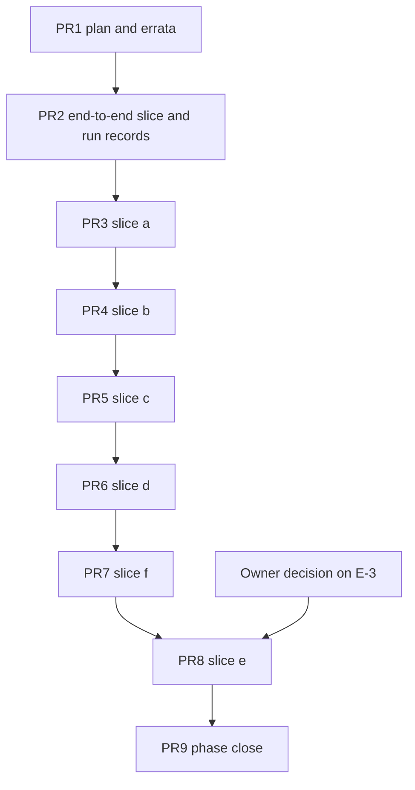

# Grade Command - Plan

This plan covers phase 3 of the [engine plan](2026-11-21-engine-plan.md). Its own ids start with G: GR for requirements, GKD for product decisions. A bare R, AE, A or F number is an entry in [the requirements](../requirements.md). Q ids are clauses of the sealed conformance collection specification, `docs/specs/conformance-collection-1.0/`; X, N, E and R ids after "judge rule" are the judge rulebook's.

## Goal Capsule

- **Objective:** A person can grade a subject with `pql grade` and trust the result as far as the synthetic subject proves it: every case of the sealed collection corpus gives the record and exit code the specification fixes, and the known-good subject is green and exits zero.
- **Means:** six slices on a thin end-to-end slice, each its own pull request, with a corpus runner that drives every case through the real `grade` command (KTD1, KTD2).
- **Authority:** the sealed judge specification 1.0 and conformance collection specification 1.0 with its errata note, then `AGENTS.md` and `CODING_STANDARDS.md`, then this plan. An input the sealed text can honestly read two ways goes to the owner with both readings (GR6).
- **Stop conditions:** a change that would need judge 1.1 or collection 1.1; a corpus case the engine cannot meet without departing from the text; a confinement rule that fails on both supported macOS versions.
- **Execution profile:** Deep. Nine pull requests: this plan with its errata entries, the end-to-end slice with the store's run records, slices a, b, c, d and f, slice e, and the phase close. Slice e waits on the owner's decision in Open Questions. A coding agent writes the code from a brief per unit; the main session writes briefs and reviews.
- **Who finishes:** the executing session opens each pull request and stops. The owner merges, or the session merges on the owner's say-so.
- **Dates:** phase 3 done by 2027-01-16, ahead of the halfway check on 2027-01-25 (engine plan §6).

---

## Product Contract

### Summary

`pql grade` reads a subject file, fixes the required set, collects evidence under confinement, builds the evidence record, calls the judge through the same function `pql judge` uses, stores the run, prints a scorecard and exits with the code the judge's output gives. It is built in the six slices the engine plan names, on a first slice that runs one scripted case end to end. A Go corpus runner assembles every corpus case and runs it through the scripted build of `grade` in CI; the three real-verifier cases run on a local macOS machine. The build is then scored against the private half of the corpus.

### Problem Frame

The judge decides a finished evidence record, and phase 2 sealed how that record is produced. Nothing yet produces one, so the engine cannot grade anything, and phase 4's first real grade cannot start until it can. The trial behind the engine plan found every judge build wrong at its JSON boundary and nowhere else, and the engine plan's largest risk is a collector that is weaker than the judge because its corpus is new: wrong evidence that the judge then grades faithfully (engine plan §7).

### Requirements

**Outcome**

- GR1. Every public case of the collection corpus passes through `pql grade` as QE19 defines a conforming collector, with the exit code the case expects: the scripted cases in CI on Linux, and `case-069`, `case-070` and `case-143` in a local run on a macOS version QH1 names.
- GR2. The known-good synthetic subject grades green and exits zero (`case-001` scripted, `case-069` real).
- GR3. The exit code, the scorecard and the stored record of every run are read from the judge's one output document, through the bytes-in, bytes-out function `pql judge` exposes (engine plan §4 rule 1, QE14, AE21).
- GR4. A record the judge rejects ends the run with exit 70 and is kept (QE15).
- GR5. The build is scored against the private half of the corpus with zero wrong records, and, as the private harness measures it, no seeded collection mistake survives the build's own CI tests. Feedback to the builder names a rule id only.

**Specification authority**

- GR6. Every rule is built from the sealed text for every input its schemas allow. An input the text can honestly read two ways is reported to the owner with both readings, and the settled reading goes in the errata note or a new version, never in a workaround.
- GR7. The test entry is QT1 to QT6: a scripted verifier and host exist only in a build made with the `scripted` tag, and the released build rejects the scripted flags with the exit codes QT1 gives.

**The slices** (engine plan §5, phase 3)

- GR8. Slice a: the subject file, `pql create` and placeholders, proved by AE20.
- GR9. Slice b: command discovery and the six generated probes, proved by AE8, AE27 and AE30.
- GR10. Slice c: authored checks, ordered runbooks, time budgets and computed expected values, proved by AE22 and AE23.
- GR11. Slice d: safety classes, scope and the no-network check with the real macOS verifier, proved by AE9 for conformance and AE24.
- GR12. Slice e: the store's baselines, comparison and anchoring, proved by AE16 to AE19, AE31 and AE33 as the owner's decision on E-3 settles.
- GR13. Slice f: the store's run records, the scorecard, and agreement of exit code, scorecard and stored record, proved by AE21.

**Confinement evidence**

- GR14. Each self-test program is shown necessary on macOS: a profile that grants only that program's operation makes the self-test fail. This runs as a test, never in a grade (QH9).
- GR15. Every rule a scripted run cannot break is proved by a local macOS run, stated in its pull request as `AGENTS.md` requires.

### Key Decisions

- GKD1. **A thin end-to-end slice comes before slice a.** It runs `case-004` through `grade`, so every later slice changes outcomes on a pipeline that already runs. Governs GR1, GR3. (session-settled: user-approved — chosen over starting at slice a as the engine plan's table does.)
- GKD2. **The corpus runner runs inside the existing CI checks.** It adds no new required check on `main`. Governs GR1. (session-settled: user-approved — chosen over a new CI job the owner would make required.)
- GKD3. **The harness assembles each case**, and `grade` takes only what QT1 and the specification name (errata E-2). Governs GR1, GR7. (session-settled: user-directed — chosen over a scripted-build `grade` that takes a case directory.)
- GKD4. **The acceptance examples the corpus does not reach go to the owner first** (errata E-3); slice e is not built until the owner decides on a collection 1.1. Governs GR12. (session-settled: user-directed — chosen over proving them with engine tests and macOS runs alone, and over dropping them from the proof.)
- GKD5. **The build is scored against the private half, as phase 1 was.** Governs GR5. (session-settled: user-directed — chosen over the public corpus alone.)

### Scope Boundaries

- Phase 4's real CLI, steering (phases 5 to 7) and any edit to a sealed folder are out.
- AE9's steering half and AE18's steering entries belong to phase 6; collection 1.0's `prompts` holds only a version.
- Linux confinement is out: version 1.0 supports macOS only.
- No macOS runner is added to CI; macOS evidence comes from local runs (`AGENTS.md`).
- Considered and not built: a store-location flag. QE17 fixes the store under the user's application-support directory, and tests isolate it through the home directory instead (KTD5). Build one only if a released-build user needs a second store.
- Considered and not built: comparing a case's whole judge input. QE19 leaves `expected` and `observed` out, so the runner compares the fields QE19 names plus the top-level fields and the whole judge output (KTD2).

### Deferred to Follow-Up Work

- Any collection 1.1 the owner decides on under E-3, and the cases it adds.
- Extending `internal/docrefs` to plan and spec citations of Q ids under `docs/`.

---

## Planning Contract

### Key Technical Decisions

- KTD1. **Pull requests in dependency order: end-to-end slice, a, b, c, d, f, e, then the close.** A case leaves the pending list when the last rule it needs lands, and 100 of the 121 judge-checked cases carry runbooks, so most cases pass only from slice c on. The plan names only cases whose rules it is sure of; each pull request lists the exact set its ratchet moves. The store's run records (QE17), which the engine plan's table puts in slice e, come with the end-to-end slice: the stored record is the only place `grade` exposes a case's judge input and output, so the corpus runner needs it from the start, and slice e waits on the owner (GKD4). The engine plan requires a separate pull request per slice.
- KTD2. **The corpus runner is a Go test behind the `scripted` tag, with a two-sided ratchet.** It assembles each case as QT6 and E-2 say, runs the built scripted `pql grade` on it, reads the judge input, judge output and exit code from the run's stored record, and compares the QE19 fields, the judge input's top-level fields, the exit code and the whole judge output. `case-069`, `case-070` and `case-143` are outside the CI ratchet by name; the same runner runs them in a local macOS mode against the released build (KTD6). A checked-in list names the cases not yet expected to pass: every case off the list must pass, and every case on it must still fail, so a slice cannot pass a case without removing it. The list is empty when phase 3 is done, with the three real-verifier cases passed on macOS. A mismatch is first a hypothesis about the case: re-derive the record from the text, the recording and the case's preimages before changing code (`docs/solutions/best-practices/judge-agreement-does-not-validate-a-case-record.md`). The gate's tagged test pass runs it, and `check.sh` runs the gate, so it reaches the `cases` job (GKD2).
- KTD3. **One strict reader and one writer for the judge contract's §3 grammar, owned by `internal/judge`.** The judge's reader and writer are unexported today. They are exported through a small API that takes each caller's own size and depth bounds, gives access to the parsed values, and exposes the canonical form, so the subject file (QS2, QS11), host and recording (QT1), computation output (QA6) and the predicates that read under §3 (QA9) all use it without a second number parser. Each input kind keeps its own shape in its own package. The export changes no judge behaviour and adds no second reader (`CODING_STANDARDS.md`, Judge and evidence code); the judge's published cases and a re-run of its private scoring guard the move (U3).
- KTD4. **A stdlib RFC 8785 canonicaliser in `internal/record` builds the check ids (QE2).** Its oracles are the four worked ids in QE2, each case's `preimages.json`, and `scripts/collection_ids.py`, never the code under test.
- KTD5. **The store's root is the user's configuration directory as Go reports it, and tests isolate it through the home directory.** On macOS that is the application-support directory QE17 names. The harness gives each run its own home and sets `XDG_CONFIG_HOME` inside it, since Go reads that variable first on Linux; this also keeps `case-143`'s real baseline from attaching to a later `case-069` run. A record is stored only once one exists, so a run that ends at the subject-file rules or the pre-check stores nothing.
- KTD6. **The real-verifier cases run on the released build.** QT1 puts the scripted verifier only in a scripted build, and the real path is the released build's.
- KTD7. **The necessity demonstration renders its one-grant profiles behind a separate test-only build tag.** `grade` uses only QH11's fixed template; no released or scripted build can render another profile.
- KTD8. **A scripted run records the host it actually ran on.** `record.schema.json` requires the host fields and QT3 checks no version, so a Linux run writes Linux's values.
- KTD9. **A pre-check refusal does not stop collection; a rejection does.** QE5 stops a run on a rejection, and `case-071` fixes that an anchor's refusal (judge rule N1) still gives full evidence and exit 5.
- KTD10. **A scripted run's tiers are all `scripted` (QT2), so QE9's offline and live tiers are proved by unit tests and the real-verifier cases.** `case-148` fixes that QT2 takes precedence.
- KTD11. **Packages follow engine plan §4:** `internal/subject`, `internal/record`, `internal/collect`, `internal/store`, `internal/scorecard`, with `create`, `grade` and `anchor` on the existing Cobra root in `cmd/pql`.
- KTD12. **The gate checks tagged and macOS code on Linux.** `gate.sh` adds `-tags scripted` passes for vet, staticcheck, errcheck, exhaustive and test, and `GOOS=darwin` passes of build, vet, staticcheck, errcheck and exhaustive, with and without KTD7's test-only tag, so the confinement code is compiled and linted in CI though it runs only on macOS. The import guard lists packages under each tag. `check.sh` needs no new step, because it runs the gate; any step added later stays outside the span `scripts/check-draft.py` reads, between `step collection-kit` and `step collection-schemas`.

### Sequencing

### Assumptions

- The private half and its scoring harness are reachable on the owner's machine, as they were for phase 1.
- A machine running macOS 27.0.1 or 27.2 is available for each slice that needs local evidence.

---

## Implementation Units

Each slice runs the peer-review gate on its diff, and each slice that adds an evidence rule first gets a short design note reviewed through the measurement lens (Verification Contract).

### PR1: plan and errata

Waits on: nothing.

### U1. Errata entries E-2 and E-3

- **Goal:** the owner's reading of case assembly, and the coverage finding behind GKD4, are on record beside the sealed folder.
- **Requirements:** GR6, GR12.
- **Dependencies:** none.
- **Files:** `docs/specs/conformance-collection-1.0-errata.md`.
- **Approach:** E-2 states both readings of QT6 and the owner's choice; E-3 lists AE16, AE19's anchoring parts, AE31 and AE33 and leaves the 1.1 decision to the owner.
- **Test expectation:** none -- a documentation note; the citation test checks its ids.
- **Verification:** the gate passes, and the note changes no case's record.

### PR2: end-to-end slice

Waits on: PR1, merge order only.

### U2. Tagged gate and the scripted build

- **Goal:** code behind the `scripted` tag is built, linted and tested, and the released build refuses the scripted flags.
- **Requirements:** GR7.
- **Dependencies:** none.
- **Files:** `gate.sh`, `check.sh`, `internal/importguard/importguard_test.go`, `cmd/pql/main_test.go`.
- **Approach:** KTD12. A released-build test runs `grade` with `--verifier scripted`, `--host` and `--behaviour` each alone and in every combination.
- **Test scenarios:**
  - a released build given any of the three scripted flags exits 2, and an unknown `--verifier` value exits 64 (QT1);
  - a scripted build given one or two of the three exits 2;
  - a deliberately unvetted line in a tagged file, and one in a darwin-only file, each fail the gate.
- **Verification:** the gate's tagged passes run, and a planted defect in tagged code turns them red.

### U3. The shared §3 reader and writer

- **Goal:** every input the specification reads under the judge contract's §3 uses the judge's one reader.
- **Requirements:** GR6.
- **Dependencies:** none.
- **Files:** `internal/judge/json.go`, a new exported entry in `internal/judge`, `internal/judge/json_test.go`.
- **Approach:** KTD3; the judge's own calls go through the exported entry, so there is still one path.
- **Test scenarios:**
  - a document over the size bound, with a repeated key, a lone surrogate, too deep, or with trailing content is refused through the exported entry exactly as `pql judge` refuses it;
  - a caller's own bounds apply: a value over QS11's size or depth limit, or computation output over QA6's, is refused at that caller's bound;
  - the judge's published cases still pass unchanged.
- **Verification:** the `cases` step and the judge's tests pass with no judge output changed, and phase 1's private judge scoring and seeded-mistake catalogue, re-run on this build, show zero wrong outputs and no surviving mistake; the pull request reports counts only.

### U4. Subject file model and parse

- **Goal:** `grade` reads a subject file into the model the required set needs.
- **Requirements:** GR1.
- **Dependencies:** U3.
- **Files:** `internal/subject/` (new), its tests.
- **Approach:** the shape of `schema/subject-file.schema.json` by hand on the shared reader; the rejection rules beyond parsing wait for U9.
- **Test scenarios:** every corpus subject file parses; the parsed model's fields match the schema's, checked against the schema file in a test.
- **Verification:** `case-004`'s subject file parses into the model U5 needs.

### U5. The required set and check ids

- **Goal:** the engine fixes the required set and every check id QE2 and QE3 define.
- **Requirements:** GR1.
- **Dependencies:** U4.
- **Files:** `internal/record/` (new), its tests.
- **Approach:** KTD4; every preimage kind QE2 names, the seed digest, and QE7's required-entry fields.
- **Test scenarios:**
  - QE2's four worked ids are reproduced;
  - for every judge-checked case, the required set and each preimage equal `input.json` and `preimages.json`;
  - an RFC 8785 edge (key order, number spelling, string escapes) matches `scripts/collection_ids.py`.
- **Verification:** the required set of all 121 judge-checked cases matches the corpus.

### U6. The scripted verifier and host

- **Goal:** a scripted run reads its host and recording and observes only what they say (QT3 to QT5).
- **Requirements:** GR7.
- **Dependencies:** U3.
- **Files:** `internal/collect/` (new, scripted files behind the tag), its tests.
- **Approach:** hand shapes for the `host` subschema and `schema/behaviour.schema.json`; QT4's attribution rules; QT5's agreement checks; a recording that lacks an invocation the record needs is an engine fault (exit 70).
- **Test scenarios:**
  - every corpus host and recording reads;
  - a host or recording that is unreadable, §3-refused, schema-invalid or breaks QT4 or QT5 exits 2;
  - a missing invocation exits 70.
- **Verification:** every scripted case's host and recording load.

### U17. The store's run records

- **Goal:** every run's record is stored as QE17 says, and the engine cleans up after itself.
- **Requirements:** GR3, GR4, GR13.
- **Dependencies:** U3.
- **Files:** `internal/store/` (new), its tests.
- **Approach:** QE17's location (KTD5), modes and R27; `record.schema.json`; a rejected record kept (QE15); QE20's per-run directories and startup sweep; a record is stored only once one exists (KTD5).
- **Test scenarios:** a stored record validates against `record.schema.json`; file and directory modes; a stale run directory swept at start.
- **Verification:** every run the corpus runner makes that reaches a record leaves a stored record.

### U7. Record builder, pre-check, judge call and exit code

- **Goal:** `pql grade` builds the record, runs the pre-check, calls the judge and exits with QE16's code.
- **Requirements:** GR3, GR4.
- **Dependencies:** U5, U6, U17.
- **Files:** `cmd/pql/main.go`, `internal/record/`, `internal/collect/`, their tests.
- **Approach:** QE5 and QE6 with KTD9; QE8 to QE10 targets, tiers and bounds with KTD10; QE18's masking of the canary and of declared values in every record, a rejected one included; the judge called through `judge.Safe(judge.Judge, …)`; QE14 and QE16; QO1's path for a failed self-test or unapplied confinement; QH3's root refusal (exit 70).
- **Test scenarios:**
  - a rejected record exits 70 and is stored (QE15), shown by a record the test makes the judge reject;
  - the canary and a declared value are masked in a stored record in each encoding QE18 covers, with the expected side written from QE18;
  - a pre-check rejection caused by the user exits 2 and one caused by the engine exits 70 (QE6);
  - running as root exits 70.
- **Verification:** `case-003` and `case-004` pass through `grade`.

### U8. The corpus runner

- **Goal:** every corpus case runs through the scripted `grade`, with the ratchet in KTD2.
- **Requirements:** GR1, GR2.
- **Dependencies:** U2, U7, U17.
- **Files:** a new test package behind the `scripted` tag, its pending-case list.
- **Approach:** KTD2 and KTD5; assembly as QT6 and E-2 describe, including `seed/`, `computations/` and `case-112`'s fixture; derivation-only cases compare the exit code.
- **Test scenarios:**
  - a case off the pending list that fails, and a case on it that passes, each fail the runner;
  - a planted wrong `target_size`, wrong tier, missing target and wrong exit code are each caught;
  - two cases run back to back never share a store, and each stored record lies under that case's own home.
- **Verification:** `case-129`, `case-003` and `case-004` pass, with any other case whose rules this slice completes (`case-090` is likely); every other case is pending; the runner runs in the gate and in `check.sh`.

### PR3: slice a, the subject file and placeholders

Waits on: PR2, merge order only.

### U9. Subject file rules

- **Goal:** every rule of QS1 to QS12 rejects what it must before anything runs.
- **Requirements:** GR8.
- **Dependencies:** U4, U7.
- **Files:** `internal/subject/`, its tests.
- **Approach:** QS1 to QS12, QS7's names with QH12's, QP7's and QP10's rejections, QA4's capture names, QA9's type and path rules, and QA5's warning.
- **Test scenarios:** one fixture per rejecting rule, each exiting 2 with the rule's cause, from the specification's text; QS8's containment and QS9's seed link rejection.
- **Verification:** derivation-only cases `case-100` to `case-128` and `case-136` leave the pending list.

### U10. Placeholders and `pql create`

- **Goal:** `pql create` writes a subject file with a placeholder for every value it cannot know, and `grade` handles each placeholder as QS5 says.
- **Requirements:** GR8.
- **Dependencies:** U9.
- **Files:** `cmd/pql/main.go`, `internal/subject/`, their tests.
- **Approach:** QS5's skip, nothing-runs, candidate and override rules. What `create` takes as input is not specified; the plan's choice is the smallest input QS5 needs, stated in the pull request.
- **Test scenarios:**
  - `create` then `grade` on its output gives `placeholder_unfilled` exactly where QS5 says, the expected side written from QS5, never from `create`'s code (AE20);
  - a subject file with each kind of placeholder gives the outcomes QS5 states, checked in a unit test where the corpus case needs a later slice.
- **Verification:** `case-060` leaves the pending list. `case-061` and `case-062` wait for discovery (U11), and `case-063` to `case-066` for authored checks (U13).

### PR4: slice b, discovery and probes

Waits on: PR3, merge order only.

### U11. Command discovery

- **Goal:** the discovery check walks help as QD1 to QD6 say.
- **Requirements:** GR9.
- **Dependencies:** U7.
- **Files:** `internal/collect/`, its tests.
- **Approach:** QD2's walk, bounds and order; QD3 and QD4's comparison; QD5; `credit-and-routes.md` §5's section headings for each framework; QO7's combination for discovery.
- **Test scenarios:** each framework's headings; the depth and cycle bounds; a missing declared command (AE27); help on stderr; a hidden command.
- **Verification:** `case-061` and `case-062` leave the pending list, and unit tests cover QD1 to QD6. Every discovery case in the corpus carries runbooks, so those cases pass from U13 on.

### U12. The six probes

- **Goal:** the bare, byte-bound, exit-code, fresh-state, store-unchanged and planted-secret probes collect as QP1 to QP13 say.
- **Requirements:** GR9.
- **Dependencies:** U7.
- **Files:** `internal/collect/`, its tests.
- **Approach:** QP1 to QP13, QO2 for a binary that could not start, QO7, QE8's targets with errata E-1, and QE10's stream bounds. A scripted run takes its leaks and home changes from the recording, so `credit-and-routes.md` §4's encoding scanner and QH25's inspection get their own unit tests.
- **Test scenarios:**
  - one test per §4 encoding, written from the table;
  - a store-unchanged check that runs no command has no artifact target (E-1);
  - QP7's and QP8's exclusions; a 17 MB stream, invalid UTF-8 and a 33-digit number.
- **Verification:** the runbook-free cases this slice's rules complete leave the pending list, among them `case-012` to `case-015`, `case-074`, `case-088`, `case-095`, `case-096` and `case-151`. The runbook-free cases that time out or end by a signal wait for U13 and U14.

### PR5: slice c, authored checks

Waits on: PR4, merge order only.

### U13. Authored checks, runbooks and computations

- **Goal:** authored checks, ordered runbooks with their budgets, and computed expected values collect as QA1 to QA9 say.
- **Requirements:** GR10.
- **Dependencies:** U12.
- **Files:** `internal/collect/`, `internal/record/`, their tests.
- **Approach:** QA1 to QA9; QO4 with QH24's known-fast control; QO5 and QO6; QA7's shared home and `earlier_step_failed`; `credit-and-routes.md` §2's credit conditions; QE11's markers; the reason order in `collection-rules.md` §2.
- **Test scenarios:**
  - each of the ten predicates and its type rules (QA9);
  - each QA6 failure mode;
  - the second step of a runbook failing, and every later step `earlier_step_failed` (AE22);
  - a computation over budget, and a known-fast control over budget giving `harness_fault`;
  - each `order:` pairing the corpus tags.
- **Verification:** the cases with runbooks leave the pending list, including `case-001` green with exit 0 (GR2, AE8, AE23).

### PR6: slice d, safety and the no-network check

Waits on: PR5, merge order only.

### U14. Scope, safety classes and outcomes

- **Goal:** scope fixes the required set and the outcome rules decide each invocation's end.
- **Requirements:** GR11.
- **Dependencies:** U13.
- **Files:** `internal/collect/`, `internal/record/`, their tests.
- **Approach:** QS6, QA7, QA8 and QE3 for scope; QO1 to QO3 and QO5's signal rules; QH21's attribution through the host; QE12 and QE13; QS7's offline settings and QE9's tiers (KTD10).
- **Test scenarios:**
  - a destructive command runs only with `destructive` in scope;
  - an unclassified command is never invoked (AE24);
  - QE9's tiers on a record built with the real verifier's inputs.
- **Verification:** the scope, kill, violator and could-not-start cases leave the pending list.

### U15. The real verifier on macOS

- **Goal:** a released build on a supported macOS confines the subject and each computation as QH1 to QH28 say.
- **Requirements:** GR11, GR15.
- **Dependencies:** U14.
- **Files:** `internal/collect/` (darwin files), its tests.
- **Approach:** QH1 to QH28 in the order the spike proved: the system version and root refusal, the private copy once per grade (`docs/solutions/test-failures/fresh-executable-per-run-stalls-parallel-sandbox-suite.md`), the self-test with clean programs judged by their output (`docs/solutions/best-practices/clean-control-must-assert-on-output.md`), QH11's fixed template with paths as parameters (`docs/solutions/best-practices/sandbox-profile-later-rule-decides.md`), the environment, descriptors and home, kqueue attribution, the known-fast control, home inspection and the read proof.
- **Test scenarios:**
  - every self-test program, with a clean program whose wrong output fails the self-test;
  - a copy changed between uses fails its invocations and is never remade;
  - an unsupported system version and running as root are refused.
- **Verification:** `case-069` and `case-070` pass on a released build on macOS (KTD6).

### U16. The confinement evidence suite

- **Goal:** a local macOS suite proves every rule a scripted run cannot break (GR15), among them QH6, QH10, QH12, QH13, QH15, QH16, QH20, QH22, QH23 and QE18, and each self-test program's necessity.
- **Requirements:** GR14, GR15.
- **Dependencies:** U15.
- **Files:** a new darwin test behind a test-only tag (KTD7).
- **Approach:**
  1. For each self-test program, a profile granting only that program's operation makes the self-test fail, the granted program completes its operation as its output shows, and no other program's result changes (GR14).
  2. Each allowance removed in turn breaks a clean run; violators and their twins.
  3. Every form of the synthetic subject is built, and each invocation in its recording runs through the released build's real verifier; the markers, ends, streams, leaks and home changes observed agree with the recording, so the real observation path is proved on defective forms as well as the known-good one.
  4. `sandbox-exec` exiting before the marker, and a profile it rejects, each leave the subject never started and its checks not observed (QH6); descriptors and the terminal are as QH13 says; the process group is ended (QH23).
  5. Commit 490d650's spike suite is reference only; nothing is copied without checking it against the sealed text.
- **Test scenarios:**
  - each program's one-grant profile fails the self-test while the granted program succeeds and the others are unchanged;
  - each allowance's removal breaks the clean program;
  - a form's observed invocation that differs from its recording fails the suite.
- **Verification:** the suite passes on macOS 27.0.1 or 27.2, and the pull request states the commit, the version and build, the command, the result and the log's SHA-256.

### PR7: slice f, the scorecard

Waits on: PR6, merge order only.

### U18. The scorecard and the agreement check

- **Goal:** the scorecard renders the judge's output, and the exit code, scorecard and stored record agree for every case (AE21).
- **Requirements:** GR3, GR13.
- **Dependencies:** U17.
- **Files:** `internal/scorecard/` (new), the corpus runner, their tests.
- **Approach:** everything QE12, QE18, QE21 and the subject rules ask the scorecard to show; the judge errata's display rules where conformance reaches them. The runner reads all three for each case and checks them against `expect.judge_output`.
- **Test scenarios:** a scorecard that recomputes a verdict instead of reading it is caught; each display item has a fixture.
- **Verification:** the agreement check passes for every case, and a private scoring run on the build so far shows zero wrong records, reported as counts only.

### PR8: slice e, baselines and anchoring

Waits on: PR7, merge order only; and the owner's decision on E-3 before it starts (Open Questions).

### U19. Baselines, comparison and anchoring

- **Goal:** `grade` compares against a baseline and `pql anchor` saves one, as QE4, QE5 and QE21 say.
- **Requirements:** GR12.
- **Dependencies:** U17.
- **Files:** `cmd/pql/main.go`, `internal/store/`, `internal/record/`, their tests.
- **Approach:** QE4's choice of baseline, the missing-id list written as a sorted array `pql anchor` accepts as its retired list, the anchor's pre-check with KTD9, QE21's anchor-not-green, and whatever cases a collection 1.1 adds.
- **Test scenarios:** a named baseline file read in place without checking its path; the missing-id list's form; an anchor of a scripted run refused with exit 5.
- **Verification:** `case-130` to `case-134`, `case-137` and `case-071` pass, and `case-143` passes on macOS in a home of its own.

### PR9: phase close

Waits on: PR8, merge order only.

### U20. Private scoring and the phase status

- **Goal:** the build is scored privately and the engine plan records phase 3 as done.
- **Requirements:** GR1, GR2, GR5.
- **Dependencies:** U19.
- **Files:** `docs/plans/2026-11-21-engine-plan.md`.
- **Approach:** the private scoring harness runs the 72 private cases and the 40 seeded mistakes outside the repository; the pull request reports counts only. A full local macOS run of the three real-verifier cases closes the evidence.
- **Test expectation:** none -- a status edit; the scoring and the macOS run are its evidence.
- **Verification:** zero wrong records, no surviving seeded mistake, the pending list empty, and the macOS evidence stated.

---

## Verification Contract

| Gate | What it proves |
|---|---|
| `./gate.sh` with its tagged passes | build, vet, staticcheck, errcheck, exhaustive and every test, the corpus runner included, on released and scripted code; build and lints on darwin code; network off |
| `./check.sh` | the gate, the binaries, the sealed kits, the judge's published cases and the corpus checks, in the `cases` job |
| `./scan.sh` | no home path, email or secret in the diff or commit messages |
| the corpus runner's ratchet | which cases pass; each slice moves cases off the pending list and none back |
| mutation evidence per rule test | each new rule test fails when its rule breaks, through `mutation-verify.sh` with a knock-out, recorded in the review log (`CODING_STANDARDS.md`, Tests) |
| a local macOS run | the real-verifier cases and the evidence suite, stated in the pull request as `AGENTS.md` requires |
| the peer-review gate per pull request | code and test lenses always; security for the confinement and anything public; the measurement lens on every evidence rule, with a design-mode round on the slice's design note before its build |
| one different-model review | this plan, before slice work starts (`AGENTS.md`, Review) |
| private scoring | GR5, after slice f and at the phase close; phase 1's judge scoring again after U3 |

---

## Definition of Done

- Every public case passes through `grade`: the scripted ones in CI with the pending list empty, and `case-069`, `case-070` and `case-143` on local macOS (GR1).
- The known-good synthetic subject is green and exits zero (GR2).
- The private scoring shows zero wrong records and no surviving seeded mistake (GR5).
- Each slice's pull request has passed the peer-review gate with every Blocker and Major resolved or accepted by the owner, and records its mutation evidence and any macOS evidence.
- The engine plan records phase 3 as done.
- No abandoned helpers, commented-out code or scratch files remain in any diff.

---

## Open Questions

- **Blocking slice e:** does a collection specification 1.1 add cases for AE16, AE19's anchoring, AE31 and AE33 (errata E-3)? If it does, slice e builds against 1.1 and its cases; if not, slice e proves what 1.0 reaches and the pull request names what stays unproved.
- **Deferred to slice a:** what `pql create` takes as input; the specification fixes only that it writes a placeholder for each value it cannot know (U10).
