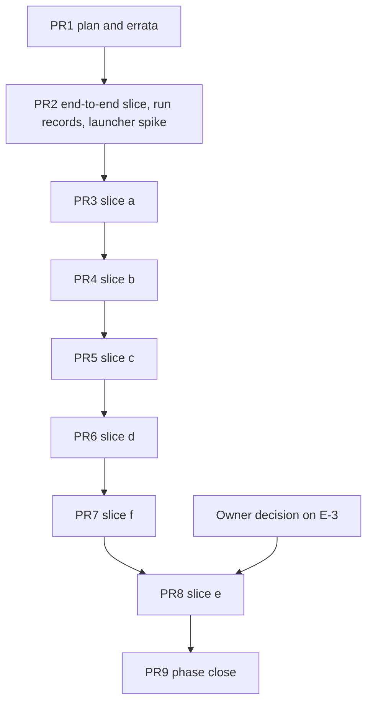

# Grade Command - Plan

This plan covers phase 3 of the [engine plan](2026-11-21-engine-plan.md). Its own ids start with G: GR for requirements, GKD for product decisions. A bare R, AE, A or F number is an entry in [the requirements](../requirements.md). Q ids are clauses of the sealed conformance collection specification, `docs/specs/conformance-collection-1.0/`; X, N, E and R ids after "judge rule" are the judge rulebook's.

## Goal Capsule

- **Objective:** A person can grade a subject with `pql grade` and trust the result as far as the synthetic subject proves it: every case of the sealed collection corpus gives the record and exit code the specification fixes, and the known-good subject is green and exits zero.
- **Means:** six slices on a thin end-to-end slice, each its own pull request, with a corpus runner that drives every case through the real `grade` command and an early macOS spike of the confinement launcher (KTD1, KTD2, KTD14).
- **Authority:** the sealed judge specification 1.0 and conformance collection specification 1.0 with its errata note, then `AGENTS.md` and `CODING_STANDARDS.md`, then this plan. An input the sealed text can honestly read two ways goes to the owner with both readings (GR6).
- **Stop conditions:** a change that would need judge 1.1 or collection 1.1, including a launcher that cannot start under the unchanged QH11 template (U21); a corpus case the engine cannot meet without departing from the text; a confinement rule that fails on macOS 27.2.
- **Execution profile:** Deep. Nine pull requests: this plan with its errata entries, the end-to-end slice with the store's run records and the launcher spike, slices a, b, c, d and f, slice e, and the phase close. Slice e waits on the owner's decision in Open Questions. A coding agent writes the code from a brief per unit; the main session writes briefs and reviews.
- **Who finishes:** the executing session opens each pull request and stops. The owner merges, or the session merges on the owner's say-so.
- **Dates:** phase 3 done by 2027-01-16, ahead of the halfway check on 2027-01-25 (engine plan §6). PR2 by 2026-12-08, slices a and b by 2026-12-18, slice c by 2026-12-29, slice d by 2027-01-08, slices f and e and the close by 2027-01-16.

---

## Product Contract

### Summary

`pql grade` reads a subject file, fixes the required set, collects evidence under confinement, builds the evidence record, calls the judge through the same function `pql judge` uses, stores the run, prints a scorecard and exits with the code the judge's output gives. It is built in the six slices the engine plan names, on a first slice that runs one scripted case end to end and spikes the macOS launcher. A Go corpus runner assembles every corpus case and runs it through the scripted build of `grade` in CI; the three real-verifier cases and the confinement evidence run on a local macOS 27.2 machine. The build is then scored against the private half of the corpus.

### Problem Frame

The judge decides a finished evidence record, and phase 2 sealed how that record is produced. Nothing yet produces one, so the engine cannot grade anything, and phase 4's first real grade cannot start until it can. The trial behind the engine plan found every judge build wrong at its JSON boundary and nowhere else, and the engine plan's largest risk is a collector that is weaker than the judge because its corpus is new: wrong evidence that the judge then grades faithfully (engine plan §7). Phase 4 then runs a real, untrusted CLI on the owner's machine, so the confinement must hold before it does.

### Requirements

**Outcome**

- GR1. Every public case of the collection corpus passes through `pql grade` or `pql anchor` as QE19 defines a conforming collector, with the exit code the case expects: the scripted cases in CI on Linux, and `case-069`, `case-070` and `case-143` in a local run on macOS 27.2.
- GR2. The known-good synthetic subject grades green and exits zero (`case-001` scripted, `case-069` real).
- GR3. The exit code, the scorecard and the stored record of every run are read from the judge's one output document, through the bytes-in, bytes-out function `pql judge` exposes (engine plan §4 rule 1, QE14, AE21).
- GR4. A record the judge rejects ends the run with exit 70 and is kept (QE15).
- GR5. The build is scored against the private half of the corpus with zero wrong records, and, as the private harness measures it, no seeded collection mistake survives the build's own CI tests. Feedback to the builder names a rule id only.

**Specification authority**

- GR6. Every rule is built from the sealed text for every input its schemas allow. An input the text can honestly read two ways is reported to the owner with both readings, and the settled reading goes in the errata note or a new version, never in a workaround.
- GR7. The test entry is QT1 to QT6: a scripted verifier and host exist only in a build made with the `scripted` tag, and the released build rejects the scripted flags with the exit codes QT1 gives.

**The slices** (engine plan §5, phase 3)

- GR8. Slice a: the subject file, `pql create` and placeholders, proved by AE20.
- GR9. Slice b: command discovery and the six generated probes, proved by AE27.
- GR10. Slice c: authored checks, ordered runbooks, time budgets and computed expected values, proved by AE8, AE22 and AE23.
- GR11. Slice d: safety classes, scope and the no-network check with the real macOS verifier, proved by AE9 for conformance, AE24 and AE30.
- GR12. Slice e: the store's baselines, comparison and anchoring, proved by AE16 to AE19, AE31 and AE33 as the owner's decision on E-3 settles.
- GR13. Slice f: the scorecard, and agreement of exit code, scorecard and stored record, proved by AE21.

**Confinement evidence**

- GR14. Each self-test program is shown necessary on macOS: a profile that grants only that program's operation makes the self-test fail. This runs as a test, never in a grade (QH9).
- GR15. Every rule a scripted run cannot break is proved by a local macOS run, stated in its pull request as `AGENTS.md` requires.

### Key Decisions

- GKD1. **A thin end-to-end slice comes before slice a.** It runs `case-004` through `grade`, so every later slice changes outcomes on a pipeline that already runs. Governs GR1, GR3. (session-settled: user-approved — chosen over starting at slice a as the engine plan's table does.)
- GKD2. **The corpus runner runs inside the existing CI checks.** It adds no new required check on `main`. Governs GR1. (session-settled: user-approved — chosen over a new CI job the owner would make required.)
- GKD3. **The harness assembles each case**, and `grade` takes only what QT1, the specification and GKD8 name (errata E-2). Governs GR1, GR7. (session-settled: user-directed — chosen over a scripted-build `grade` that takes a case directory.)
- GKD4. **The acceptance examples the corpus does not reach go to the owner first** (errata E-3); slice e is not built until the owner decides on a collection 1.1. Governs GR12. (session-settled: user-directed — chosen over proving them with engine tests and macOS runs alone, and over dropping them from the proof.)
- GKD5. **The build is scored against the private half, as phase 1 was.** Governs GR5. (session-settled: user-directed — chosen over the public corpus alone.)
- GKD6. **The launcher, the self-test programs and the known-fast control are hidden modes of the `pql` binary, written in Go,** and copied once per grade. Governs GR11, GR14, GR15. (session-settled: user-directed — chosen over embedding the spike's C programs.)
- GKD7. **Darwin-only code may use `golang.org/x/sys` as one reviewed dependency, with raw syscalls where it falls short, and no cgo,** so the Linux gate compiles and lints all of it. Governs GR11, GR15. (session-settled: user-directed — chosen over cgo and over the standard library alone.)
- GKD8. **The command line:** `pql grade <subject-file> [--scope conformance[,destructive]] [--baseline <file>]`; `pql anchor <subject-file> [--retired <file>] [--accept <file>]`; the QT1 flags on both; the missing-id list written to the run's store directory; a subject-file or pre-check rejection prints one stable line `pql: rejected: <rule id>: <cause>` on standard error; a malformed command line exits 64 before any exit 2. Governs GR1, GR7. (session-settled: user-directed — chosen over deciding the command line at PR2's review.)
- GKD9. **macOS evidence is taken on 27.2 only.** The phase close states 27.0.1 as unverified for phase 3, and the owner decides whether that stands. Governs GR1, GR15. (session-settled: user-directed — chosen over evidence on both supported versions.)

### Scope Boundaries

- Phase 4's real CLI, steering (phases 5 to 7) and any edit to a sealed folder are out.
- AE9's steering half and AE18's steering entries belong to phase 6; collection 1.0's `prompts` holds only a version.
- Linux confinement is out: version 1.0 supports macOS only. On any other system, the real verifier gives every check that runs the subject `network_unverifiable` (QH1), which U14 builds and tests.
- No macOS runner is added to CI; macOS evidence comes from local runs (`AGENTS.md`).
- Considered and not built: a store-location flag. QE17 fixes the store under the user's application-support directory, and tests isolate it through the home directory instead (KTD5). Build one only if a released-build user needs a second store.
- Considered and not built: comparing a case's whole judge input. QE19 leaves `expected` and `observed` to the collector, so the runner compares the fields QE19 names, the top-level fields and the whole judge output (KTD2).
- Considered and not built: a JSON Schema library in Go. Schema validation runs in `check.sh` through the pinned Python `jsonschema` the repository already uses (KTD15); build one only if a Go-side validation is needed at run time.

### Deferred to Follow-Up Work

- Any collection 1.1 the owner decides on under E-3, and the cases it adds.
- Extending `internal/docrefs` to plan and spec citations of Q ids under `docs/`.

---

## Planning Contract

### Key Technical Decisions

- KTD1. **Pull requests in dependency order: end-to-end slice with the launcher spike, a, b, c, d, f, e, then the close.** A case leaves the pending list when the last rule it needs lands, and 100 of the 121 judge-checked cases carry runbooks, so most cases pass only from slice c on. The plan names only cases whose rules it is sure of; each slice's design note predicts its set, and its pull request lists the set its ratchet moved. The store's run records (QE17) come with the end-to-end slice, because the stored record is the only place `grade` exposes a case's judge input and output. The launcher spike (U21) comes with it too, because the real verifier is the one part CI cannot check. The engine plan requires a separate pull request per slice.
- KTD2. **The corpus runner is a Go test behind the `scripted` tag, with a two-sided ratchet and guards against vacuous passes.**
  1. It finds the cases, asserts their number, and derives the real-verifier exclusions from `input.verifier`, asserting they are exactly `case-069`, `case-070` and `case-143`.
  2. It assembles each case as QT6 and E-2 say, with the run's home outside the assembled directory (QS8), and runs the scripted `pql grade` or `pql anchor` as `input.request` says.
  3. For a judge-checked case it requires a stored record, compares the QE19 fields, the judge input's top-level fields other than `required` and `evidence` (which it compares as QE19 says after sorting by check id), the process's exit code and the whole judge output, and re-judges the stored input with `pql judge` to confirm the stored output. A compared field absent on both sides is a failure.
  4. For a derivation-only case it requires the process's exit code, no stored record, and the rejection line's rule (GKD8) equal to `expect.rule`.
  5. A checked-in list names the cases not yet expected to pass: every case off it must pass, every case on it must still fail, and a separate layer requires every judge-checked case's `required` array to match from PR2 on. A CI step fails when the list gains an entry relative to the merge base.
  6. A mismatch is first a hypothesis about the case: re-derive the record from the text, the recording and the case's preimages before changing code (`docs/solutions/best-practices/judge-agreement-does-not-validate-a-case-record.md`).
  7. In its macOS mode it builds the released `pql`, builds the known-good form and checks its source digest against the recording (QT6, as `internal/collectionkit/subject_test.go` does), runs the three real-verifier cases, and reports them not run on a system QH1 does not name.

  The list is empty when phase 3 is done.
- KTD3. **The judge's strict reader, value access and exact equality are shared; its writer serialises only the judge input.** The reader is exported with the document bounds each input sets (the judge contract's §3, QS2, and QA6's 1 MiB), with access to the parsed values, so the subject file, host and recording (QT1), computation output (QA6) and the predicates (QA9) use one reader and one number parser. QA9's comparisons use the judge's exact-decimal `equalJSON` and `normalize`, never canonical bytes, so two integers that round to one double never compare equal. The judge's writer is the contract writer and is not RFC 8785. The export changes no judge behaviour; the judge's published cases and a re-run of its private scoring guard it (U3).
- KTD4. **RFC 8785 lives in one leaf package, `internal/jcs`,** used for QE2's check ids and seed digest and for QS11's canonical-form size and round-trip rules. Its oracles are QE2's four worked ids, each case's `preimages.json` and `scripts/collection_ids.py`, never the code under test.
- KTD5. **The store's root is the user's configuration directory, resolved only in `cmd/pql` and passed down.** On macOS that is the application-support directory QE17 names. Tests give each run its own home and set `XDG_CONFIG_HOME` inside it, since Go reads that first on Linux, and a test guard fails if a test reaches the developer's real store. Records and baselines are written by temporary file and rename at mode 0600, keyed by a digest of the subject file's canonical path. A record is stored only once one exists. QE20's per-run directories live under a user-owned 0700 parent checked with `Lstat`, are created with `os.MkdirTemp`, and the startup sweep matches only their name pattern, never follows a link, checks the process id and start time it reads, and restores modes before removal.
- KTD6. **The real-verifier cases run on the released build.** QT1 puts the scripted verifier only in a scripted build, and the real path is the released build's.
- KTD7. **The necessity demonstration renders its one-grant profiles behind a separate test-only build tag.** `grade` renders only QH11's fixed template from a closed set of variants with no free-text hook; no released or scripted build can render another profile.
- KTD8. **A scripted run records the host it actually ran on.** `record.schema.json` requires the host fields and QT3 checks no version, so a Linux run writes Linux's values.
- KTD9. **A pre-check refusal does not stop collection; a rejection does.** QE5 stops a run on a rejection, and `case-071` fixes that an anchor's refusal (judge rule N1) still gives full evidence and exit 5.
- KTD10. **A scripted run's tiers are all `scripted` (QT2), so QE9's offline and live tiers are proved by unit tests and the real-verifier cases.** `case-148` fixes that QT2 takes precedence.
- KTD11. **Packages follow engine plan §4, with one leaf added.** `internal/jcs` (RFC 8785), `internal/subject`, `internal/record`, `internal/collect`, `internal/store`, `internal/scorecard`, and `create`, `grade` and `anchor` on the existing Cobra root. `subject` imports `jcs`; `record` imports `subject` and `jcs` and defines the observation types; `collect` imports `record`. `record` holds one pure resolver that decides each check's outcome and reason in the order of `collection-rules.md` §2, from PR2 on; later slices fill in its steps. These are the collection specification's evidence rules, not verdicts: the judge still decides requiredness, rollups, comparison and every verdict. `internal/judge` exports the scope-to-dimension and always-applicable tables the resolver needs, so they are not typed twice.
- KTD12. **The gate checks tagged and macOS code on Linux, within its time limit.** `gate.sh` adds `-tags scripted` passes of vet, staticcheck, errcheck and exhaustive across the module and of test across the packages with tagged files; `GOOS=darwin` passes of build, vet, staticcheck, errcheck and exhaustive, with and without the `scripted` tag and KTD7's test-only tag; a step that fails if `GOOS=darwin go list -f '{{.CgoFiles}}' ./...` lists any file (GKD7); and a check that no scripted-only symbol is in the released binary. Tags and `GOOS` reach the import guard's `go list` through its environment. `GOFLAGS` keeps `-mod=readonly` beside each tag. The gate's run time is measured in PR2 and its limit raised only if needed.
- KTD13. **Observation is the only seam between the scripted and real paths.** `record` defines untagged `Observation` (QT5's run: markers, end, streams, home changes, planted file, leaks, decoys, a computation's value) and `Controls` (QT4's fields) types. The scripted adapter and the darwin adapter each only produce those values; one shared, untagged path turns them into evidence, as QT4 requires QO1, QO4, QP9, QP11 and QH21 to decide "exactly as the released build decides". A guard test fails if a tagged or darwin file declares an outcome or reason.
- KTD14. **The launcher and the self-test programs are hidden modes of `pql` (GKD6).** The mode is chosen first in `main`, before Cobra and before any package initialisation the frozen profile could kill. The per-invocation marker is drawn from `crypto/rand` and passed in the arguments, since QH12 allows nothing else through the environment. The launcher strips its own arguments, closes every descriptor above 2 (QH13), and replaces itself with the program, keeping its process id (QH4). Only the first line of standard error is read for the marker or the could-not-start marker (QH5, QH7), so a subject cannot forge either. The self-test modes validate their targets (decoys only, a process id above 0). The hidden modes are part of the released command surface that U2 tests.
- KTD15. **Schema oracles come from the specification, not the code.** Each reader rejects every file in `examples/invalid/` that targets its schema; boundary tests take each limit ± 1 from the schema files; and a `check.sh` step validates the records and baselines the corpus runner keeps against `record.schema.json` and `baseline.schema.json` with the pinned Python `jsonschema`, outside the span `scripts/check-draft.py` reads. A record the judge rejected is stored even when it fails `record.schema.json` (QE15), and that step reports it rather than failing.
- KTD16. **A run's bytes take one path.** Build, mask (QE18), bound (QE10), serialise once with the contract writer, judge, then store those exact bytes; the scorecard renders from the stored record. One §4 encoder serves masking and the leak scan. Until U18, the stored record's `next_actions`, `offline_settings` and `bookkeeping_excluded` are empty lists, which no case compares (QE12).
- KTD17. **Every goroutine the engine starts recovers its own panic as an engine defect, exit 70,** because an unrecovered panic exits 2, the code for a rejected request (`CODING_STANDARDS.md`, Judge and evidence code).
- KTD18. **macOS evidence runs on 27.2 with automatic updates off (GKD9).** Each run records the commit, the version and build, the command and the result; the pull request carries the summary and the log's SHA-256, and a log attached in full first passes `scan.sh`'s home-path and secret rules. Scenarios that depend on timing or access times repeat 25 times, as the spike's did. The full evidence suite and the self-test checks run again at the close on the exact commit phase 4 will use.

### Sequencing

### Assumptions

- The private half and its scoring harness are reachable on the owner's machine, as they were for phase 1, and the harness can score a collector build (Open Questions).
- A machine running macOS 27.2 with automatic updates off is available for each slice that needs local evidence.

---

## Implementation Units

Each pull request from PR2 to PR8 first gets a short design note reviewed through the measurement lens in design mode, naming its evidence rules, its predicted ratchet set and its controls; its build waits on that review. Each then runs the peer-review gate on its diff. Each unit brief gives the exact `go test` command for its tests, written to fail first.

### PR1: plan and errata

Waits on: nothing.

### U1. Errata entries E-2 and E-3

- **Goal:** the owner's reading of case assembly, and the coverage finding behind GKD4, are on record beside the sealed folder.
- **Requirements:** GR6, GR12.
- **Dependencies:** none.
- **Files:** `docs/specs/conformance-collection-1.0-errata.md`.
- **Approach:** E-2 states both readings of QT6 and the owner's choice; E-3 lists AE16, AE19's anchoring parts, AE31 and AE33 and leaves the 1.1 decision to the owner.
- **Test expectation:** none -- a documentation note; the citation test checks its ids.
- **Verification:** the gate passes, and the note changes no case's record.

### PR2: end-to-end slice, run records and the launcher spike

Waits on: PR1, merge order only.

### U2. The command line and the tagged gate

- **Goal:** `grade` and `anchor` exist with the command line GKD8 fixes, the scripted build adds only the QT1 test entry, and the gate checks tagged and darwin code.
- **Requirements:** GR7.
- **Dependencies:** none.
- **Files:** `cmd/pql/main.go`, `cmd/pql/main_test.go`, `gate.sh`, `internal/importguard/importguard_test.go`.
- **Approach:** GKD8 and KTD12; scripted files behind `//go:build scripted`, released-only tests behind `!scripted`; the hidden modes of KTD14 dispatched before Cobra, as stubs until U21.
- **Test scenarios:**
  - a released `grade` or `anchor` given any of `--verifier scripted`, `--host` or `--behaviour` exits 2, and an unknown `--verifier` value exits 64 (QT1);
  - a malformed command line exits 64 even with a scripted flag present (GKD8);
  - a scripted build given one or two of the three exits 2;
  - a planted unvetted line in a tagged file, and one in a darwin-only file, each fail the gate; a cgo file under darwin fails it;
  - the released binary holds no scripted-only symbol.
- **Verification:** the gate's tagged and darwin passes run within its limit, and each planted defect turns them red.

### U3. The shared reader and exact equality

- **Goal:** every input read under the judge contract's §3 uses the judge's one reader, and QA9 can compare values exactly.
- **Requirements:** GR6.
- **Dependencies:** none.
- **Files:** `internal/judge/json.go`, `internal/judge/statistics.go`, a new exported entry in `internal/judge`, their tests.
- **Approach:** KTD3; the judge's own calls go through the exported entry, so there is still one path.
- **Test scenarios:**
  - a document over its size bound, with a repeated key, a lone surrogate, too deep, or with trailing content is refused through the exported entry exactly as `pql judge` refuses it;
  - a caller's document bound applies, such as QA6's 1 MiB;
  - `9007199254740993` and `9007199254740992` compare unequal, and `1`, `1.0` and `1e0` equal.
- **Verification:** the `cases` step and the judge's tests pass with no judge output changed, and phase 1's private judge scoring and seeded-mistake catalogue, re-run on this build, show zero wrong outputs and no surviving mistake; the pull request reports counts only.

### U22. RFC 8785 canonicalisation

- **Goal:** one RFC 8785 implementation serves check ids, the seed digest and QS11.
- **Requirements:** GR1.
- **Dependencies:** U3.
- **Files:** `internal/jcs/` (new), its tests.
- **Approach:** KTD4, over the shared reader's values.
- **Test scenarios:** key order by UTF-16 code units; number spelling; `\b` and `\f` escapes; each matched against `scripts/collection_ids.py`'s output.
- **Verification:** QE2's four worked ids are reproduced.

### U4. Subject file model and parse

- **Goal:** `grade` reads a subject file into the model the required set needs.
- **Requirements:** GR1.
- **Dependencies:** U3, U22.
- **Files:** `internal/subject/` (new), its tests.
- **Approach:** the shape of `schema/subject-file.schema.json` by hand on the shared reader (KTD15); the rejection rules beyond parsing wait for U9.
- **Test scenarios:** every judge-checked case's subject file parses; `case-100` is refused as QS2 says; each `examples/invalid/` subject-file example is refused.
- **Verification:** the model holds every field the required set needs.

### U5. The required set and check ids

- **Goal:** the engine fixes the whole required set, every check id and every required-entry field.
- **Requirements:** GR1.
- **Dependencies:** U4, U22.
- **Files:** `internal/record/` (new), its tests.
- **Approach:** all of QE2, QE3 and QE7: every preimage kind, the seed digest, QP1's probes and their placement, the bare binary's defaults, QS7's offline arguments in preimages, QS5's candidate checks, QA7's exclusion of destructive runbooks outside that scope, QA3's crediting with `credit-and-routes.md` §2's credit conditions, and QA9's `empty_satisfiable` and `asserts_emptiness`.
- **Test scenarios:** QE2's worked ids; for every judge-checked case, the required set and each preimage equal `input.json` and `preimages.json`.
- **Verification:** the runner's `required` layer passes for all 121 judge-checked cases.

### U23. Observation types and the resolver

- **Goal:** the seam of KTD13 and the resolver of KTD11 exist before any collector does.
- **Requirements:** GR1, GR6.
- **Dependencies:** U5.
- **Files:** `internal/record/`, its tests.
- **Approach:** the `Observation` and `Controls` types; the resolver's steps in the order of `collection-rules.md` §2, with QO1 and the QS5 override filled in now; the guard test of KTD13.
- **Test scenarios:** each `order:` pairing the corpus tags, from fixtures written from §2; a planted reason in a tagged file fails the guard.
- **Verification:** `case-004`'s 29 checks resolve to `network_unverifiable` through the shared path.

### U6. The scripted adapter

- **Goal:** a scripted run turns its host and recording into `Observation` and `Controls` values (QT3 to QT5).
- **Requirements:** GR7.
- **Dependencies:** U3, U23.
- **Files:** `internal/collect/` (scripted files behind the tag), its tests.
- **Approach:** hand shapes for the `host` subschema and `schema/behaviour.schema.json` (KTD15); QT4's attribution and QT5's agreement; a recording that lacks an invocation the record needs is an engine fault (exit 70).
- **Test scenarios:** every corpus host and recording reads; each `examples/invalid/` host and behaviour example, and a host or recording that is unreadable, §3-refused or breaks QT4 or QT5, exits 2; a missing invocation exits 70.
- **Verification:** every scripted case's host and recording load into the seam's types.

### U17. The store's run records

- **Goal:** every run's record is stored as QE17 says, and the engine cleans up after itself.
- **Requirements:** GR3, GR4.
- **Dependencies:** U3.
- **Files:** `internal/store/` (new), its tests.
- **Approach:** KTD5 and KTD16; QE17's modes and R27; a rejected record kept (QE15); QE20's per-run directories and startup sweep.
- **Test scenarios:**
  - file and directory modes; a stale run directory swept at start, and a link or a foreign directory left alone;
  - a directory with mode 0000 inside a home removed;
  - a test that would resolve the developer's real store fails;
  - a store write that fails after the judge has decided exits as Open Questions settles.
- **Verification:** every run the corpus runner makes that reaches a record leaves a stored record under that run's home.

### U7. Record builder

- **Goal:** the engine builds the evidence record's pieces from the resolver's results.
- **Requirements:** GR3.
- **Dependencies:** U23.
- **Files:** `internal/record/`, its tests.
- **Approach:** QE7 to QE10: required entries, evidence, targets in QE8's order with errata E-1, tiers with KTD10, and QE10's bounds, including an unfittable record ending the run with exit 70.
- **Test scenarios:** each target kind; QE10's bounds at their limits; an unfittable record exits 70.
- **Verification:** `case-004`'s evidence and targets match `input.json`.

### U24. Masking

- **Goal:** no byte the engine writes carries the canary or a declared value QE18 masks.
- **Requirements:** GR3.
- **Dependencies:** U7.
- **Files:** `internal/record/`, its tests.
- **Approach:** QE18 with KTD16's one §4 encoder; masking happens before the first byte reaches disk.
- **Test scenarios:** a leaking-run fixture whose test scans every byte `pql` writes, to disk and to its streams, error and panic text included, for each §4 encoding of the canary and of a declared value of 8 bytes or more; the expected side written from QE18 and `credit-and-routes.md` §4.
- **Verification:** the fixture finds no unmasked value.

### U25. Pre-check, judge call and exit code

- **Goal:** `pql grade` and `pql anchor` run the pre-check, call the judge and exit with QE16's code.
- **Requirements:** GR3, GR4.
- **Dependencies:** U6, U7, U17, U24.
- **Files:** `cmd/pql/main.go`, `internal/collect/`, their tests.
- **Approach:** QE5 and QE6 with KTD9; KTD16's path; the judge called through `judge.Safe(judge.Judge, …)` for the pre-check and the final call; QE14 and QE16; QH3's root refusal (exit 70); KTD17; GKD8's rejection line.
- **Test scenarios:**
  - a rejected record exits 70 and is stored (QE15), shown by a record the test makes the judge reject;
  - a pre-check rejection the user caused exits 2 and one the engine caused exits 70 (QE6);
  - running as root exits 70;
  - a panic in a collector goroutine exits 70.
- **Verification:** `case-003` and `case-004` pass through `grade`.

### U8. The corpus runner

- **Goal:** every corpus case runs through the scripted `grade` or `anchor`, with KTD2's ratchet and guards.
- **Requirements:** GR1, GR2.
- **Dependencies:** U2, U25.
- **Files:** a new test package behind the `scripted` tag, its pending-case list, `check.sh` (KTD15's validation step and the pending-list check).
- **Approach:** KTD2 and KTD5; assembly as QT6 and E-2 describe, including `seed/`, `computations/` and `case-112`'s fixture.
- **Test scenarios:**
  - a case off the list that fails, a case on it that passes, and a list that grew each fail the runner;
  - one planted mutation per QE19 field (`outcome`, `reason`, `failure_kind`, `target_size`, `precondition_observed`, `tier`, a target's kind, id and tier, the `required` array) and an extra and a missing evidence piece, each caught;
  - an empty case directory, a deleted stored record, a renamed field and a wrong rejection rule each fail the runner;
  - two cases run back to back never share a store.
- **Verification:** `case-129`, `case-003` and `case-004` pass, with any other case the slice's design note predicts; every judge-checked case's `required` array matches; the runner runs in the gate and in `check.sh`.

### U21. The launcher spike on macOS

- **Goal:** before any slice builds on it, a Go launcher in `pql` is shown to start under the unchanged QH11 template.
- **Requirements:** GR11, GR15.
- **Dependencies:** U2.
- **Files:** `internal/collect/` (darwin files), `cmd/pql/main.go`, a darwin test behind KTD7's tag.
- **Approach:** time-boxed to three days. KTD14's launcher mode; QH11's template as fixed text; the marker; the private copy once per grade (`docs/solutions/test-failures/fresh-executable-per-run-stalls-parallel-sandbox-suite.md`); kqueue's end (QH21); one clean program judged by its output (`docs/solutions/best-practices/clean-control-must-assert-on-output.md`); one violator; the known-fast control; a bare invocation of the known-good form. If the launcher needs an allowance the template lacks, the stop condition fires and the owner is told the same day.
- **Test scenarios:** the clean program's output equals its known value; the violator is killed by the confinement; the known-fast control stays within its bound; the marker is random per invocation.
- **Verification:** the spike passes on macOS 27.2, stated in the pull request as KTD18 says.

### PR3: slice a, the subject file and placeholders

Waits on: PR2, merge order only.

### U9. Subject file rules

- **Goal:** every rule of QS1 to QS12 rejects what it must before anything runs, and names itself.
- **Requirements:** GR8.
- **Dependencies:** U4, U25.
- **Files:** `internal/subject/`, its tests.
- **Approach:** QS1 to QS12; QS11's size and depth checked on each parsed literal with `internal/jcs`; QS7's names with QH12's; QP7's and QP10's rejections; QA4's capture names; QA9's type and path rules; QA5's warning on the terminal, in `pql grade --help`, and in the README.
- **Test scenarios:** one fixture per rejecting rule, each exiting 2 with GKD8's line naming that rule, from the specification's text; QS8's containment and QS9's seed-link rejection; a literal near QS11's 64 KiB in RFC 8785 form, on each side; the QA5 warning's text.
- **Verification:** the derivation-only cases still pending leave the pending list, each rejected by the rule its case names.

### U10. Placeholders and `pql create`

- **Goal:** `pql create` writes a subject file with a placeholder for every value it cannot know, and each placeholder gives the outcomes QS5 states.
- **Requirements:** GR8.
- **Dependencies:** U9.
- **Files:** `cmd/pql/main.go`, `internal/subject/`, their tests.
- **Approach:** QS5's skip and nothing-runs rules as resolver steps; QS5's candidates are U5's. What `create` takes as input is not specified (Open Questions); the plan's choice is the smallest input QS5 needs, stated in the pull request.
- **Test scenarios:**
  - `create` then `grade` on its output gives `placeholder_unfilled` exactly where QS5 says, the expected side written from QS5, never from `create`'s code (AE20);
  - each kind of placeholder gives QS5's outcomes in a unit test where its corpus case needs a later slice.
- **Verification:** `case-060` leaves the pending list. `case-061` and `case-062` wait for discovery (U11), and `case-063` to `case-066` for authored checks (U13).

### PR4: slice b, discovery and probes

Waits on: PR3, merge order only.

### U11. Command discovery

- **Goal:** the discovery check walks help as QD1 to QD6 say.
- **Requirements:** GR9.
- **Dependencies:** U23.
- **Files:** `internal/collect/`, its tests.
- **Approach:** QD2's walk, bounds and order; QD3 and QD4; QD5; `credit-and-routes.md` §5's headings; QO7's combination for discovery.
- **Test scenarios:** each framework's headings; the depth and cycle bounds; a missing declared command (AE27); help on stderr; a hidden command.
- **Verification:** `case-061` and `case-062` leave the pending list, and unit tests cover QD1 to QD6. Every discovery case carries runbooks, so those cases pass from U13 on.

### U12. The six probes

- **Goal:** the bare, byte-bound, exit-code, fresh-state, store-unchanged and planted-secret probes collect as QP1 to QP13 say.
- **Requirements:** GR9.
- **Dependencies:** U23.
- **Files:** `internal/collect/`, `internal/record/`, their tests.
- **Approach:** QP1 to QP13; QS7's appended arguments and environment for each invocation; QO2 for a binary that could not start; QO5's exit-code rules; QO7; QE8's targets with errata E-1; QE10's stream bounds; KTD16's §4 encoder for the leak scan; QH25's inspection, with unit tests, since a scripted run takes leaks and home changes from its recording.
- **Test scenarios:**
  - one test per §4 encoding, written from the table;
  - a store-unchanged check that runs no command has no artifact target (E-1);
  - QP7's and QP8's exclusions; a 17 MB stream, invalid UTF-8 and a 33-digit number.
- **Verification:** the runbook-free cases this slice's rules complete leave the pending list, among them `case-012` to `case-015`, `case-074`, `case-088`, `case-095`, `case-096` and `case-151`. Those that time out or end by a signal wait for U27 and U14.

### PR5: slice c, authored checks

Waits on: PR4, merge order only.

### U13. Predicates

- **Goal:** each of QA9's ten predicates decides as QA9 says.
- **Requirements:** GR10.
- **Dependencies:** U12.
- **Files:** `internal/collect/`, `internal/record/`, their tests.
- **Approach:** QA1, QA2 and QA9, comparing with U3's exact equality.
- **Test scenarios:** each predicate and its type rules; `stdout_json_equals` on two integers that round to one double; invalid UTF-8 and a big number in predicates.
- **Verification:** the predicate cases the design note predicts leave the pending list.

### U26. Computations

- **Goal:** computed expected values are produced and checked as QA4, QA6 and QO6 say.
- **Requirements:** GR10.
- **Dependencies:** U13.
- **Files:** `internal/collect/`, its tests.
- **Approach:** QA4, QA6 with U3's 1 MiB bound, QO6; a cut capture is never run (QE10).
- **Test scenarios:** each QA6 failure mode; a computation that pipes its input; one that runs the subject.
- **Verification:** the computation cases leave the pending list (AE23).

### U27. Runbooks, budgets and markers

- **Goal:** ordered runbooks with their budgets and markers collect as QA7, QO4 and QE11 say.
- **Requirements:** GR10.
- **Dependencies:** U26.
- **Files:** `internal/collect/`, `internal/record/`, their tests.
- **Approach:** QA7's shared home and `earlier_step_failed`; QO4 with QH24's known-fast control from the host; QA8; QE11's markers.
- **Test scenarios:**
  - a runbook's second step failing, and every later step `earlier_step_failed` (AE22);
  - a step over budget, and a known-fast control over budget giving `harness_fault`;
  - a known defect's marker giving exit 3.
- **Verification:** the cases with runbooks leave the pending list, including `case-001` green with exit 0 (GR2, AE8).

### PR6: slice d, safety and the no-network check

Waits on: PR5, merge order only.

### U14. Scope, safety classes and outcomes

- **Goal:** scope fixes which checks run and the outcome rules decide each invocation's end.
- **Requirements:** GR11.
- **Dependencies:** U27.
- **Files:** `internal/collect/`, `internal/record/`, their tests.
- **Approach:** QS6, QA7, QA8 and QE3 for scope; QO1 to QO3 and QO5's signal rules as resolver steps; QH21's attribution from the host; QE12 and QE13; QE9's tiers (KTD10). On a system QH1 does not name, Linux included, the real verifier gives every check that runs the subject `network_unverifiable` and the run still reaches the judge (QH1).
- **Test scenarios:**
  - a destructive command runs only with `destructive` in scope (AE30 with `case-001`);
  - an unclassified command is never invoked (AE24);
  - a released build on Linux, or with the version check reporting 27.1, grades `case-069`'s subject with every subject-running check `network_unverifiable` and exit 4;
  - QE9's tiers on a record built from real-verifier observations.
- **Verification:** the scope, kill, violator and could-not-start cases leave the pending list.

### U15. Launcher and private copies

- **Goal:** U21's launcher becomes the released build's, with the private copy and the markers as QH4 to QH8 say.
- **Requirements:** GR11, GR15.
- **Dependencies:** U14, U21.
- **Files:** `internal/collect/` (darwin files), `cmd/pql/main.go`, their tests.
- **Approach:** KTD14; QH4 to QH8; the copy made once per grade and checked before each use, never silently remade.
- **Test scenarios:** a forged marker or could-not-start marker printed by the subject is not honoured; a copy changed between uses fails its invocations; the marker differs between invocations.
- **Verification:** the launcher's tests pass on macOS 27.2.

### U28. Profile, environment and descriptors

- **Goal:** the subject and each computation run with exactly QH10 to QH15's profile, environment, descriptors and home.
- **Requirements:** GR11, GR15.
- **Dependencies:** U15.
- **Files:** `internal/collect/` (darwin files and untagged builders), their tests.
- **Approach:** QH10 to QH15 with KTD7's closed variants; paths only as `-D` parameters (`docs/solutions/best-practices/sandbox-profile-later-rule-decides.md`). The profile and argument builders are untagged, so their tests run in Linux CI.
- **Test scenarios:**
  - the template and its blocks, extracted from the code fences of `confinement.md`, equal the engine's fixed text byte for byte for both variants;
  - seed, declared and secret names holding quotes, parentheses and profile syntax leave the profile bytes unchanged and appear only as `-D NAME=value`;
  - with sentinel variables (`PQL_SENTINEL`, `DYLD_X`, `XDG_CONFIG_HOME`) in the engine's environment, the built environment equals QH12's table plus the declared values, in order; no descriptor above 2 is passed; stdin is `/dev/null`; a new session is set; `__CF_USER_TEXT_ENCODING` is the uid in uppercase hex;
  - on macOS, a probe program under the real launcher prints its environment and open descriptors, compared with a known value.
- **Verification:** the builder tests pass in CI and the probe passes on macOS 27.2.

### U29. Self-test, calibration and the known-fast control

- **Goal:** the self-test programs run as QH9 says, with the calibration and the known-fast control.
- **Requirements:** GR11, GR15.
- **Dependencies:** U28.
- **Files:** `internal/collect/` (darwin files), their tests.
- **Approach:** QH9's programs for both profiles as hidden modes (KTD14), clean programs judged by their output; QH24; QH26's calibration.
- **Test scenarios:** every self-test program, with a clean program whose wrong output fails the self-test; a failed self-test gives every subject check `network_unverifiable`.
- **Verification:** the self-test passes on macOS 27.2.

### U30. Attribution, home inspection and the read proof

- **Goal:** each end is attributed and each home and planted file is read as QH21 to QH28 say.
- **Requirements:** GR11, GR15.
- **Dependencies:** U29.
- **Files:** `internal/collect/` (darwin files), their tests.
- **Approach:** QH21 to QH23 with kqueue and the process group's end; QH25's inspection without following links; QH26 to QH28's two-signal read proof.
- **Test scenarios:** a kill by the confinement and a crash told apart; a link the subject made reported as a change; an atime forgery and a real read each read as the proof says.
- **Verification:** these tests pass on macOS 27.2, and `case-069` and `case-070` pass through the runner's macOS mode (KTD6).

### U31. Computation confinement

- **Goal:** each computation runs under its own profile as QH16 to QH20 say.
- **Requirements:** GR11, GR15.
- **Dependencies:** U28.
- **Files:** `internal/collect/` (darwin files), their tests.
- **Approach:** QH16 to QH20's computation variant.
- **Test scenarios:** a computation's child runs and its `setsid` or `setpgid` is killed (QH18); a computation that runs the subject.
- **Verification:** these tests pass on macOS 27.2.

### U16. The necessity and allowance evidence

- **Goal:** a local macOS suite proves each self-test program's necessity and each allowance's role, with no vacuous pass.
- **Requirements:** GR14, GR15.
- **Dependencies:** U29, U30, U31.
- **Files:** a darwin test behind KTD7's tag.
- **Approach:**
  1. For each self-test program, a profile granting only that program's operation makes the self-test fail, the granted program completes its operation as its output shows, and no other program's result changes (GR14).
  2. Each allowance removed in turn breaks a clean run.
  3. Every mutated or negative run must show the launcher's marker and then the expected end; a run with no marker is not evaluated, never a pass.
  4. `sandbox-exec` exiting before the marker, and a profile it rejects, each leave the subject never started and its checks not observed (QH6).
  5. Every rule a scripted run cannot break (GR15) has a test: each QH rule `CASES.md` lists as not expressible or not cited, and QE18.
  6. Commit 490d650's spike suite is reference only; nothing is copied without checking it against the sealed text.
- **Test scenarios:** each program's one-grant profile fails the self-test while the granted program succeeds; each allowance's removal breaks the clean program; a run with no marker is reported not evaluated.
- **Verification:** the suite passes on macOS 27.2 as KTD18 says.

### U32. The form replay

- **Goal:** the real observation path is proved on defective forms as well as the known-good one.
- **Requirements:** GR15.
- **Dependencies:** U30, U31.
- **Files:** a darwin test behind KTD7's tag, with a decoy harness and an invocation driver.
- **Approach:** each form is built and its source digest checked against `form_sha256`; the decoys QT5 names are prepared; each invocation in the recording runs through the released build's real adapter; every field QT5's agreement clause lists, the planted file and each decoy's state included, is compared with the recording, the canary replaced in every encoding first; violating forms also run the unconfined positive control. Forms pass one at a time, so one form cannot block the rest.
- **Test scenarios:** a form whose observed invocation differs from its recording fails; a missing decoy is reported not evaluated.
- **Verification:** every form agrees with its recording on macOS 27.2, or a disagreement is reported to the owner as a GR6 finding.

### PR7: slice f, the scorecard

Waits on: PR6, merge order only.

### U18. The scorecard and the agreement check

- **Goal:** the scorecard renders the stored record, and the exit code, scorecard and stored record agree for every case (AE21).
- **Requirements:** GR3, GR13.
- **Dependencies:** U25.
- **Files:** `internal/scorecard/` (new), the corpus runner, the README, their tests.
- **Approach:** KTD16; QE12's next actions per reason; everything the scorecard must show: QS5's placeholders by location, QS7's offline settings and their commands, QP7's bookkeeping exclusions, QD2's bound when reached, QD3's undeclared commands, QD4's counts and missing names, a computation's stderr (QA4), QE18's note for a declared value too short to mask, and QE21's anchor exit never shown as green, in the scorecard and the README; the judge errata's display rules where conformance reaches them.
- **Test scenarios:** a judge output that recomputing would contradict is rendered as the judge wrote it; each display item has a fixture.
- **Verification:** the agreement check passes for every case, and a private scoring run on the build so far shows zero wrong records on the private cases that need no baseline or anchor, reported as counts only.

### PR8: slice e, baselines and anchoring

Waits on: PR7, merge order only; and the owner's decision on E-3 before it starts (Open Questions).

### U19. Baselines, comparison and anchoring

- **Goal:** `grade` compares against a baseline and `pql anchor` saves one, as QE4, QE5 and QE21 say.
- **Requirements:** GR12.
- **Dependencies:** U17, U18.
- **Files:** `cmd/pql/main.go`, `internal/store/`, `internal/record/`, their tests.
- **Approach:** QE4's choice of baseline and each missing id's cause from its stored preimage; the missing-id list written as GKD8 says; the anchor's pre-check with KTD9; QE21; KTD5's atomic writes; and whatever cases a collection 1.1 adds.
- **Test scenarios:** a named baseline file read in place without checking its path; the missing-id list's form and causes; an anchor of a scripted run refused with exit 5; a written baseline valid against `baseline.schema.json` (KTD15).
- **Verification:** `case-130` to `case-134`, `case-137` and `case-071` pass, and `case-143` passes on macOS 27.2 in a home of its own.

### PR9: phase close

Waits on: PR8, merge order only.

### U20. Private scoring, final evidence and the phase status

- **Goal:** the build is scored privately, the confinement evidence is current, and the engine plan records phase 3 as done.
- **Requirements:** GR1, GR2, GR5, GR15.
- **Dependencies:** U19.
- **Files:** `docs/plans/2026-11-21-engine-plan.md`.
- **Approach:** the private harness runs the 72 private cases and the 40 seeded mistakes, each mistake applied as Open Questions settles; the pull request reports counts only. KTD18's full re-run of U16, U32, the self-test and the three real-verifier cases on the commit phase 4 will use. 27.0.1 is stated as unverified (GKD9).
- **Test expectation:** none -- a status edit; the scoring and the macOS run are its evidence.
- **Verification:** zero wrong records, no surviving seeded mistake, the pending list empty, and the macOS evidence stated.

---

## Verification Contract

| Gate | What it proves |
|---|---|
| `./gate.sh` with its tagged and darwin passes | build, vet, staticcheck, errcheck, exhaustive and every test, the corpus runner included, on released and scripted code; build and lints on darwin code, cgo-free; no scripted symbol in the released binary; network off |
| `./check.sh` | the gate, the binaries, the sealed kits, the judge's published cases, the corpus checks, the stored records' schema validation and the pending list's growth check, in the `cases` job |
| `./scan.sh` | no home path, email or secret in the diff, the commit messages or an attached log |
| the corpus runner | which cases pass, with KTD2's guards; each slice moves cases off the pending list and none back |
| mutation evidence per rule test | each new rule test fails when its rule breaks, through `mutation-verify.sh` with a knock-out, recorded in the review log (`CODING_STANDARDS.md`, Tests) |
| a local macOS 27.2 run | the launcher spike, the real-verifier cases and the evidence suites, stated as KTD18 says |
| the peer-review gate per pull request | a design-mode measurement review of each slice's design note before its build; code and test lenses always; security for the confinement and anything public; the measurement lens on every evidence rule |
| one different-model review | this plan, before slice work starts (`AGENTS.md`, Review); done, recorded in `docs/agent-reviews/2026-11-24-phase3-plan-reviews.md` |
| private scoring | GR5, after slice f on the cases that need no baseline, and in full at the close; phase 1's judge scoring again after U3 |

---

## Definition of Done

- Every public case passes through `grade` or `anchor`: the scripted ones in CI with the pending list empty, and `case-069`, `case-070` and `case-143` on local macOS 27.2 (GR1).
- The known-good synthetic subject is green and exits zero (GR2).
- The private scoring shows zero wrong records and no surviving seeded mistake (GR5).
- Each slice's pull request has passed the peer-review gate with every Blocker and Major resolved or accepted by the owner, and records its mutation evidence and any macOS evidence.
- The confinement evidence is re-run on the commit phase 4 will use, and 27.0.1's status is stated.
- The engine plan records phase 3 as done.
- No abandoned helpers, commented-out code or scratch files remain in any diff.

---

## Open Questions

- **Blocking slice e:** does a collection specification 1.1 add cases for AE16, AE19's anchoring, AE31 and AE33 (errata E-3)? If it does, slice e builds against 1.1 and its cases; if not, slice e proves what 1.0 reaches and the pull request names what stays unproved.
- **Before U17 (GR6):** when the store write fails after the judge has decided, does the engine exit 70 (QE16) or with the judge's code (QE14)? The plan's reading is 70, since the run did not complete; the owner confirms or corrects.
- **Before U17 (GR6):** QE15 keeps a rejected record, and `record.schema.json` nests the judge input's schema, so a record the judge rejected as schema-invalid cannot validate. The plan's reading is that QE15 wins and the stored record need not validate (KTD15); the owner confirms, and the reading goes in the errata.
- **Before U9 (GR6):** QS8 names "the user's home directory". The plan's reading is the account's home from the system's user record, not `$HOME`, since tests override `$HOME`; the owner confirms.
- **Before U26 (GR6):** is QA6's depth limit for computation output counted from the output, or from where the value sits inside a record? The plan's reading is inside the record, since QA6 says "inside a record"; the owner confirms.
- **For the owner (GR6):** nothing in the specification bounds how much a subject or computation writes inside its home, so a subject can fill the volume within its budget. This is a candidate stated limit or a 1.1 rule; the engine does not work around it.
- **Before PR7's private scoring:** does the private harness score a collector build, and how is each seeded collection mistake applied? The plan's procedure: each catalogued mistake becomes a mutation at its rule's site; the mutant must compile and produce exactly the catalogued wrong record on its private case under QE19's fields; CI must then fail; a party other than the session that briefs the next build runs it and returns rule ids only.
- **Deferred to slice a:** what `pql create` takes as input; the specification fixes only that it writes a placeholder for each value it cannot know (U10).
