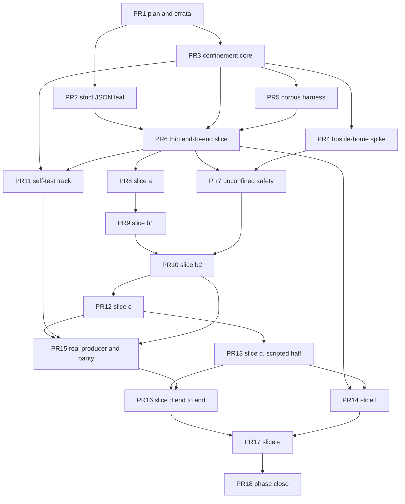

# Grade Command - Plan

This plan covers phase 3 of the [engine plan](2026-11-21-engine-plan.md). Its own ids start with G: GR for requirements, GKD for product decisions. A bare R, AE, A or F number is an entry in [the requirements](../requirements.md). Q ids are clauses of the sealed conformance collection specification, `docs/specs/conformance-collection-1.0/`; X, N, E and R ids after "judge rule" are the judge rulebook's.

## Goal Capsule

- **Objective:** A person can grade a subject with `pql grade` and trust the result as far as the synthetic subject proves it: every case of the sealed collection corpus gives the record and exit code the specification fixes, and the known-good subject is green and exits zero.
- **Means:**
  - **First week:** the strict JSON leaf, the confinement core on macOS and the corpus harness.
  - **Then:** a thin end-to-end slice, then the six slices beside a macOS track that builds the real producer.
  - **Proof:** a corpus runner drives every case through the real `grade` command, the real producer is checked against the sealed recordings, and a rule ledger maps every rule to its proof (KTD1, KTD2, KTD22).
- **Authority:** the sealed judge specification 1.0 and conformance collection specification 1.0 with its errata note, then `AGENTS.md` and `CODING_STANDARDS.md`, then this plan. An input the sealed text can honestly read two ways goes to the owner with both readings (GR6).
- **Stop conditions:**
  - a change that would need judge 1.1 or collection 1.1, including a launcher that cannot start under the unchanged QH11 template by 2026-12-04 (U21);
  - a corpus case the engine cannot meet without departing from the text;
  - a confinement rule that fails on macOS 27.2.
- **Execution profile:** Deep. Eighteen pull requests (Implementation Units). A coding agent writes the code and the Linux-runnable tests from a brief per unit. The main session writes briefs, reviews, and runs every macOS test outside any sandbox (KTD19).
- **Who finishes:** the executing session opens each pull request and stops. The owner merges, or the session merges on the owner's say-so.
- **Dates:** phase 3 done by 2027-01-16, ahead of the halfway check on 2027-01-25 (engine plan §6). Each date is a merge target.

  | Pull requests | Merge target |
  |---|---|
  | the plan | 2026-11-25 |
  | the leaf, the confinement core and the corpus harness | 2026-12-01 |
  | the launcher stop rule falls | 2026-12-04 |
  | the hostile-home spike and the thin end-to-end slice | 2026-12-08 |
  | unconfined safety, slice a, slice b1, and the macOS self-test track | 2026-12-14 |
  | slice b2 and slice c | 2026-12-18 |
  | the scripted half of slice d, slice f, and the real producer with parity; first private scoring | 2026-12-23 |
  | slice d end to end | 2026-12-30 |
  | slice e; second private scoring | 2027-01-08 |
  | the close | 2027-01-13 |

  The first week spans a public holiday, so 2026-12-08 for the thin slice is at risk if the confinement core runs to its stop date. The weeks of 2026-12-21 and 2026-12-28 are half buffer, and 2027-01-16 is kept spare. The owner settled every open reading on 2026-11-25 (errata E-3 to E-14).

---

## Product Contract

### Summary

`pql grade` reads a subject file, fixes the required set, collects evidence under confinement, builds the evidence record, calls the judge through the same function `pql judge` uses, stores the run, prints a scorecard and exits with the code the judge's output gives.

It is built in the six slices the engine plan names, on a thin end-to-end slice, after a first week that proves the riskiest parts. That week proves the judge's JSON boundary, the Go launcher under the frozen profile, and the corpus harness. A macOS track builds the real producer beside the slices and checks it against the sealed recordings.

A Go corpus runner assembles every corpus case and runs it through the scripted build in CI. The three real-verifier cases and the confinement evidence run on a local macOS 27.2 machine. The build is scored against the private half of the corpus twice.

### Problem Frame

The judge decides a finished evidence record, and phase 2 sealed how that record is produced. Nothing yet produces one, so the engine cannot grade anything, and phase 4's first real grade cannot start until it can.

The trial behind the engine plan found every judge build wrong at its JSON boundary and nowhere else. The engine plan's largest risk is a collector that is weaker than the judge because its corpus is new: wrong evidence that the judge then grades faithfully (engine plan §7).

Phase 4 then runs a real, untrusted CLI on the owner's machine. The confinement, and everything the engine does unconfined around it, must hold before that run.

### Requirements

**Outcome**

- GR1. Every public case of the collection corpus passes through `pql grade` or `pql anchor` as QE19 defines a conforming collector, with the exit code the case expects: the scripted cases in CI on Linux, and `case-069`, `case-070` and `case-143` in a local run on macOS 27.2.
- GR2. The known-good synthetic subject grades green and exits zero (`case-001` scripted, `case-069` real).
- GR3. The exit code, the scorecard and the stored record of every run are read from the judge's one output document, through the bytes-in, bytes-out function `pql judge` exposes (engine plan §4 rule 1, QE14, AE21).
- GR4. A record the judge rejects ends the run with exit 70 and is kept (QE15).
- GR5. The build is scored against the private half of the corpus with zero wrong records, and, as the private harness measures it, no seeded collection mistake survives the build's own CI tests. Feedback to the builder names a rule id only.

**Specification authority**

- GR6. Every rule is built from the sealed text for every input its schemas allow. An input the text can honestly read two ways is reported to the owner with both readings, and the settled reading goes in the errata note or a new version, never in a workaround.
- GR7. The test entry is QT1 to QT6: a scripted verifier and host exist only in a build made with the `scripted` tag, and the released build rejects the scripted flags with the exit codes QT1 gives.

**The slices** (engine plan §5, phase 3)

- GR8. Slice a: the subject file, `pql create` and placeholders, proved by AE20.
- GR9. Slice b: command discovery and the six generated probes, proved by AE27.
- GR10. Slice c: authored checks, ordered runbooks, time budgets and computed expected values, proved by AE8, AE22 and AE23.
- GR11. Slice d: safety classes, scope and the no-network check with the real macOS verifier, proved by AE9 for conformance, AE24 and AE30.
- GR12. Slice e: the store's baselines, comparison and anchoring, proved by AE16 to AE19, AE31 and AE33 as far as collection 1.0's cases reach, with engine tests for the rest (errata E-3).
- GR13. Slice f: the scorecard, and agreement of exit code, scorecard and stored record, proved by AE21 and by the naming halves of AE8, AE20, AE23, AE24 and AE27.

**Confinement evidence**

- GR14. Each self-test program is shown necessary on macOS: a profile that grants only that program's operation makes the self-test fail. This runs as a test, never in a grade (QH9).
- GR15. Every rule a scripted run cannot break is proved by a local macOS run, stated in its pull request as `AGENTS.md` requires.
- GR16. Nothing the engine does unconfined around a subject (cleanup, inspection, scanning, rendering) acts on anything outside the throwaway directories it made, whatever the subject or a computation leaves in them.

### Key Decisions

- GKD1. **A thin end-to-end slice comes before slice a.** It runs `case-003`, `case-004` and `case-129` through `grade`, each stage only as wide as those cases need, so every later slice changes outcomes on a pipeline that already runs. The judge's JSON refactor lands first, in its own pull request. Governs GR1, GR3. (session-settled: user-approved — chosen over starting at slice a as the engine plan's table does; the split that keeps it thin was chosen after the gate's third pass over keeping one large pull request.)
- GKD2. **The corpus runner runs inside the existing CI checks.** It adds no new required check on `main`. Governs GR1. (session-settled: user-approved — chosen over a new CI job the owner would make required.)
- GKD3. **The harness assembles each case**, and `grade` takes only what QT1, the specification and GKD8 name (errata E-2). Governs GR1, GR7. (session-settled: user-directed — chosen over a scripted-build `grade` that takes a case directory.)
- GKD4. **The acceptance examples the corpus does not reach went to the owner first** (errata E-3). The owner decided on 2026-11-25 that no collection 1.1 is written for phase 3: slice e proves what 1.0's cases reach, engine tests cover the rest, and its pull request names what the corpus leaves unproved. Governs GR12. (session-settled: user-directed — chosen over drafting a 1.1 before slice e.)
- GKD5. **The build is scored against the private half, as phase 1 was.** Governs GR5. (session-settled: user-directed — chosen over the public corpus alone.)
- GKD6. **The launcher, the self-test programs and the known-fast control are hidden modes of the `pql` binary, written in Go,** and copied once per grade. Governs GR11, GR14, GR15. (session-settled: user-directed — chosen over embedding the spike's C programs.)
- GKD7. **Darwin-only code may use `golang.org/x/sys` as one reviewed dependency, with raw syscalls where it falls short, and no cgo,** so the Linux gate compiles and lints all of it. Governs GR11, GR15. (session-settled: user-directed — chosen over cgo and over the standard library alone.)
- GKD8. **The command line:** `pql grade <subject-file> [--scope conformance[,destructive]] [--baseline <file>]`; `pql anchor <subject-file> [--retired <file>] [--accept <file>]`; `pql create <binary>` (GKD11); the QT1 flags on both; the missing-id list written to the run's store directory; every rejection prints one stable line `pql: rejected: <rule id>: <cause>` on standard error, a subject-file or pre-check rejection with exit 2 and a record the judge rejected (QE15) with exit 70 and the judge's rule; `--scope` passes any comma-separated tokens to the judge, which rejects an unknown one under X1 (errata E-7); a command line that cannot be parsed exits 64 before any exit 2. Governs GR1, GR7. (session-settled: user-directed — chosen over deciding the command line at the end-to-end slice's review; the QE15 line and the scope reading were settled on 2026-11-25.)
- GKD9. **macOS evidence is taken on 27.2 only.** The phase close states 27.0.1 as unverified for phase 3, and the owner decides whether that stands. Governs GR1, GR15. (session-settled: user-directed — chosen over evidence on both supported versions.)
- GKD10. **The build order and its proof follow the bake-off's selected approach.**
  - The order: macOS risk first; recordings as the contract between running and deciding; a served-invocation check, a rule ledger and one package for unconfined file work.
  - What this plan's earlier version adds to it: the growth check, schema validation against an independent count, the violating-form replay and the total writer.
  - Governs GR1, GR5, GR14 to GR16. (session-settled: user-approved — chosen over the plan's earlier fifteen-PR order after a bake-off of four approaches, whose comparison is in the review log.)
- GKD11. **`pql create` takes the binary's path only.** It writes a subject file naming that binary, with a placeholder for every command, class, fact and setting, and never runs the subject. Governs GR8. (session-settled: user-directed — chosen over a confined help walk at create time.)

### Scope Boundaries

- Phase 4's real CLI, steering (phases 5 to 7) and any edit to a sealed folder are out.
- No collection 1.1 is written in phase 3 (errata E-3); `record.schema.json`'s `spec_version` stays `"1.0"`.
- Stated limits of collection 1.0, named in the documentation and never worked around: unbounded writes inside a home (errata E-13), and base64 matching of the canary only at its own alignment (errata E-14).
- AE9's steering half and AE18's steering entries belong to phase 6; collection 1.0's `prompts` holds only a version.
- Linux confinement is out: version 1.0 supports macOS only. On any other system, the real verifier gives every check that runs the subject `network_unverifiable` (QH1).
- No macOS runner is added to CI; macOS evidence comes from local runs (`AGENTS.md`).
- Stated limits from `CASES.md` and the specification, such as QH19 and QP14, are named as limits in the pull request that meets them and in the rule ledger, never given a test that cannot fail.
- Considered and not built: a store-location flag. QE17 fixes the store under the user's application-support directory, and tests isolate it through the home directory instead (KTD5). Build one only if a released-build user needs a second store.
- Considered and not built: comparing a case's whole judge input. QE19 leaves `expected` and `observed` to the collector, so the runner compares the fields QE19 names, the top-level fields and the whole judge output (KTD2).
- Considered and not built: a JSON Schema library in Go. Schema validation runs in `check.sh` through the pinned Python `jsonschema` the repository already uses (KTD15); build one only if a Go-side validation is needed at run time.
- Considered and not built: a fake `sandbox-exec` that replays recordings on Linux. QT3 says a scripted run starts no process, and it would prove no darwin behaviour.
- Stated limit: with the launcher being the whole `pql` binary (GKD6), a computation could run the private launcher copy if it found its path. The copy's folder name is random, and running it gives no more than the profile already allows; the plan states this in slice d rather than building around it.

### Deferred to Follow-Up Work

- Extending `internal/docrefs` to plan and spec citations of Q ids under `docs/`.

---

## Planning Contract

### Key Technical Decisions

- KTD1. **Eighteen pull requests, risk first (GKD10).**
  - **Order.** The first week merges the strict JSON leaf, the confinement core with its launcher stop rule, and the corpus harness. A hostile-home spike and the thin end-to-end slice follow. Then the slices run beside a macOS track that builds self-test and necessity, then the real producer, then slice d end to end. Slices f and e and the close come last.
  - **Parallel work.** Pull requests in the same week are written in parallel and merge in the order their Waits-on lines give. The precedence table's levels are cumulative (KTD11), so the slices merge in level order: slice a (level 2), slice b1 (levels 3, 5 and 7), slice b2 (the probes' level 8), then slice c (levels 4 and 6, and the predicates' level 8). Each level sits in its own file in `internal/decide`.
  - **Ratchet sets.** A case leaves the pending list when every level its checks pass through exists. Each slice's design note computes its ratchet set with a script that reads each case's checks against KTD11's trigger table and the levels built so far; the plan names only the anchor cases. Its pull request traces every case that passed outside the prediction to the rule that produced it, and diagnoses every predicted case still pending.
  - The engine plan requires at least one pull request per slice.
- KTD2. **The corpus runner is a Go test behind the `scripted` tag, with a two-sided ratchet and guards against vacuous passes.**
  1. **Finding the cases.** It finds the cases, asserts their number, and derives the real-verifier exclusions from `input.verifier`, asserting they are exactly `case-069`, `case-070` and `case-143`.
  2. **Assembling them.** It assembles each case as QT6 and E-2 say. The assembled directory must hold exactly QT6's entries and never a case's `case.json`, `input.json` or `preimages.json`. The run's home and working directory sit outside it (QS8). It then runs the scripted `pql grade` or `pql anchor` as `input.request` says.
  3. **An independent decoder.** It decodes stored records and case files with `encoding/json` and `UseNumber`, never with the engine's own reader, so a reader defect cannot cancel out on both sides.
  4. **Judge-checked cases.** For a judge-checked case off the pending list, it requires a stored record and compares:
     - the QE19 fields;
     - the judge input's top-level fields other than `required` and `evidence`;
     - `required` and `evidence` as QE19 says, after sorting by check id;
     - the process's exit code;
     - the whole judge output.

     Lists in the judge input are compared as multisets, since the judge contract gives input order no meaning. It then re-judges the stored input with `pql judge` to confirm the stored output. A compared field absent on both sides is a failure.
  5. **Derivation-only cases.** For a derivation-only case it requires the process's exit code, no stored record, and the rejection line's rule (GKD8) equal to `expect.rule`.
  6. **The trace and the served-invocation check.**
     - The scripted build reads a trace path from an environment variable only it knows, outside the workspace. It appends the required set before collection, each invocation key the scripted source serves, and each home the workspace creates.
     - For every case, the served keys must be a subset of the case's `invocations` field. QT6 defines that field as every invocation the record names or implies, runbook steps included, and as empty for a derivation-only case. A derivation-only case must also show no home made.
     - That field also names invocations a not-observed check would have used (QE8), so the subset alone cannot catch a run that should not have started. The runner therefore also requires, from the case's host and subject file:
       - zero served keys and zero homes when confinement was not applied, the self-test failed, the private copy changed, or the binary is a placeholder;
       - only discovery's help requests when the seed or the store is a placeholder (QS5);
       - no key served only for checks the case expects as `earlier_step_failed` or as `placeholder_unfilled` because QS5’s level-2 dependency rule stops them from running, excluding QS5’s final override;
       - no computation served whose capture the case's evidence shows cut (QA4).
     - KTD12's symbol check keeps the trace out of the released binary.
  7. **The pending list.** A checked-in list names the cases not yet expected to pass. Every case off it must pass, and every case on it must still fail.
     - From slice a on, a separate layer requires every judge-checked case's required set, read from the trace, to equal `input.json`'s `required`.
     - A `check.sh` step compares the list with its version at the base commit as a set. It fails on any entry added and on the list's removal. The list may be absent at the base only when the base also has no corpus runner, which is true once.
     - In CI the `cases` job fetches full history and is given the pull request's base, or the push's previous commit on `main`, and a missing base commit is a failure. A local run defaults to the merge base with `origin/main` and says so.
  8. **A mismatch.** A mismatch is first a hypothesis about the case: re-derive the record from the text, the recording and the case's preimages before changing code (`docs/solutions/best-practices/judge-agreement-does-not-validate-a-case-record.md`).
  9. **The macOS mode.** In its macOS mode, behind KTD19's evidence tag, it:
     - builds the released `pql`;
     - builds the known-good form and checks its source digest against the recording (QT6, as `internal/collectionkit/subject_test.go` does);
     - runs the three real-verifier cases under KTD18's repeat rule;
     - reports them not run on a system QH1 does not name.

  The list is empty when phase 3 is done.
- KTD3. **The strict reader's grammar, the value types, exact equality and the contract writer move into a leaf package, `internal/strictjson`, which the judge imports.**
  - **What the leaf exports:** a grammar-and-limits reader that takes the caller's bounds and an opaque per-node hook, which decides whether to keep, discard or only note a value; the value types; `equalJSON` and `normalize`; and the writer.
  - **What the judge keeps:** `shape`, `inputShape` and its table of what to keep, so its streaming read stays within the allocation cap `internal/judge/review_memory_test.go` sets.
  - **Other readers.** The subject file (QS2), host and recording (QT1), computation output (QA6) and the predicates (QA9) read through the same grammar with their own bounds. Each validates its own shape after parsing, in its own package. QA9 compares with the exact-decimal `equalJSON` and `normalize`, never canonical bytes.
  - **The writer** is not RFC 8785 and never panics on a valid value:
    - an integer within 64 bits is written as today, so `-0` is written `0`;
    - a longer integer is written by its digits, with the sign dropped when every digit is zero;
    - any other number is written in the form it was read;
    - any string-kinded value is written as its string.

    It offers a length function for QE10's bounds.
  - **Exports from the judge.** `internal/judge` exports `ScopeIncludes` and `AlwaysApplicable`, built on its existing exhaustive switches and used by the judge itself.
  - **Guards.** The move changes no judge output. The judge's published cases, its tests and a re-run of its private scoring guard it, and any later change under `internal/strictjson` re-runs that scoring (U3).
- KTD4. **RFC 8785 lives in `internal/jcs`, above `internal/strictjson`.** It is used for QE2's check ids and seed digest, and for QS11's canonical-form size and round-trip rules. Its oracles are QE2's four worked ids, each case's `preimages.json`, and vectors generated once by `scripts/collection_ids.py` and checked in, so `go test` needs no Python.
- KTD5. **Durable store and per-run workspace are separate.**
  - **Durable store (QE17).** It is the user's configuration directory, resolved only in `cmd/pql` after QH3's root refusal and passed down; on macOS that is the application-support directory.
    - Records, baselines and missing-id lists are written there by temporary file and rename at mode 0600, keyed by a digest of the subject file's canonical path.
    - An existing store directory's mode is checked.
  - **Per-run workspace (QE20).** It holds homes, scratch and private copies, and `internal/throwaway` alone creates and handles it (KTD20).
    - It lives under the canonicalised system temporary directory, in a user-owned 0700 parent checked with `Lstat`.
    - It is published atomically by renaming in a process-id file, which also records each live process group's id and start time.
  - **Startup sweep.** It matches only that name pattern, never follows a link, and checks the process id and start time. It ends any recorded group still alive before it removes anything.
  - **Tests.** Each run gets its own home and `XDG_CONFIG_HOME`, and a guard fails if a test reaches the developer's real store.
  - A record is stored only once one exists.
- KTD6. **The real-verifier cases run on the released build.** QT1 puts the scripted verifier only in a scripted build, and the real path is the released build's.
- KTD7. **The necessity demonstration renders its one-grant profiles behind a separate test-only build tag.** `grade` renders only QH11's fixed template from a closed set of variants with no free-text hook; the gate checks that no released or scripted binary holds the test-only renderer.
- KTD8. **A scripted run records the host it actually ran on.** `record.schema.json` requires the host fields and QT3 checks no version, so a Linux run writes Linux's values, read from `uname` on Linux and from sysctls on darwin.
- KTD9. **A pre-check refusal does not stop collection; a rejection does.** QE5 stops a run on a rejection, and `case-071` fixes that an anchor's refusal (judge rule N1) still gives full evidence and exit 5.
- KTD10. **A scripted run's tiers are all `scripted` (QT2), so QE9's offline and live tiers are proved by unit tests and the real-verifier cases.** `case-148` fixes that QT2 takes precedence.
- KTD11. **Packages follow engine plan §4, with leaves added, and the import direction is enforced.**
  - **The packages:**
    - `internal/strictjson` and `internal/jcs`;
    - `internal/observe` (the seam's types);
    - `internal/subject`;
    - `internal/plan` (pure: ids, the required set, crediting, invocation keys in QT5's shape, the layout of targets);
    - `internal/decide` (pure: the precedence table and the per-check rules);
    - `internal/collect` (the one collection loop);
    - `internal/scripted` (tagged) and `internal/confine` (the darwin real source; its other builds report QH1);
    - `internal/throwaway` (KTD20);
    - `internal/record` (builder, masking);
    - `internal/store` and `internal/scorecard`;
    - `internal/grade`, which owns the run's one path and its one exit funnel.

    `create`, `grade` and `anchor` sit on the existing Cobra root and call `internal/grade`.
  - **The directions.** `collect` imports `observe`, `plan` and `decide`, and never `store` or `judge`. Only two files under `cmd/pql` choose between `scripted` and `confine`.
  - **The precedence table.** `decide` holds `collection-rules.md` §2's order as one table, one level per step and one file per level, and QS5's final override. The loop records only facts such as "skipped after step N"; `decide` alone assigns a reason. A check that no earlier level decides passes through every later level, in order.
  - **Unbuilt levels.** Each level names a trigger: a fact that holds whenever the level could apply. A level not yet built ends the run with exit 70, naming its rule, when a check reaches it and its trigger holds or cannot be ruled out; otherwise the check passes on. So an unbuilt rule is an engine fault, never a pass. The triggers:
    - level 2: the check depends on a placeholder (from the required set);
    - level 3: the check is a generated check, since QD4 governs no authored check;
    - level 4: the check is a runbook step with an earlier step;
    - level 5: always, since any private copy can change;
    - level 6: the check has a computation or a capture;
    - level 7: always, for any check with an invocation;
    - level 8: always.

    Level 7 decides a check with one invocation directly. Discovery and the planted-secret probe have several, and QO7 orders them: their own rules in U11 and U37 call level 7's per-invocation helper (QO1 to QO4, and an engine kill as `harness_fault`), in QO7's order. A crash or an unsuccessful exit there is QD5's or proves no read, never QO5's.

    A test at the close asserts that no unbuilt level remains.
  - These are the collection specification's evidence rules, not verdicts: the judge still decides requiredness, rollups, comparison and every verdict.
- KTD12. **The gate checks tagged and macOS code on Linux, within its time limit.**
  - **Tagged passes.** `gate.sh` adds `-tags scripted` passes of vet, staticcheck, errcheck and exhaustive across the module, and of test across the packages with tagged files.
  - **Darwin passes.** It adds `GOOS=darwin` passes of build, vet, staticcheck, errcheck and exhaustive, with and without the `scripted` tag and KTD7's tag. It also compiles the `macos_evidence` tests with `go test -c`.
  - **The cgo check.** A step fails on any darwin file that imports `"C"`. Such files are found by `CGO_ENABLED=1 GOOS=darwin go list -f '{{.CgoFiles}}'` and a search of darwin files, since a Linux cross-build drops them silently (GKD7).
  - **The import guard.** It runs `go list -deps -test` for each of Linux and darwin and each tag set, with its environment set explicitly. It enforces:
    - Cobra only under `cmd/`;
    - `golang.org/x/sys` only in darwin builds;
    - KTD11's directions;
    - the tagged and untagged dependency lists of `cmd/pql` differing by at most `internal/scripted`, and by exactly that package once U6 lands.

    Its classifier is also tested on synthetic `go list` output.
  - **Other checks.** No scripted-only or test-only symbol may be in the released binary, and no `func init` may appear in the module. `GOFLAGS` keeps `-mod=readonly` beside each tag.
  - **Time.** The run time is measured in the confinement core, and the limit raised only if needed.
- KTD13. **The seam between the scripted and real paths is an interface, and every decision is untagged.**
  - **Three layers.** Raw facts are what a source returns: QT5's run object and QT4's control results, in those shapes. `observe` values are what untagged functions derive from them. Resolution is what `decide` assigns.
  - **The loop.** `collect` owns all sequencing: QD2's walk, runbook order, fresh homes, the controls, the planted canary from `crypto/rand` (QP10) and QP9's control copy. It calls `Source.Controls()` and `Source.Observe(key, spec)`.
  - **The scripted source** looks the key up in the recording and maps the recording's attributed end and the host's override back into raw facts. Only its reader may read the recording's attribution strings.
  - **The darwin source** only spawns, waits on kqueue, kills the group and reads files through `internal/throwaway`.
  - **Untagged derivations.** Every function from raw facts to `observe` values is untagged and tested on Linux with fakes. These include:
    - QH5 and QH7's marker parsing;
    - QH8's copy comparison;
    - QH24's bound;
    - QA6's parse;
    - QH21 and QO5's kill attribution from the raw end: the signal, whether the marker was seen, any kill the engine sent and when, the exit detail, and whether the program was still running at the budget.
  - **Guards.** A type-based guard fails on any tagged, darwin or unsupported-system file outside the scripted reader that refers to `observe` or `decide`'s outcome, reason or attribution values. A projection test checks that the scripted source's facts for every corpus recording and host serialise back to the recording's run and the host object, field for field. U32 compares real facts through the same serialiser.
- KTD14. **The launcher and the self-test programs are hidden modes of `pql` (GKD6).**
  1. **Selecting a mode.** A reserved first argument selects a hidden mode at the top of `main`, before Cobra. Its arguments are positional and fixed in number, so no subject word is read as a launcher option.
  2. **Initialisation.** No package in `pql`'s import graph does work at initialisation that the frozen profile kills.
     - A checked-in list of `GOOS=darwin go list -deps ./cmd/pql` fails the gate on any change.
     - A Linux gate test compares the package names in `GODEBUG=inittrace=1` output for the launcher mode with a checked-in list.
     - A guard fails if `crypto/x509`, `crypto/tls` or `net/http` enter `cmd/pql`'s darwin dependencies; `net` is allowed because Cobra's pflag imports it; on darwin it has no `func init`, and macOS launcher evidence covers its initialisation, while the inittrace list covers Linux.
     - Any pull request that changes either list re-runs U21's launcher check on macOS.
  3. **The marker and the exec.** The marker is drawn from `crypto/rand` per invocation and passed in the arguments, since QH12 allows nothing else through the environment.
     - The launcher writes the marker as the first line of standard error and strips its own arguments.
     - It closes every descriptor above 2 in a loop up to `RLIMIT_NOFILE`, never by listing `/dev/fd` (QH13).
     - It then replaces itself with the program, keeping its process id (QH4).
  4. **The could-not-start marker.** If the replacement fails, the launcher writes the could-not-start marker, which carries the same per-invocation value, as the line directly after the marker. It then exits with its reserved code and writes nothing more (QH7). The engine honours it only there. Both marker lines are stripped before any count, digest, keep or scan.
  5. **Self-test programs.** They make raw `golang.org/x/sys/unix` calls (socket, connect, sendto, bind, kill, sysctl and the like), never the `net` or `os/exec` packages, whose option calls the profile kills. They print each call's result. Their targets are decoys only, with a process id above 0.
  6. **The private copy and the command surface.** The private copy's folder name inside the run directory is random. The hidden modes are part of the released command surface U2 tests.
- KTD15. **Schema oracles come from the specification, not the code.**
  - **Readers.** Each reader rejects every file in `examples/invalid/` that targets its schema, with the rejection line naming the rule in the example's file name. Boundary tests take each limit ± 1 from the schema files.
  - **Record copies.** `check.sh` makes a fresh directory with `mktemp -d`, names it to the corpus runner through an environment variable, and runs the runner with `-count=1`. The runner copies each stored record and baseline there.
  - **Validation.** A `check.sh` step then validates those files against `record.schema.json` and `baseline.schema.json` with the pinned Python `jsonschema`. It fails unless their number equals the number of scripted judge-checked cases off the pending list, which it counts itself from the corpus and the list, never from the runner. It also fails on any record the judge rejected, since no corpus case leads to one (`CASES.md`).
  - The step sits outside the span `scripts/check-draft.py` reads.
- KTD16. **A run's bytes take one path, owned by `internal/grade`.**
  - **Order.** Build, mask (QE18), bound (QE10, using the contract writer's length function), serialise once, judge, then store those exact bytes. The scorecard renders from the stored record.
  - **Exit-code cross-check.** The run takes its exit code from the judge output's `exit_code` field. If that differs from the code the judge function returned, the run exits 70.
  - **Masking.** It applies to captured bytes before any head is cut, so a value that straddles the 64 KiB head edge or QE10's digest cut is masked. One §4 encoder serves masking and the leak scan.
  - **Interim fields.** Until U18, the stored record's `next_actions`, `offline_settings` and `bookkeeping_excluded` are empty lists, which no case compares (QE12).
  - **Escaping.** Every value from the subject or the subject file passes one escaping function before it reaches a terminal or standard stream: in the scorecard, in an error and in the exit funnel, whether or not the stream is a terminal.
    - It covers C0, DEL, C1, ESC, bidirectional controls, other format characters, U+2028, U+2029 and the tag characters.
    - Masking runs before escaping.
    - No subject-file value is quoted in a rejection line's cause.
- KTD17. **Every panic and every interruption ends in the one exit funnel.**
  - **Panics.** The grade and anchor commands recover a panic on the main goroutine, and every goroutine the engine starts recovers its own, as an engine defect, exit 70. An unrecovered panic would exit 2, the code for a rejected request (`CODING_STANDARDS.md`, Judge and evidence code).
  - **Signals.** SIGINT, SIGTERM, SIGHUP and SIGQUIT end every live process group, then clean up, and the run exits 70 (errata E-6).
  - **The funnel.** It ends live groups (QH23) and runs QE20's cleanup on every exit.
- KTD18. **macOS evidence runs on 27.2 with automatic updates off (GKD9).**
  - **The evidence script.** It runs every `macos_evidence` test with `go test -json`. It fails if any test the rule ledger (KTD22) names did not run, skipped or was not evaluated, or if the system is not 27.2.
  - **What a run records:** the commit, the version and build, the command and the log's SHA-256.
  - **What the pull request carries:** the summary and the log's SHA-256. A log attached in full first passes `scan.sh`'s home-path and secret rules and has the host name removed.
  - **When it is taken:** once per pull request, on its head after every unit lands.
  - **Repeats:** scenarios that depend on timing or access times repeat 25 times and pass only 25 of 25, as the spike's did. The three real-verifier cases are among them. A repeat that is not evaluated fails.
  - **At the close:** the full evidence suite and the self-test checks run again on the exact commit phase 4 will use.
- KTD19. **Coding agents never run macOS tests, and nothing runs them by default.**
  - **Why.** Codex runs inside a macOS sandbox, where every confined run exits 71 (QH6).
  - **The tag.** Every test that starts `sandbox-exec` sits behind one opt-in tag, `macos_evidence`, so `go test ./...` and `gate.sh` on a Mac never start one.
  - **Who runs what.** A darwin unit's brief has the agent write the code and the Linux-runnable tests, and list the macOS tests it wrote but did not run. The main session runs the tagged tests with the tool sandbox disabled, or the owner runs them. Their failure output (the rendered profile, the parameters and the ends) becomes the next brief.
  - **Exit 71.** A brief that meets it reports an environment fault.
- KTD20. **One package, `internal/throwaway`, does all unconfined work on throwaway directories, and it never follows a link.**
  - **What it alone may do.** Create, copy into, inspect (QH25), scan, snapshot and remove the per-run workspace.
  - **The guard.** An AST test forbids `os.Remove*`, `os.Open*`, `os.ReadFile`, `os.Chmod`, `os.Lstat` and `filepath.Walk*` in collection packages outside an allow-list. A planted call in a fixture is its control.
  - **The walk.** Each throwaway directory is opened with `os.OpenRoot` and walked with `Root.Lstat`.
    - Before descending, the walk sets each directory to 0700 with `Root.Chmod`, which refuses to resolve a link out of the root.
    - It removes each child entry with `Root.RemoveAll`, then removes the directory itself from its parent's root.
    - It never opens a FIFO, a socket or another special file.
    - Walks are bounded in time and entries.
  - **Regular files.** Before a scan or a digest, a regular file in a used home may have its mode changed the same way. The profile kills `file-link` and `file-clone`, so no file in a home can share an inode with one outside it. An entry that still cannot be read is not observed with `harness_fault`, never held or unchanged (errata E-10).
  - **Darwin flags and access-control entries.** On darwin, U43 showed (`docs/spikes/2026-11-25-hostile-home.md`) that a subject can set user flags, deny ACL entries and mode 0000 together, and that no descriptor can be opened on such an entry. The package therefore acts on each entry by name, relative to its parent directory opened `O_DIRECTORY|O_NOFOLLOW`. It clears the flags and then the ACL with `setattrlistat` and `FSOPT_NOFOLLOW`, restores the mode with `fchmodat` and `AT_SYMLINK_NOFOLLOW`, and removes the entry with `unlinkat`. It never acts through a descriptor on the hostile entry itself.
  - **When cleanup fails.** The run exits 70, the scorecard names the directory left behind, and the next sweep retries it (errata E-11).
  - **Where it is tested.** The walk is untagged and tested in CI; the flag and access-control half is tested on macOS (GR16).
- KTD21. **Until slice d end to end, the released real path never starts a subject or a computation.** From the thin slice, a released `grade` or `anchor` gives every required check `network_unverifiable` (QO1, errata E-15) and still reaches the judge, as it must on any system QH1 does not name. It starts no subject and no computation. U35 replaces this with the real verifier.
- KTD22. **A rule ledger maps every binding rule to its proof.**
  - **The ledger test.** It is written in the style of `internal/docrefs`. It extracts every binding rule id, QS1 to QT6, from the sealed files, and requires each to map to one or more of:
    - a named test function;
    - a named `macos_evidence` test;
    - a stated limit with its proof route, from `CASES.md`'s list of rules that are not expressible or not cited.

    Every rule GR15 covers, each rule a scripted run cannot break, needs a `macos_evidence` entry, whatever else it maps to.
  - **The list of unmapped rules.** A checked-in list names the rules not yet mapped. It can only shrink, under the same growth check as the pending cases, and it is empty at the close.
  - **Its control.** Removing one mapping is its planted-defect control.
  - **Per pull request.** Each pull request records, for each rule it maps, the mutation that broke the rule and the test that failed (`CODING_STANDARDS.md`, Tests).

### Sequencing

### Assumptions

- The private half and its scoring harness are reachable on the owner's machine, as they were for phase 1. The owner confirmed on 2026-11-25 that the harness can score a collector build through the binary contract: the scripted build, the store isolated through the home directory, and the stored record. A party other than the build session runs it.
- A machine running macOS 27.2 with automatic updates off is available for each pull request that needs local evidence. It matches the recordings' build 26B123 closely enough for parity, and the main session can run commands there with the tool sandbox disabled (KTD19).
- The owner is available for rulings and merges through the holiday weeks, which the dates treat as half buffer.

---

## Implementation Units

**Before the build.** From the thin slice to slice e, each pull request first gets a short design note. The note names its evidence rules, its predicted ratchet set, the rules it moves off KTD22's list, and its controls. It is reviewed through the measurement lens in design mode, and the build waits on that review.

**After the build.** Each pull request then runs the peer-review gate on its diff.

**Briefs.** Each unit brief gives the exact `go test` command for its tests, with `-tags scripted` where they need it, written to fail first. It also names the test seams it injects: effective user id, system version, clock.

### PR1: plan and errata

Waits on: nothing.

### U1. Errata entries E-2 to E-14

- **Goal:** the owner's readings of 2026-11-24 and 2026-11-25 are on record beside the sealed folder.
- **Requirements:** GR6, GR12.
- **Dependencies:** none.
- **Files:** `docs/specs/conformance-collection-1.0-errata.md`.
- **Approach:** E-2 states both readings of QT6 and the owner's choice; E-3 lists AE16, AE19's anchoring parts, AE31 and AE33 and records the owner's decision against a 1.1; E-4 to E-12 record the readings the build needs; E-13 and E-14 record two stated limits.
- **Test expectation:** none -- a documentation note; the citation test checks its ids.
- **Verification:** the gate passes, and the note changes no case's record.

### PR2: the strict JSON leaf

Waits on: PR1, merge order only.

### U3. The strict JSON leaf, exact equality and the judge's tables

- **Goal:** every input read under the judge contract's §3 uses one grammar, QA9 compares exactly, the writer is total over valid values, and the judge's scope and applicability rules are exported once.
- **Requirements:** GR6.
- **Dependencies:** none.
- **Files:** `internal/strictjson/` (new), `internal/judge/json.go`, `internal/judge/statistics.go`, `internal/judge/requests.go`, `internal/judge/results.go`, their tests.
- **Approach:** KTD3.
- **Test scenarios:**
  - a document over its size bound, with a repeated key, a lone surrogate, too deep, or with trailing content is refused exactly as `pql judge` refuses it, and a caller's own bound applies (QA6's 1 MiB);
  - `TestUnusedValuesMemory` still holds;
  - `9007199254740993` and `9007199254740992` compare unequal, and `1`, `1.0` and `1e0` equal;
  - a 21-digit integer and a 32-digit one serialise without a panic and read back equal;
  - an anchor whose baseline holds an out-of-scope prompt entry with `k: -0` writes `0`, and a writer mutated to pass numbers through turns the test red;
  - `ScopeIncludes` and `AlwaysApplicable` match the rulebook's §6 text, written as literals.
- **Verification:**
  - the `cases` step and the judge's tests pass with no judge output changed;
  - phase 1's private judge scoring and seeded-mistake catalogue are re-run on this build. They show zero wrong outputs and no surviving mistake, and report how many mistakes were evaluated out of the total;
  - a mistake that can no longer be placed at its site blocks the pull request unless the owner waives it by id;
  - the pull request reports counts only.

### U22. RFC 8785 canonicalisation

- **Goal:** one RFC 8785 implementation serves check ids, the seed digest and QS11.
- **Requirements:** GR1.
- **Dependencies:** U3.
- **Files:** `internal/jcs/` (new), its tests and checked-in vectors.
- **Approach:** KTD4.
- **Test scenarios:** key order by UTF-16 code units; number spelling; `\b` and `\f` escapes; each against the checked-in vectors.
- **Verification:** QE2's four worked ids are reproduced.

### PR3: the confinement core

Waits on: PR1, merge order only. Runs beside PR2 and PR5. The launcher stop rule falls on 2026-12-04. If the launcher cannot write its marker and run the known-good form by then, no other real-path pull request proceeds, and the owner is told the same day.

### U42. The tagged and darwin gate

- **Goal:** the gate checks tagged and darwin code before any of it lands.
- **Requirements:** GR7, GR15.
- **Dependencies:** none.
- **Files:** `gate.sh`, `internal/importguard/importguard_test.go`, the checked-in darwin dependency list.
- **Approach:** KTD12 and KTD14.2's dependency list; KTD19's `macos_evidence` tag; the module-wide ban on `func init`.
- **Test scenarios:**
  - each of these fails the gate in Linux CI: a planted unvetted line in a tagged file and in a darwin-only file; a cgo file under darwin; a Cobra import in a darwin file; a `func init`; a `macos_evidence` test that does not compile;
  - the `x/sys` rule fires on synthetic `go list` output;
  - a changed darwin dependency list fails the gate.
- **Verification:** the gate's tagged and darwin passes run within its limit, and each planted defect turns them red.

### U21. The launcher core on macOS

- **Goal:** the full `pql` binary's launcher mode starts under the unchanged QH11 template, and its known-fast control and clean programs show their outputs.
- **Requirements:** GR11, GR15.
- **Dependencies:** U42.
- **Files:** `cmd/pql/main.go` (the hidden-mode branch at the top of `main`), `cmd/pql/hidden.go` (new), `internal/confine/` (new; darwin files and untagged builders), a shared test helper that builds a synthetic form and checks its source digest, the checked-in initialisation list (KTD14.2), `go.mod`, `go.sum`, their tests.
- **Approach:**
  - **Launcher.** KTD14's launcher mode and markers, and the known-fast control mode.
  - **Profile.** QH11's template as one literal for both variants, with paths only as `-D` parameters, canonical with every link resolved (`docs/solutions/best-practices/sandbox-profile-later-rule-decides.md`).
  - **Dependency.** `golang.org/x/sys` added to `go.mod`.
  - **Form builds.** One test helper builds a synthetic form and checks it against `form_sha256`, as `internal/collectionkit/subject_test.go` does; U15, U8 and U32 reuse it.
  - **If the launcher needs an allowance the template lacks:** first rebuild with a minimal import graph to tell the runtime's needs from `pql`'s imports. If it still does, the stop condition fires.
- **Test scenarios:**
  - on Linux:
    - an unknown hidden-mode argument exits 64;
    - the template and its blocks, extracted from the code fences of `confinement.md`, equal the engine's fixed text byte for byte for both variants;
    - seed, declared and secret names holding quotes, parentheses and profile syntax leave the profile bytes unchanged and appear only as `-D NAME=value`;
  - on macOS, behind KTD19's tag:
    - the known-fast control runs 5 times under each profile within QH24's bound;
    - the launcher runs the known-good form's `--help`, and its standard output's digest equals the recording's;
    - a clean program's output equals its known value;
    - the marker differs between invocations.
- **Verification:** the Linux tests pass in CI, and the macOS tests pass on 27.2 as KTD18 says, with the first launch's latency recorded.

### U15. Private copies, spawn and ends

- **Goal:** the darwin source spawns each invocation from a checked private copy and reports its raw end and both markers, as QH4 to QH8 and QH21 say.
- **Requirements:** GR11, GR15.
- **Dependencies:** U21.
- **Files:** `internal/confine/` (darwin files), `internal/observe/` (new; the raw-fact types and the untagged marker parsing), their tests.
- **Approach:**
  - the private copy is made once per grade in a randomly named folder, and checked before each use, never silently remade;
  - spawning uses `/usr/bin/sandbox-exec` by absolute path;
  - the end comes from kqueue's exit detail and the process group's end (QH23);
  - an argument list too long for the system is an engine fault, never a fallback.
- **Test scenarios:**
  - on Linux: a forged marker, a could-not-start line without the per-invocation value, and a could-not-start line not directly after the marker are each not honoured;
  - on macOS, behind KTD19's tag:
    - the not-executable form gives both markers and reads as could not start;
    - a subject that execs the launcher copy with its own marker and a missing program does not read as could not start;
    - subject words such as `--`, `-D` and the mode token pass through unchanged;
    - a copy changed between uses fails its invocations;
    - a violator is killed, and a kill by the confinement and a crash give distinct raw facts.
- **Verification:** the Linux tests pass in CI and the macOS tests on 27.2.

### PR4: the hostile-home spike

Waits on: PR3, needed before this group can start. It merges the spike's record only.

### U43. What a confined subject can leave in its home

- **Goal:** before cleanup is designed, measure what a program under the unchanged subject profile can leave in its home, and whether a descriptor-relative walk can undo each thing.
- **Requirements:** GR16.
- **Dependencies:** U15.
- **Files:** `docs/spikes/` (the spike's record); the spike's code on its branch, which the record names by commit.
- **Approach:** a confined program tries each of these and the record says which succeed: `uchg` and `uappnd` flags, access-control deny entries, extended attributes, mode 0000 on files and directories, FIFOs, and socket files, and mode 0000 combined with `uchg` and a deny entry on one file and on one directory, where no descriptor can be opened to clear the flag. For each that succeeds, the record says whether the `x/sys` calls on a descriptor opened with `O_NOFOLLOW` can undo it. The spike also probes which socket options Go's `net` package sets.
- **Test expectation:** none -- a time-boxed spike; its record is the evidence.
- **Verification:** the record exists, states the macOS build, and scopes U40's darwin half.

### PR5: the corpus harness and the ledgers

Waits on: PR3, merge order only, since the runner needs the gate's tagged pass. Written beside PR2 and PR3. Every case starts on the pending list, and every rule on KTD22's list.

### U34. Case assembly for tests

- **Goal:** one test helper assembles a case's directory as QT6 and E-2 say, for the record tests and the corpus runner alike.
- **Requirements:** GR1.
- **Dependencies:** none.
- **Files:** a test-only package behind the `scripted` tag.
- **Approach:** QT6's entries, including `seed/`, `computations/`, `bin/subject` and `case-112`'s fixture; the run's home and working directory outside the directory (KTD2.2).
- **Test scenarios:** an assembled directory holds exactly QT6's entries; a case file never appears in it.
- **Verification:** every case assembles.

### U8. The corpus runner

- **Goal:** every corpus case runs through the scripted `grade` or `anchor`, with KTD2's ratchet and guards.
- **Requirements:** GR1, GR2.
- **Dependencies:** U34.
- **Files:** a new test package behind the `scripted` tag, its pending-case list, `check.sh` (KTD15's validation step and the growth check), `.github/workflows/ci.yml` (full history and the base commit for the `cases` job).
- **Approach:** KTD2, KTD5 and KTD15. The comparator and the trace reader are tested on fixture records and traces until `grade` exists.
- **Test scenarios:**
  - **The ratchet:**
    - a case off the list that fails, and a case on it that passes, each fail the runner;
    - a list with one entry added or swapped fails the growth check, and so do a removed list, a missing base in CI, and a list absent at a base that has a runner;
    - a list absent at a base with no runner passes.
  - **Planted mutations** are each caught: one per QE19 field (`outcome`, `reason`, `failure_kind`, `target_size`, `precondition_observed`, `tier`, a target's kind, id and tier, the `required` array), plus an extra and a missing evidence piece.
  - **Allowed variations** each still pass: shuffled evidence order, different `expected` and `observed` content (QE19), and permuted top-level input lists.
  - **Runner failures:** each of these fails the runner:
    - an empty case directory, a deleted stored record and a renamed field;
    - a wrong rejection rule;
    - a trace serving a key outside the case's `invocations`;
    - a loop mutated to call the source before levels 1, 2 and 5, so `case-003`, `case-060` or `case-061` serves keys its host or subject file forbids;
    - a derivation-only case whose trace shows a home made.
  - **Validation step:** fewer records than its own count fails it.
  - two cases run back to back never share a store, switched on in PR6 once the store exists.
- **Verification:** the runner runs in the gate and in `check.sh` with every case pending, and each planted defect turns it red.

### U45. The rule ledger

- **Goal:** every binding rule maps to its proof, and the list of unmapped rules can only shrink (KTD22).
- **Requirements:** GR6, GR15.
- **Dependencies:** none.
- **Files:** a test beside `internal/docrefs`, its list of unmapped rules, `check.sh` (the growth check over that list).
- **Approach:** KTD22.
- **Test scenarios:** a rule mapped to a test that does not exist fails; a removed mapping fails; an added entry on the unmapped list fails the growth check.
- **Verification:** the ledger runs in the gate with every rule unmapped.

### PR6: thin end-to-end slice

Waits on: PR2, PR3 and PR5, needed before this group can start. Each stage is only as wide as `case-003`, `case-004` and `case-129` need.

### U2. The command line

- **Goal:** `grade` and `anchor` exist with the command line GKD8 fixes, and the scripted build adds only the QT1 test entry.
- **Requirements:** GR7.
- **Dependencies:** U42.
- **Files:** `cmd/pql/main.go`, `cmd/pql/main_test.go`.
- **Approach:** GKD8; scripted files behind `//go:build scripted`, released-only tests behind `!scripted`.
- **Test scenarios:**
  - a released `grade` or `anchor` given any of `--verifier scripted`, `--host` or `--behaviour` exits 2, and an unknown `--verifier` value exits 64 (QT1);
  - a malformed command line exits 64 even with a scripted flag present (GKD8);
  - a scripted build given one or two of the three exits 2;
  - the released binary holds no scripted-only or test-only symbol.
- **Verification:** `go test ./cmd/pql` and its scripted pass succeed.

### U4. Subject file model and parse

- **Goal:** `grade` reads a subject file into the model the required set needs.
- **Requirements:** GR1.
- **Dependencies:** U3.
- **Files:** `internal/subject/` (new), its tests.
- **Approach:**
  - the shape of `schema/subject-file.schema.json` by hand on the shared grammar (KTD3, KTD15);
  - every violation the schema can detect names its rule:
    - a version that is not `1.0` names QS1;
    - a named rule takes precedence over QS2 where the schema also rejects the file (QT6);
    - the `examples/invalid/` files name theirs;
  - rules a schema cannot detect wait for U9.
- **Test scenarios:**
  - every judge-checked case's subject file parses;
  - `case-100` is refused as QS2 says, and `case-129` as QS1 says;
  - each `examples/invalid/` subject-file example is refused naming its rule.
- **Verification:** the model holds every field the required set needs.

### U5. Preimages and check ids

- **Goal:** the engine builds a check's preimage and id as QE2 says, for the slice's cases.
- **Requirements:** GR1.
- **Dependencies:** U4, U22, U34.
- **Files:** `internal/plan/` (new), its tests.
- **Approach:**
  - the preimage kinds `case-003` and `case-004` need, computation preimages with their `files` digests and multi-step `earlier` lists among them;
  - the seed digest, and the `files` digests over the assembled directory;
  - the bare binary's defaults, and QS7's offline arguments in preimages;
  - each invocation's key in QT5's shape, with QS7's appended arguments and environment, for every generated probe and runbook step; the loop uses only these keys;
  - the rest come with U39.
- **Test scenarios:** QE2's worked ids; for `case-003` and `case-004`, each preimage equals `preimages.json`.
- **Verification:** `go test -tags scripted ./internal/plan` passes.

### U33. The required set for the slice's cases

- **Goal:** the engine fixes the required set and its entries as QE3 and QE7 say, as far as `case-003` and `case-004` need.
- **Requirements:** GR1.
- **Dependencies:** U5.
- **Files:** `internal/plan/`, its tests.
- **Approach:**
  - QP1's probes and their placement;
  - the declared commands and runbooks those cases carry, with QA9's `empty_satisfiable`;
  - scope through `ScopeIncludes`;
  - the other required-set rules come with U39.
- **Test scenarios:** for `case-003` and `case-004`, the required set equals `input.json`'s `required`.
- **Verification:** `go test -tags scripted ./internal/plan` passes.

### U23. The seam, the loop and the precedence table

- **Goal:** KTD13's seam and loop and KTD11's precedence table exist before any rule beyond QO1 does.
- **Requirements:** GR1, GR6.
- **Dependencies:** U15, U33.
- **Files:** `internal/observe/`, `internal/collect/` (new), `internal/decide/` (new), their tests.
- **Approach:**
  - the `observe` values and the `Source` interface;
  - the untagged loop;
  - `decide`'s table with level 1 (QO1) built and every other level as KTD11's unbuilt sentinel;
  - KTD13's guard and projection test.
- **Test scenarios:**
  - a check that reaches an unbuilt level ends the run with exit 70, naming that level's rule;
  - a tagged or darwin file outside the scripted reader that names an `observe` or `decide` outcome, reason or attribution value fails the guard.
- **Verification:** with an injected failed self-test fact, `case-004`'s 29 checks resolve to `network_unverifiable` at level 1.

### U6. The scripted source

- **Goal:** a scripted run turns its host and recording into raw facts (QT3 to QT5), and writes KTD2.6's trace.
- **Requirements:** GR7.
- **Dependencies:** U3, U23.
- **Files:** `internal/scripted/` (new, behind the tag), its tests.
- **Approach:**
  - hand shapes for the `host` subschema and `schema/behaviour.schema.json` (KTD15);
  - QT4's attribution and QT5's agreement mapped into raw facts;
  - a recording that lacks an invocation the record needs is an engine fault (exit 70).
- **Test scenarios:**
  - every corpus host and recording reads, and the projection test holds for each;
  - each `examples/invalid/` host and behaviour example exits 2, and so does a host or recording that is unreadable, refused under §3, or breaks QT4 or QT5;
  - a missing invocation exits 70;
  - the trace lists the required set, once it is fixed and before any baseline or anchor input is handled, then each served key and each home.
- **Verification:** every scripted case's host and recording load.

### U46. The throwaway package

- **Goal:** `internal/throwaway` alone creates and removes the workspace, with KTD20's walk and guard, before any probe inspects a home.
- **Requirements:** GR16.
- **Dependencies:** none.
- **Files:** `internal/throwaway/` (new), the AST guard test, their tests.
- **Approach:** KTD20's walk and guard; the darwin half comes with U40.
- **Test scenarios:**
  - a link inside a home to an outside directory of mode 0555 holding a file leaves that target unchanged, and replacing the no-follow change with `os.Chmod(path)` turns the test red;
  - a mode-0000 directory and a FIFO inside a home are removed without the FIFO being opened;
  - a planted `os.RemoveAll` in a collection package fails the guard.
- **Verification:** the tests pass in CI.

### U17. The durable store and the workspace

- **Goal:** every run's record is stored as QE17 says, and the per-run workspace is made and published safely.
- **Requirements:** GR3, GR4.
- **Dependencies:** U3, U46.
- **Files:** `internal/store/` (new), its tests.
- **Approach:**
  - KTD5 and KTD16; QE17's modes and R27; a rejected record kept (QE15); QE20's workspace and sweep through `internal/throwaway`;
  - the stored record's own fields, as `record.schema.json` and QS4 give them: `record_version`, `spec_version`, `host` (KTD8), `subject_file_path`, `subject_file_digest`, `binary_digest`, `seed_digest`, `request`, `scope`, `exit_code`, `judge_input`, `judge_output` and `judge_rejected`.
- **Test scenarios:**
  - file and directory modes; an existing store directory with a wrong mode;
  - a stale run directory swept, and a link, a foreign directory and a directory without its published process-id file left alone;
  - a test that would resolve the developer's real store fails;
  - a store write that fails after the judge has decided exits 70, with the scorecard's note (errata E-4);
  - a record the judge rejected is stored with `judge_rejected: true` without validating against the record schema (errata E-5).
- **Verification:** every run the corpus runner makes that reaches a record leaves a stored record under that run's home.

### U7. Record builder

- **Goal:** the engine builds the judge input from the precedence table's results.
- **Requirements:** GR3.
- **Dependencies:** U23.
- **Files:** `internal/record/` (new), its tests.
- **Approach:**
  - QE7 to QE10:
    - required entries and evidence;
    - targets in QE8's order, with errata E-1;
    - tiers, with KTD10;
    - QE10's bounds through the length function, and an unfittable record ending the run with exit 70;
  - the top-level fields `request`, `scope`, `claimed_tier`, `subject_facts`, `markers`, `baseline`, `retired`, `accepted_regressions` and `trials`, as QE9, QE11 and QS4 give them.
- **Test scenarios:**
  - each target kind;
  - QE10's bounds at their limits, and an unfittable record exiting 70;
  - each top-level field for `case-004`.
- **Verification:** `case-004`'s judge input matches `input.json` under KTD2.4.

### U25. The grade pipeline, pre-check, judge call and exit code

- **Goal:** `internal/grade` runs the pre-check, collects, calls the judge, stores and exits with QE16's code, through one exit funnel.
- **Requirements:** GR3, GR4.
- **Dependencies:** U2, U6, U7, U17.
- **Files:** `internal/grade/` (new), `cmd/pql/main.go`, their tests.
- **Approach:**
  - QE5 and QE6 with KTD9;
  - KTD16's path and its exit-code cross-check;
  - the judge called through `judge.Safe(judge.Judge, …)` for the pre-check and the final call, under QE14 and QE16;
  - QH3's root refusal before the store or the sweep;
  - KTD17, and KTD21's released real path;
  - GKD8's rejection line, with a pre-check rejection naming QE6 and the judge's rule in its cause;
  - KTD16's escaping in the exit funnel.
- **Test scenarios:**
  - a rejected record exits 70 and is stored (QE15), shown by a record the test makes the judge reject;
  - an injected judge that returns a doctored document makes the exit code, scorecard and stored record all follow it, and one whose `exit_code` field disagrees with its returned code exits 70;
  - a pre-check rejection the user caused exits 2, and one the engine caused exits 70 (QE6);
  - running as root exits 70 before any store is resolved;
  - a panic on the main goroutine and one in a collector goroutine each exit 70;
  - a released `grade` on any system starts no subject or computation process (KTD21). A sentinel `bin/subject` writes a file when run, and a positive control runs it directly and sees the file;
  - an error carrying a control sequence from a subject file reaches standard error escaped.
- **Verification:** `case-003`, `case-004` and `case-129` leave the pending list, with the derivation-only cases whose rule U4's checks name, among them `case-100`, `case-101`, `case-102` and `case-136`; the design note lists them. The rules they prove leave KTD22's list.

### PR7: unconfined safety

Waits on: PR4 and PR6, needed before this group can start.

### U40. Unconfined safety: the hostile home, the sweep and interrupted runs

- **Goal:** cleanup, inspection and the sweep act only inside the throwaway directories, whatever U43 found a subject can leave there, and a run that dies leaves no subject running unwatched (GR16).
- **Requirements:** GR16.
- **Dependencies:** U17, U25, U43, U46.
- **Files:** `internal/throwaway/` (darwin files for flags and access-control entries), `internal/store/`, `internal/grade/`, their tests.
- **Approach:** KTD20's darwin half, scoped by U43; KTD5's recorded process groups and the sweep that ends them; KTD17's signals.
- **Test scenarios:**
  - a home swapped for a link mid-cleanup deletes nothing outside it;
  - a 0000 directory swapped for a link between its `Lstat` and its mode change leaves the outside directory's mode unchanged;
  - a racing process that keeps swapping directories for links through a thousand walks changes nothing outside, by digest, mode and existence;
  - names with newlines and invalid UTF-8, and trees at QP13's bounds;
  - a cleanup that cannot remove an entry exits 70, names the directory, and the next sweep removes it (errata E-11);
  - SIGINT, SIGTERM, SIGHUP and SIGQUIT each end the live group and clean up;
  - a sweep after a killed `pql` ends the recorded group before removing its home;
  - on macOS, behind KTD19's tag, every hazard U43 found possible is removed, among them `uchg`, `uappnd`, a deny-delete access-control entry, and mode 0000 combined with `uchg` on one entry, where U43 shows them.
- **Verification:** the Linux tests pass in CI, and the macOS tests pass on 27.2 as KTD18 says.

### PR8: slice a, the subject file and placeholders

Waits on: PR6, merge order only.

### U39. The whole required set and every preimage

- **Goal:** the engine fixes every check's preimage, id and required entry for every judge-checked case (QE2, QE3, QE7).
- **Requirements:** GR1.
- **Dependencies:** U33.
- **Files:** `internal/plan/`, its tests, the corpus runner's `required` layer (KTD2.7).
- **Approach:**
  - every preimage kind and every invocation key, and QS5's candidate checks;
  - QA7's exclusion of destructive runbooks outside that scope;
  - QA3's crediting, with `credit-and-routes.md` §2's credit conditions;
  - QA9's `asserts_emptiness` and preconditions.
- **Test scenarios:** for every judge-checked case, each preimage equals `preimages.json` and the required set equals `input.json`'s `required`.
- **Verification:** `go test -tags scripted ./internal/plan` passes on all 121 cases, and the runner's `required` layer is on.

### U9. Subject file rules

- **Goal:** every rule of QS1 to QS12 rejects what it must before anything runs, and names itself.
- **Requirements:** GR8.
- **Dependencies:** U4, U22, U25.
- **Files:** `internal/subject/`, its tests.
- **Approach:**
  - QS1 to QS12, checked clause by clause, with QS11's size and depth checked on each parsed literal with `internal/jcs`;
  - QS7's names with QH12's, QP7's and QP10's rejections, QA4's capture names, and QA9's type and path rules;
  - QA5's warning on the terminal, in the help of `grade` and `anchor`, and in the README.

  A file that breaks two named rules names the first in the order errata E-9 gives, with QS2 named only when no other rule is broken (QT6). QS8's home is the account's home from the system's user record (errata E-8).
- **Test scenarios:**
  - one fixture per rejecting rule, from the specification's text. Each exits 2 with GKD8's line naming that rule, and quotes no subject-file value in the cause;
  - QS8's containment and QS9's seed-link rejection;
  - a literal near QS11's 64 KiB in RFC 8785 form, on each side;
  - the QA5 warning's text.
- **Verification:** the derivation-only cases still pending leave the pending list, each rejected by the rule its case names.

### U10. Placeholders and `pql create`

- **Goal:** `pql create` writes a subject file with a placeholder for every value it cannot know, and each placeholder gives the outcomes QS5 states.
- **Requirements:** GR8.
- **Dependencies:** U9.
- **Files:** `cmd/pql/main.go`, `internal/subject/`, `internal/decide/`, their tests.
- **Approach:** level 2 of the precedence table (QS5) and QS5's final override. `create` takes the binary's path only and never runs the subject (GKD11).
- **Test scenarios:**
  - through the scripted build with a passing host and a recording, `create` then `grade` on its output gives `placeholder_unfilled` exactly where QS5 says. The expected side is written from QS5, never from `create`'s code (AE20). If `create`'s output has checks that pass level 2, this test moves to the slice that builds their later levels;
  - each kind of placeholder gives QS5's outcomes in a unit test where its corpus case needs a later slice.
- **Verification:** `case-060` and `case-090` leave the pending list; the other placeholder cases leave it where their later levels land, as each design note computes.

### PR9: slice b1, discovery and the invocation outcome rules

Waits on: PR8, merge order only.

### U11. Command discovery

- **Goal:** the discovery check walks help as QD1 to QD6 say.
- **Requirements:** GR9.
- **Dependencies:** U10, U23.
- **Files:** `internal/collect/`, `internal/decide/`, their tests.
- **Approach:**
  - QD2's walk in the loop, with its bounds and order;
  - QD3, QD4 (level 3 of the precedence table) and QD5;
  - `credit-and-routes.md` §5's headings;
  - QO7's combination for discovery.
- **Test scenarios:**
  - each framework's headings;
  - the depth and cycle bounds;
  - a missing declared command (AE27);
  - help on stderr;
  - a hidden command.
- **Verification:** unit tests cover QD1 to QD6. Every discovery case carries runbooks and probe checks, so those cases pass from slice c.

### U44. The invocation outcome rules

- **Goal:** levels 5 and 7 of the precedence table decide each invocation's end, so later slices' cases can pass through them.
- **Requirements:** GR9, GR11.
- **Dependencies:** U23.
- **Files:** `internal/decide/`, `internal/observe/`, their tests.
- **Approach:**
  - level 5: QH8, a changed private copy giving `harness_fault`;
  - level 7: QO2 to QO5, from KTD13's raw end and attribution, with QO4's known-fast condition from the host (QH24). This unit owns QO5.
- **Test scenarios:**
  - a changed copy;
  - a binary that could not start;
  - a kill by the confinement, a budget kill and a crash told apart from raw facts;
  - a timeout with the known-fast control within and outside its bound.
- **Verification:** unit tests cover QH8 and QO2 to QO5. `case-061` and `case-062` leave the pending list with this pull request, since every check in them stops at level 2 or is discovery. `case-005` also needs level 4 and passes from slice c; `case-095` needs the probes' invocations and passes from slice b2.

### PR10: slice b2, probes, the leak scan and masking

Waits on: PR7 and PR9, needed before this group can start. Its predicted ratchet set, among them `case-012` to `case-015`, `case-074`, `case-088`, `case-095`, `case-096` and `case-151`, holds once all its units land.

### U12. The bare, byte-bound and exit-code probes

- **Goal:** these probes decide as QP1 to QP5 say.
- **Requirements:** GR9.
- **Dependencies:** U11, U39, U44.
- **Files:** `internal/collect/`, `internal/decide/`, their tests.
- **Approach:**
  - QP1 to QP5's selection and decisions in the loop, invoking through U5's and U39's keys;
  - QE8's targets, with errata E-1;
  - QE10's stream bounds.
- **Test scenarios:** a 17 MB stream, invalid UTF-8 and a 33-digit number.
- **Verification:** unit tests cover QP1 to QP5; the cases come off at the pull request's level.

### U36. The fresh-state and store-unchanged probes

- **Goal:** these probes collect as QP6 to QP9 say, and QH25's inspection reports what changed.
- **Requirements:** GR9, GR16.
- **Dependencies:** U12, U40.
- **Files:** `internal/collect/`, `internal/decide/`, `internal/throwaway/`, their tests.
- **Approach:** QP6 to QP9, with QP9's control copy and QP8's side files; QH25's inspection through KTD20's walk.
- **Test scenarios:**
  - a store-unchanged check that runs no command has no artifact target (E-1);
  - QP7's and QP8's exclusions;
  - a link or FIFO the subject made is reported as a change, without being followed or opened;
  - a mode-0000 file in the store-unchanged comparison is read, or never ends as unchanged.
- **Verification:** unit tests cover QP6 to QP9; the cases come off at the pull request's level.

### U38. The leak scan

- **Goal:** one §4 encoder finds a canary or declared value in every encoding `credit-and-routes.md` §4 lists.
- **Requirements:** GR9.
- **Dependencies:** U23.
- **Files:** `internal/record/`, its tests.
- **Approach:** the §4 table, shared with U24's masking (KTD16).
- **Test scenarios:** one test per §4 encoding, written from the table.
- **Verification:** unit tests cover every row of §4.

### U37. The planted-secret probe

- **Goal:** the planted-secret probe collects as QP10 to QP13 say.
- **Requirements:** GR9, GR16.
- **Dependencies:** U12, U38, U40.
- **Files:** `internal/collect/`, `internal/decide/`, their tests.
- **Approach:** QP10's per-invocation canary planted by the loop; QP11 to QP13; and QO7's combination with the read proof's facts, calling level 7's per-invocation helper after the leak scan and the read control (KTD11).
- **Test scenarios:**
  - each QP11 to QP13 outcome from raw facts;
  - a mode-0000 file holding the canary is found, or never ends as held;
  - a scan mutated to skip unreadable files turns that test red.
- **Verification:** unit tests cover QP10 to QP13; the cases come off at the pull request's level.

### U24. Masking

- **Goal:** the store, the streams and every scorecard carry no canary or declared value QE18 masks.
- **Requirements:** GR3.
- **Dependencies:** U7, U38.
- **Files:** `internal/record/`, `internal/grade/`, their tests.
- **Approach:**
  - QE18 with KTD16's order and one §4 encoder;
  - a process-wide masking writer over standard output and error that knows each invocation's canary and the declared values, and masks across write boundaries;
  - the planted file and QA4's capture files are the only places a plain value may sit, and QE20 removes them.
- **Test scenarios:**
  - a fresh random canary and a declared value of 8 bytes or more are injected at the seam: into stream heads, home-change paths, error text and a computation's standard error, with one copy straddling the 64 KiB head edge and one QE10's digest cut;
  - each injected value is shown present before masking, and absent afterwards from the store, the streams and the scorecard, in each §4 encoding;
  - a declared value holding a character the escaper rewrites is masked;
  - the per-run directory holding the planted file is gone after the run.
- **Verification:** the test finds no unmasked value, and QE18 leaves KTD22's list.

### PR11: the macOS self-test track

Waits on: PR3 and PR6, needed before this group can start. Draining and the environment land first, so the self-test and the necessity evidence run on the path that grades the subject.

### U30. Draining and the raw ends

- **Goal:** the darwin source drains each invocation's streams as QE10 says and reports the budget's raw facts.
- **Requirements:** GR11, GR15.
- **Dependencies:** U15.
- **Files:** `internal/confine/` (darwin files), their tests.
- **Approach:**
  - the budget timer, and whether the program was still running at it;
  - non-blocking draining, with the byte count past 1 MiB and the cut flag (QE10).

  Attribution stays KTD13's untagged function.
- **Test scenarios,** behind KTD19's tag: a budget kill gives its raw facts; the `huge-output` form is drained and cut.
- **Verification:** these tests pass on macOS 27.2.

### U28. Environment, descriptors and home

- **Goal:** the subject and each computation run with exactly QH12 to QH15's environment, descriptors and home.
- **Requirements:** GR11, GR15.
- **Dependencies:** U15.
- **Files:** `internal/confine/` (darwin files and untagged builders), their tests.
- **Approach:** QH12 to QH15; the lines added to the profile per invocation.
- **Test scenarios:**
  - the lines added per invocation (`PLANTED_DIR_n`, QH27's control line, `DECLARED_n`, `SEED_n`) in count and order, and paths under a symlinked temporary root made canonical;
  - with sentinel variables (`PQL_SENTINEL`, `DYLD_X`, `XDG_CONFIG_HOME`) in the engine's environment:
    - the built environment equals QH12's table plus the declared values, in order;
    - stdin is `/dev/null`;
    - a new session is set;
    - `__CF_USER_TEXT_ENCODING` is the uid in uppercase hex;
  - on macOS, behind KTD19's tag: with a descriptor opened without close-on-exec and sentinels in `pql`'s own environment, a probe program under the real launcher sees neither. A knock-out run with the closing disabled fails.
- **Verification:** the builder tests pass in CI, and the probe passes on macOS 27.2.

### U31. Computation confinement

- **Goal:** each computation runs under its own profile as QH16 to QH20 say.
- **Requirements:** GR11, GR15.
- **Dependencies:** U15.
- **Files:** `internal/confine/` (darwin files), their tests.
- **Approach:** QH16 to QH20's computation variant, tested with a fixture scratch directory as working directory and home. QA4's substitutions join it in U35.
- **Test scenarios,** behind KTD19's tag:
  - a computation's child runs, and its `setsid` or `setpgid` is killed (QH18);
  - a computation that runs the subject;
  - a QH19 survivor cannot reach a later computation's sandbox, which is the plan's reading. If the run shows otherwise, the finding goes to the owner (GR6) rather than being built around.

  Survivors outliving the grade are QH19's stated limit, named in the pull request and the ledger.
- **Verification:** these tests pass on macOS 27.2.

### U29. Self-test, calibration and the known-fast control

- **Goal:** the self-test programs run as QH9 says, for both profiles, with the calibration and the known-fast control.
- **Requirements:** GR11, GR15.
- **Dependencies:** U28, U30, U31.
- **Files:** `internal/confine/` (darwin files), `cmd/pql/hidden.go`, their tests.
- **Approach:** QH9's programs for both profiles as hidden modes with raw calls (KTD14), clean programs judged by their output (`docs/solutions/best-practices/clean-control-must-assert-on-output.md`); QH24; QH26's calibration, which this unit owns.
- **Test scenarios,** behind KTD19's tag:
  - every self-test program, with a clean program whose wrong output fails the self-test;
  - a failed self-test gives every subject check `network_unverifiable`.
- **Verification:** the self-test passes on macOS 27.2.

### U16. The necessity and allowance evidence

- **Goal:** a local macOS suite proves each self-test program's necessity and each allowance's role, with no vacuous pass.
- **Requirements:** GR14, GR15.
- **Dependencies:** U29.
- **Files:** a darwin test behind KTD7's and KTD19's tags.
- **Approach:**
  1. **Necessity.** For each self-test program, a profile granting only that program's operation, appended last because the later rule decides, makes the self-test fail. The granted program completes its operation as its output shows, and the self-test's problem list names exactly that program (GR14).
  2. **Allowances.** Each allowance removed in turn breaks the clean program's own operation at the step that allowance governs, judged by its output, never an incidental failure.
  3. **Runs that should start** show the launcher's marker and then the expected end. A run with no marker there is not evaluated.
  4. **Runs that should not start** show no marker and the expected exit or kill. These are `sandbox-exec` exiting before the marker, a profile it rejects, and a run with an allowance the launcher needs to start removed. Each sits beside a control in the same session whose unmodified profile does write the marker (QH6).
  5. **Not evaluated.** Any run not evaluated, and any repeat under KTD18 not evaluated, fails the suite.
  6. **The old spike.** Commit 490d650's spike suite is reference only; nothing is copied without checking it against the sealed text.
- **Test scenarios:**
  - each program's one-grant profile fails the self-test while the granted program succeeds;
  - each allowance's removal breaks its own step;
  - a run with no marker where one was due fails the suite.
- **Verification:** the suite passes on macOS 27.2 as KTD18 says, and is taken again after PR15. QH9 leaves KTD22's list after that second run.

### PR12: slice c, authored checks

Waits on: PR10, merge order only. Every check in a runbook case also passes the probes' levels, so slice c follows slice b2.

### U13. Predicates

- **Goal:** each of QA9's ten predicates decides as QA9 says.
- **Requirements:** GR10.
- **Dependencies:** U23.
- **Files:** `internal/decide/`, its tests.
- **Approach:** QA1, QA2 and QA9, comparing with `internal/strictjson`'s exact equality.
- **Test scenarios:**
  - each predicate and its type rules;
  - `stdout_json_equals` on two integers that round to one double;
  - invalid UTF-8 and a big number in predicates.
- **Verification:** unit tests cover every predicate; the corpus cases pass from U27.

### U26. Computations

- **Goal:** computed expected values are produced and checked as QA4, QA6 and QO6 say, with level 6 of the precedence table.
- **Requirements:** GR10.
- **Dependencies:** U13.
- **Files:** `internal/collect/`, `internal/decide/`, their tests.
- **Approach:**
  - QA4's substitutions (`{SEED}`, `{SUBJECT_DIR}`, `{CAPTURE:<step>}`);
  - capture files in the scratch directory, and the scratch directory as working directory and home;
  - QA6 with its 1 MiB bound;
  - QO6;
  - a cut capture is never run (QE10).
- **Test scenarios:**
  - each QA6 failure mode;
  - each substitution;
  - a computation that pipes its input;
  - one that runs the subject.
- **Verification:** unit tests cover QA4, QA6 and QO6; the corpus cases pass from U27 (AE23).

### U27. Runbooks, budgets and markers

- **Goal:** ordered runbooks with their budgets and markers collect as QA7, QO4 and QE11 say, with level 4 of the precedence table.
- **Requirements:** GR2, GR10.
- **Dependencies:** U11, U12, U24, U26, U36, U37, U44.
- **Files:** `internal/collect/`, `internal/decide/`, their tests.
- **Approach:**
  - QA7's shared home in the loop, which records where a runbook stopped;
  - level 4's `earlier_step_failed`;
  - QE11's markers on runbook outcomes, which U7 already writes (AE22).

  A destructive runbook is not run until U14.
- **Test scenarios:**
  - a runbook's second step failing, and every later step `earlier_step_failed` (AE22);
  - a known defect's marker giving exit 3.
- **Verification:** the runbook cases leave the pending list, as the slice's design note computes, including `case-001` green with exit 0 (GR2, AE8), the discovery cases, `case-005`, `case-063` to `case-066` and `case-092`.

### PR13: slice d, the scripted half

Waits on: PR12, merge order only.

### U14. Scope, safety classes and outcomes

- **Goal:** scope fixes which checks run, and each safety class is honoured as QS6, QA7 and QA8 say.
- **Requirements:** GR11.
- **Dependencies:** U27.
- **Files:** `internal/plan/`, `internal/collect/`, `internal/decide/`, their tests.
- **Approach:** QS6, QA7's destructive runbooks, QA8 and QE3 for scope, with the loop running a destructive runbook only from this unit on; QE12 and QE13.
- **Test scenarios:**
  - a destructive command runs only with `destructive` in scope (AE30 with `case-001`);
  - an unclassified command is never invoked (AE24), shown by KTD2.6's served keys.
- **Verification:** `case-002` and `case-059` leave the pending list, with the QE13 cases the design note computes.

### PR14: slice f, the scorecard

Waits on: PR6, merge order only; it merges after PR13.

### U18. The scorecard and the agreement check

- **Goal:** the scorecard renders the stored record, and the exit code, scorecard and stored record agree for every case off the pending list (AE21).
- **Requirements:** GR3, GR13.
- **Dependencies:** U25.
- **Files:** `internal/scorecard/` (new), the corpus runner, the README, their tests.
- **Approach:**
  - KTD16 and its escaping, and QE12's next actions per reason.
  - Everything the scorecard must show, each the naming half of an acceptance example:
    - QS5's placeholders by location (AE20);
    - QS7's offline settings and their commands, and QP7's bookkeeping exclusions;
    - QD2's bound when reached, QD3's undeclared commands and the command named (AE24), and QD4's counts and missing names (AE27);
    - the defect's check named (AE8), and a computation's stderr (QA4, AE23);
    - QE18's note for a declared value too short to mask;
    - QE21's anchor exit never shown as green, in the scorecard and the README.
  - The judge errata's display rules where conformance reaches them.
- **Test scenarios:**
  - a judge output that recomputing would contradict is rendered as the judge wrote it;
  - each display item has a fixture;
  - each escaped character class has a fixture.
- **Verification:**
  - the agreement check passes for every case off the pending list;
  - the first private scoring round, on 2026-12-23, shows zero wrong records. It covers every private case that needs no baseline and no real verifier, a non-empty set the scoring party fixes before the run. It is reported as scored out of that set's total, with mistakes evaluated out of the catalogue's total.

### PR15: the real producer and parity

Waits on: PR10, PR11 and PR12, needed before this group can start. After it lands, U16's and U29's macOS evidence is taken again on its head.

### U41. The read proof, the real controls and inspection

- **Goal:** the darwin source produces the read proof's raw facts, the real controls and QH25's snapshot, in QT5's and QT4's shapes.
- **Requirements:** GR11, GR15.
- **Dependencies:** U15, U29, U38, U46.
- **Files:** `internal/confine/` (darwin files), their tests.
- **Approach:**
  - the planted file's access time and inode before and after;
  - QH27's read control and QP9's control copy, with QH26's calibration from U29;
  - QH25's snapshot and the leak scan through `internal/throwaway`.

  The decisions stay U36's and U37's.
- **Test scenarios,** behind KTD19's tag: an access-time forgery and a real read each give the raw facts the proof names.
- **Verification:** these tests pass on macOS 27.2.

### U32. Recording parity

- **Goal:** the real producer is shown to observe what the sealed recordings hold, on violating forms as well as clean ones.
- **Requirements:** GR15.
- **Dependencies:** U12, U27, U28, U30, U36, U37, U41.
- **Files:** a darwin test behind KTD7's and KTD19's tags, with a decoy harness.
- **Approach:**
  1. **Build.** Each form is built and its source digest checked against `form_sha256`, and the build is recorded beside the recordings' 27.2 build.
  2. **Decoys.** The decoys QT5 names are prepared in an owner-only directory checked with `Lstat`, restricted to the spike's decoy set. The signal decoy is an unreaped child of the harness, checked alive before its process id is written.
  3. **Context.** Each invocation's context comes from the cases whose `invocations` field names it: the subject file, the declared values and the captures. Where cases give one invocation different contexts, it is replayed once per context, and each must agree.
  4. **Replay.** Each invocation runs five times through the loop with the darwin source, with a runbook's steps in order in one shared home. Its facts go through KTD13's projection serialiser. Every field QT5's agreement clause lists is compared with the recording, the planted file and each decoy's state included, after the canary is replaced in every encoding.
  5. **Positive controls.** A violating form's unconfined positive control runs with QH12's built environment and a throwaway home, both asserted. It must touch its decoy, or the form is not evaluated.
  6. **Mismatches.** A mismatch is a hypothesis to triage: an observer defect is fixed, a build difference is recorded, and a recording defect goes to the owner.
  7. **Coverage.** The pull request reports invocations replayed out of the recorded total. It lists those no case names, by count and name, and the owner decides whether that coverage stands.
- **Test scenarios:**
  - a form whose observed invocation differs from its recording fails;
  - a missing decoy, or a positive control that touched nothing, fails as not evaluated.
- **Verification:**
  - every replayed invocation agrees with its recording on macOS 27.2. A disagreement fails until it is diagnosed, and only one the owner rules a specification matter is waived, by name;
  - the QH rules parity proves leave KTD22's list.

### PR16: slice d end to end

Waits on: PR13 and PR15, needed before this group can start.

### U35. The real verifier in `grade`

- **Goal:** the released build's real verifier replaces KTD21's interim path.
- **Requirements:** GR11, GR15.
- **Dependencies:** U14, U16, U29, U32, U40.
- **Files:** `internal/confine/`, `internal/grade/`, their tests.
- **Approach:**
  - the darwin source wired into `grade`, with QA4's substitutions joined to U31's profile;
  - QE9's tiers (KTD10);
  - QH1 to QH3, with the system version read from the `kern.osproductversion` sysctl and matched exactly. On a system QH1 does not name, Linux included, every check that runs the subject is `network_unverifiable`, and the run still reaches the judge (QH1);
  - QE20's cleanup on the real path.
- **Test scenarios:**
  - a released build on Linux, or with the version check reporting 27.1, 27.20, 27.2.1 or 27.0, grades `case-069`'s subject with every subject-running check `network_unverifiable` and exit 4. A prefix-matching version check turns those tests red;
  - a sentinel `bin/subject`, with its positive control, shows the subject never started on those systems;
  - QE9's tiers on a record built from real-verifier observations.
- **Verification:**
  - `case-069` and `case-070` pass through the runner's macOS mode 25 times out of 25 (KTD6, KTD18);
  - KTD22's list holds only slice e's rules.

### PR17: slice e, baselines and anchoring

Waits on: PR14 and PR16, merge order only. The owner decided against a collection 1.1 (errata E-3).

### U19. Baselines, comparison and anchoring

- **Goal:** `grade` compares against a baseline and `pql anchor` saves one, as QE4, QE5 and QE21 say.
- **Requirements:** GR12.
- **Dependencies:** U17, U18.
- **Files:** `cmd/pql/main.go`, `internal/store/`, `internal/record/`, `internal/grade/`, their tests.
- **Approach:**
  - QE4's choice of baseline, and each missing id's cause from its stored preimage;
  - the missing-id list written to the durable store;
  - the anchor's pre-check with KTD9, and QE21;
  - KTD5's atomic writes;
  - engine tests for the parts of AE16, AE19, AE31 and AE33 the corpus does not reach, and the pull request naming them as unproved by the corpus (errata E-3).
- **Test scenarios:**
  - a named baseline file read in place without checking its path;
  - the missing-id list's form and causes;
  - an anchor without `--baseline` carrying QE4's latest stored baseline;
  - a written baseline valid against `baseline.schema.json` (KTD15).
- **Verification:**
  - `case-071`, `case-130` to `case-134` and `case-137` pass, and U18's agreement check passes again with them;
  - `case-143` passes on macOS 27.2 in a home of its own;
  - the second private scoring round, on 2027-01-08, covers the whole private half.

### PR18: phase close

Waits on: PR17, merge order only.

### U20. Private feedback, final evidence and the phase status

- **Goal:** the private feedback is answered, the confinement evidence is current, and the engine plan records phase 3 as done.
- **Requirements:** GR1, GR2, GR5, GR15.
- **Dependencies:** U19.
- **Files:** `docs/plans/2026-11-21-engine-plan.md`, and the rule tests the feedback calls for.
- **Approach:**
  - **Feedback.** Each rule id from the second private scoring round becomes rule tests. The round's counts are reported only as counts: cases scored out of 72, and mistakes evaluated out of 40.
  - **The final check.** A test asserts that no unbuilt level remains (KTD11).
  - **Evidence.** KTD18's full re-run of every `macos_evidence` test, on the commit phase 4 will use. It covers U16, U32, U40's macOS tests, the self-test and the three real-verifier cases.
  - **27.0.1** is stated as unverified (GKD9).
- **Test expectation:** none -- a status edit with the tests the feedback calls for; the scoring and the macOS run are its evidence.
- **Verification:**
  - zero wrong records and no surviving seeded mistake;
  - no private case unscored and no mistake not evaluated, unless the owner waived it by id;
  - the pending list and KTD22's list are both empty;
  - the macOS evidence is stated.

---

## Verification Contract

| Gate | What it proves |
|---|---|
| `./gate.sh` with its tagged and darwin passes | <ul><li>build, vet, staticcheck, errcheck, exhaustive and every test, the corpus runner and the rule ledger included, on released and scripted code</li><li>build and lints on darwin code, cgo-free, and the `macos_evidence` tests compiled</li><li>the import guard on each system and tag set, and the darwin dependency and initialisation lists</li><li>the filesystem guard</li><li>no `func init`, and no scripted or test-only symbol in the released binary</li><li>network off, and no `sandbox-exec` started</li></ul> |
| `./check.sh` | <ul><li>the gate, the binaries, the sealed kits and the judge's published cases</li><li>the corpus checks, and the stored records' schema validation against an independent count</li><li>the growth checks on the pending list and the rule ledger's list, in the `cases` job</li></ul> |
| `./scan.sh` | no home path, email or secret in the diff, the commit messages or an attached log |
| the corpus runner | which cases pass, with KTD2's guards and the served-invocation check; each slice moves cases off the pending list and none back |
| the rule ledger | every binding rule mapped to its proof; each pull request moves rules off its list and none back |
| mutation evidence per rule test | each new rule test fails when its rule breaks, through `mutation-verify.sh` with a knock-out, recorded in the review log (`CODING_STANDARDS.md`, Tests) |
| a local macOS 27.2 run of the evidence script | <ul><li>every `macos_evidence` test: the launcher core, the hostile home, self-test and necessity, the real producer, parity, and the real-verifier cases</li><li>run by the main session with the tool sandbox disabled, and stated as KTD18 says</li></ul> |
| the peer-review gate per pull request | a design-mode measurement review of each slice's design note before its build; code and test lenses always; security for the confinement and anything public; the measurement lens on every evidence rule |
| one different-model review | this plan, before slice work starts (`AGENTS.md`, Review): an agy review of its first version (rows 12 to 19), and Gemini and GPT approaches in the bake-off; the rebuilt order itself has had Claude review only, and the owner decides whether a different-model pass on it runs before PR1 |
| private scoring | <ul><li>GR5: a first round on 2026-12-23 on a fixed subset, and a second in full on 2027-01-08</li><li>phase 1's judge scoring after U3, and after any later change under `internal/strictjson`</li></ul> |

---

## Definition of Done

- Every public case passes through `grade` or `anchor`: the scripted ones in CI with the pending list empty, and `case-069`, `case-070` and `case-143` on local macOS 27.2 (GR1).
- The known-good synthetic subject is green and exits zero (GR2).
- Every binding rule is mapped to its proof, and the rule ledger's list is empty (KTD22).
- The private scoring shows zero wrong records and no surviving seeded mistake, with every case scored and every mistake evaluated or waived by id (GR5).
- Each pull request has passed the peer-review gate with every Blocker and Major resolved or accepted by the owner, and records its mutation evidence and any macOS evidence.
- The confinement evidence is re-run on the commit phase 4 will use, and 27.0.1's status is stated.
- The engine plan records phase 3 as done.
- No abandoned helpers, commented-out code or scratch files remain in any diff.

---

## Open Questions

None. The owner settled every reading on 2026-11-24 and 2026-11-25:
- errata E-1 to E-12 hold the specification readings;
- E-13 and E-14 hold two stated limits;
- GKD4, GKD8 and GKD11 hold the decisions about slice e, the command line and `pql create`;
- the Assumptions record that the private harness can score a collector build.

A new reading found during the build goes to the owner with both readings (GR6) and lands in the errata note.

**The seeded-mistake procedure for private scoring**
1. Each catalogued mistake becomes a mutation at its rule's site.
2. The mutant must build and pass every lint, and produce exactly the catalogued wrong record on its private case under QE19's fields.
3. CI must then fail through a test, and the failing tests are recorded by name. A mutant only a lint or the build catches is not evaluated.
4. A party other than the session that briefs the next build runs it and returns rule ids only.
5. A mistake that cannot be expressed this way is not evaluated and is reported by count with its rule id. It blocks GR5 unless the owner waives it by id.
