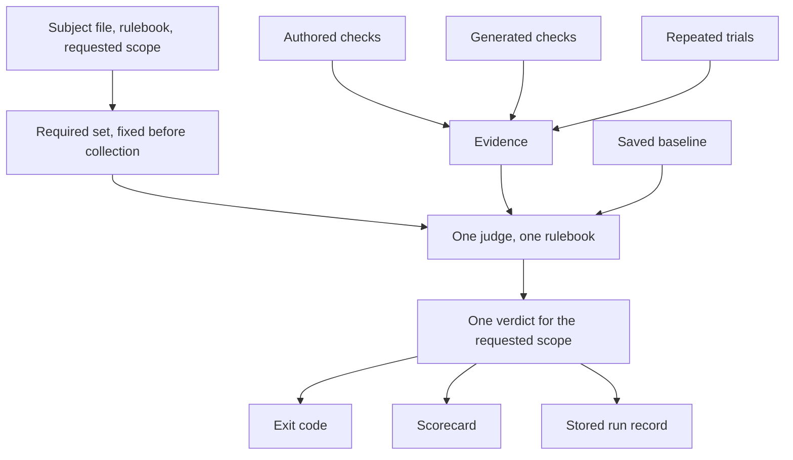

# Requirements

These are the requirements the engine answers. They were written for the predecessor engine's plan of 2026-11-18 and brought across on 2026-11-21 so that the requirement (R) and acceptance-example (AE) numbers the judge specification cites can be read here. The judge specification calls this document "the requirements plan". Below, "this plan" means that plan of 2026-11-18, not the [engine plan](plans/2026-11-21-engine-plan.md).

Every requirement, acceptance example, actor (A) and flow (F) is as it was in that plan, word for word and in the same order, including the order the numbers appear in (AE33 to AE36 appear in reverse order, as in that plan). Their numbers and wording do not change. The gate's tests check that every R and AE number cited under `docs/` resolves to one entry here, and that the entries are unchanged. R30 already reads as the plan amended it on 2026-11-18, which the rulebook's §15 records.

The other sections record the plan as it stood on 2026-11-18, with these edits: references into the predecessor engine are removed, or say "the predecessor engine"; the provenance notes on the key decisions are reworded in plain English; the language trial, now finished, is one sentence among the key decisions, and its item under How This Work Fits Together is removed; the assumption that the new repository starts private now says it is public; and the open blockers and outstanding questions are replaced by [Settled since](#settled-since). The engine plan now sets the order of the work. Where the judge's rulebook departs from these requirements is in [Where the rulebook departs from these requirements](#where-the-rulebook-departs-from-these-requirements).

## Goal Capsule

- **Objective:** Someone who has just printed a CLI with Printing Press can grade it and trust the result: green means everything the run was asked to measure was measured and held, red names a real defect, and anything else says what was not measured and what to do about it.
- **Means:** A new engine in a fresh repository, built on one evidence spine with one judge, using the predecessor engine as reference only.
- **Product authority:** The maintainer. This plan covers the first usable version of the new engine. Later families, moving the real fleet, and going public are not active scope here.

---

## Product Contract

### Summary

Build a new quality engine for Printing Press users in a fresh repository. It collects evidence in three ways — checks the user writes, checks it generates, and repeated trials — and one judge turns all of it into verdicts using one rulebook grown from the CDR spec. Conformance and steering both run on that spine in the first usable version, on one scorecard, reached through one subject file and one command.

### Problem Frame

Five months of fixes to the predecessor engine have not converged. A July audit estimated about ten specs to close the key issues; the count is now past a hundred. The November audit of the predecessor engine explains why: each measurement family was built with its own registration, verdict vocabulary, baseline logic, storage and idea of "not measured", so every fix is local and the inconsistency between families is structural.

The cost lands on the one promise the tool exists to keep. A skill subject with no run logs audits as PASS. A bootstrap subject with no transcript audits as PASS. A store with its tables emptied passes both the invariant check and the regression gate, where a check that stopped measuring counts as improved. A contract check against a missing baseline passes. The steering measurement sends the pass criteria to the agent instead of the prompt.

One of these is not a bug in the code. A CDR dimension with one passing check and several unrun ones is GREEN because the spec says so: a probe that ran takes precedence over one that did not (the CDR spec 0.9.1, §9.5 rule 6 and §15.1). The reference ledger implements that rule faithfully. Removing this false green means amending the spec and its fixtures.

A review of every family's code found that the ten families are a handful of mechanisms under many names, that they share no meaning of "not measured", and that the CDR grader decides in three disconnected places: the spec's run token is printed but never sets the exit code. "The steering A/B" is three unconnected mechanisms, and only one of them has a decision rule.

Printing Press already checks printed CLIs at build time (its score, verify, dogfood and shipcheck steps). Those are the generator's own checks on its output. What a user lacks is a grade of the finished CLI as an agent meets it: whether its commands conform, and whether an agent reaches for the right one.

### Key Decisions

- **Start fresh; nothing in the current contracts is protected.** The predecessor engine is reference only. (The owner chose this over paying down the predecessor engine in place: local fixes have not converged and the inconsistency between families is structural.)
- **A compiled language, Go or Rust.** (The owner chose this over staying in Python: the maintainer wants compiler-enforced handling of verdicts in agent-authored code.)
- **Two families on the spine in the first usable version: CDR conformance and steering.** Governs R11, R13. (The owner chose this over one grader first and over the fleet's five-family working set: a deterministic family and a statistical one force the spine to generalise without the breadth that drifted before.)
- **The first user is a Printing Press user.** Governs R15. (The owner chose this over the maintainer's own fleet with public use later, and over outside CLI and MCP authors in general.)
- **The spine is an evidence spine with one judge.** Governs R1, R4, R6, R27. (The owner chose this over a thin kernel with family plug-ins, which unifies only the edge, and over making the runbook format the engine, which cannot express generated checks or arm comparisons as steps.)
- **The judge speaks one rulebook, grown from the CDR spec.** Governs R4, R5, R14. (Proposed and approved by the owner over a neutral engine vocabulary with the spec mapped onto it: that leaves two vocabularies and leaves the unrun-check gap in the spec.)
- **The spec is folded into the engine and amended.** A consequence of the previous decision; the engine co-owns the spec. Governs R8.
- **The language was chosen by a trial on the judge, which picked Go after six independent judge builds, three in Go and three in Rust.**
- **A run's verdict covers what the run asked for.** Governs R19. (The owner chose this over "green means conformance and steering were both measured", which makes a free offline green impossible, and over two separate verdicts.)
- **The engine's scorecard sits beside the generator's build-time checks.** Governs R37. (The owner chose this over consuming the generator's results as evidence and over replacing them.)
- **Day one keeps surface checks, ordered runbooks with timing, and computed expected values.** Governs R12, R33, R34. (The owner chose this over surface checks only: each is split into its own testable requirement and the computed-value mechanism is fixed before the bake-off.)
- **The predecessor engine's known false greens are labelled, not fixed.** (The owner chose this over fixing the worst of them there, and over leaving the output unmarked.)
- **Steering is designed new, not ported.** No current steering number is a reliable baseline. Governs R13, R28 to R32.
- **The old engine's outputs are not an oracle.** They are wrong where it matters, so they serve as test cases. The oracle is the amended spec, its fixtures and the two-sided corpus. Governs R10.
- **"Family" means a measurement family.** The spec's Safety, Operability and similar groupings are called dimension groups in this plan and in the amended rulebook.

### How This Work Fits Together

This plan covers one area: the first usable version of the new engine, meaning the spine, the two day-one families and the single path to a first verdict. The breakdown below is the current understanding, not a committed roadmap. The first two items run in the order listed.

- **Effort terms.** Everything below depends on them: the time box, the budget, and the rule for abandoning the effort.
- **Rulebook freeze.** This plan and the bake-off depend on it. It writes down, once and in language-neutral form: the spec amendment, the steering decision rule, how computed expected values are supplied, the exit codes, the closed list of scopes, the result of the paper check in R40, whether the no-network check can be made on each supported system, and the shared corpus.
- **Skill audit as the third family.** Depends on this plan. It is the expected test of R18.
  - Bootstrap checks would fold into it.
- **Further families.** Can proceed independently of each other once the spine exists: store checks (invariants, data gaps), the contract and API fidelity checks, definition-iteration as a revision axis of arm comparison.
- **Verdict consumers.** Depend on this plan for one uniform verdict record: retro mining, opportunities ranking, the HTML report.
- **Labelling the predecessor engine's known false greens.** Can proceed independently of this plan.
- **Moving the real fleet and archiving the predecessor engine.** Depends on the families the fleet's gates need. Still to decide: when.
- **Generator scaffolding and going public.** Can proceed independently of this plan. Still to decide.

### Actors

- A1. Printing Press user: a person who has printed a CLI and wants to know whether it is good.
- A2. Operator agent: an agent that runs the engine on the user's behalf, often unattended, and reads its exit code and verdict.
- A3. Agent under test: the model whose tool choices are observed in steering trials.
- A4. Subject CLI: the printed CLI, and its MCP surface where it has one, that the checks run against.

### Key Flows

- F1. First conformance verdict
  - **Trigger:** A1 or A2 has a printed CLI and no subject file.
  - **Actors:** A1, A2, A4
  - **Steps:** Run the engine's create command to get a subject file with named placeholders for facts about the subject. Fill them. Run the grade command. Generated and authored checks run against A4 with no model call and no network use by A4. The judge produces a scorecard for the conformance scope.
  - **Outcome:** A scorecard in which at least one dimension is judged green or red from generated checks alone, and every other dimension carries an outcome and, where it was not measured, a reason that names the next action. Steering dimensions show as not-measured, "live trials not run", and do not affect this run's verdict.
  - **Covered by:** R11, R15, R16, R17, R19, R35, R36
- F2. Steering run
  - **Trigger:** A1 or A2 requests a scope that includes steering.
  - **Actors:** A1, A2, A3, A4
  - **Steps:** The engine states the planned trial count and expected cost. Approval is given interactively or by a budget cap set in advance. The engine sends each authored prompt to A3 for the planned number of trials and records tool choices as evidence. The judge applies the steering rule.
  - **Outcome:** Steering dimensions on the same scorecard, shown as a count of trials with an interval, and included in this run's verdict.
  - **Covered by:** R13, R14, R16, R28 to R32
- F3. Comparing two versions
  - **Trigger:** A1 or A2 wants to know whether a change to the CLI's tool descriptions helped.
  - **Actors:** A1, A2, A3, A4
  - **Steps:** Run steering trials for both versions as two arms on the same model and prompts. The judge applies the two-arm rule.
  - **Outcome:** Improved, regressed, no material change, or not-measured.
  - **Covered by:** R5, R28, R29
- F4. Regression check
  - **Trigger:** A1 or A2 grades a subject that has a saved baseline.
  - **Actors:** A1, A2
  - **Steps:** As part of the grade, the judge compares the current evidence with the baseline, check by check.
  - **Outcome:** Regressed, not regressed, or not-measured, with any vanished or uncompared checks listed; the result enters the run verdict.
  - **Covered by:** R6, R9, R25, R41
- F5. Saving or re-anchoring a baseline
  - **Trigger:** A1 or A2 asks to save the current run as the baseline.
  - **Actors:** A1, A2
  - **Steps:** The engine checks the run may be anchored. Where checks present in the old baseline are absent, the user names them as retired.
  - **Outcome:** A new baseline, or a refusal that says why.
  - **Covered by:** R26

### Requirements

**The spine**

- R1. A family reports a per-check outcome (held, not held, or not observed with a reason) and nothing above that; requiredness, dimension routing, precedence, baseline comparison, rollups and verdicts belong to the judge.
- R2. Evidence reaches the engine in exactly three ways: checks the user authored, checks the engine generated, and repeated trials. A family does not add a fourth.
- R3. One piece of evidence states what was checked, what was expected, and either what was observed or why it could not be observed. It names each source it evaluated, a command invocation or a recorded artifact, and who decided the outcome, a deterministic rule or a named model. A check whose predicate an empty target would satisfy also states the size of the target it evaluated, and a check that asserts emptiness also states a separately observed precondition that data existed. Trial evidence also states its trial and arm, the model identity, the sampling settings where the harness exposes them, the trial count declared for its pool, and whether the trial errored; it may also carry a grade beside the outcome. The engine records, from what actually executed, whether each source came from a live run, a replay, a scripted test run or an offline run.
- R4. One judge produces every verdict from evidence in one vocabulary, and the exit code, the scorecard and the stored run record are all derived from that one verdict.
- R5. The judge supports a fixed, named set of rules: all expectations hold; a rate against a threshold with an interval; a difference between two arms with an interval; and the amended spec precedence for expected failures, not-applicable dimensions and unrun checks. A rule is added only through a reviewed change to the rulebook, takes only evidence fields defined in R3, and is run against the full corpus for every existing family.
- R6. Comparison against a baseline exists once, in the judge. No family has its own.
- R27. Run records, trials and baselines persist only in the engine's store, and a family holds no state between runs that can change a verdict.

**What a verdict means**

- R20. The engine's tokens are the amended spec's. In plain words there are four outcomes: green; red; known defect, which is a measured failure the author declared in advance through the spec's expected-failure mechanism; and not-measured. The rulebook maps every spec state and result value onto these four.
- R19. A run's verdict and exit code cover the scope the run requested, and the stored record names that scope. Scopes are a closed list in the rulebook: each is one or more families, with any excluded dimensions named in the list; a request outside the list is rejected. Dimensions outside the scope are shown as not-measured with their reason and do not enter the verdict. Steering checks are required in every scope that includes steering.
- R21. The set of required checks is fixed before collection, from the subject file, the rulebook and the requested scope. Evidence cannot declare itself not required. An author can lower a check only through the spec's visible mechanisms, and a capability left unstated in the subject file is an unfilled placeholder under R17, never a "no".
- R42. Discovery of the subject's commands is itself a required check: it reports how many commands it found against the number the subject file declares, and finding fewer leaves the generated checks not-measured.
- R7. "Not measured" has one meaning: there is no non-vacuous observation for something required, either because the engine, its harness or the environment could not obtain one, or because no required check feeds an applicable dimension.
- R22. A failure of the subject is an observation: a subject CLI that crashes, exits wrongly or runs past its time budget on a check grades red. A binary that cannot be started is not-measured.
- R8. A dimension is green only when every required check feeding it was observed and held, and at least one was. A dimension group and a run are green only when every applicable dimension in them is green. An unrun required check is never covered by another check that ran, and unrun dimensions within the requested scope stay in the count at every level.
- R23. At every level red outranks not-measured, which outranks known defect, which outranks green. In a comparison, regressed outranks not-measured. Whatever was outranked is listed alongside.
- R24. Only a green run exits zero. Red, known defect and not-measured each exit non-zero with a distinct code, and a rejected request exits with a usage code.

**Baselines**

- R9. A baseline comparison fails closed and covers the requested scope. A check in that scope that was measured in the baseline and is not measured now, and not named as retired, makes the comparison not-measured unless it is regressed. A baseline that holds no check in the requested scope does not apply to that grade. Otherwise, a comparison in which none of the baseline's in-scope checks is compared is not-measured, with re-anchoring as the next action.
- R25. A baseline stores the observation status of every required check, passes included, under check identities that are stable across runs, each with the version of the rulebook it was judged under and the tier it was observed under. Whether a check is absent is decided by its identity first. Two observations of a check are then compared only when their rulebook version and tier match; otherwise that check is listed as not compared and, being inside the requested scope, makes the comparison not-measured unless the comparison is regressed. Baseline checks outside the requested scope are listed as not compared and do not affect the comparison. A check new since the baseline is graded on its own state. A trial-based dimension whose condition is unchanged since the baseline is not regressed by identity; when the condition has changed, the new pool is compared with the baseline's as two arms.
- R41. When a baseline applies under R9, the comparison is part of the grade: regressed makes the run red, and a not-measured comparison makes the run not-measured.
- R26. A user can save a run as the baseline and re-anchor it. Whether a run may be anchored is judged from its verdict before the baseline comparison: the engine refuses a run that is red or not-measured on its own evidence, or that carries stale expected-failure markers. A regression against the old baseline must be named as accepted. Anchoring replaces only the checks inside the run's scope, and baseline checks outside it carry forward unchanged. A check inside that scope that is absent from the new baseline must be named as retired. The stored record of a re-anchor keeps the replaced baseline's verdicts beside the new ones.

**The corpus**

- R10. A two-sided corpus stands permanently in the test suite: every not-measured case has a repaired twin that must grade green, known-good subjects must grade green, and seeded defects must grade red on the named check. It is written once, in language-neutral form, and in the finished engine it is run through the one grade command.
- R38. Corpus cases are defined as conditions on evidence, the rulebook decides which apply to a family, and a family is admitted only after adding its own cases and passing all that apply. Each false green found later adds a case.

**Day-one families**

- R11. CDR conformance grades a runbook of authored checks plus the generated probes, with the amended dimension rules as the verdict.
- R12. Surface checks run inside conformance as authored or generated checks, each mapped to a spec dimension: bare invocation, output within the declared byte bound, and declared exit codes. The destructive-refusal check runs a destructive command, so the default scope is conformance with the destructive-guard dimension excluded, and the scope that includes it is opt-in.
- R33. A runbook can be ordered: steps run in sequence, a step past its time budget grades red, and steps after a failed step are not-measured with the reason "earlier step failed". Timing compared across hosts is advisory.
- R34. An authored check can take its expected value from a literal or from a computation the user supplies. A computation that fails or is absent leaves the check not-measured.
- R13. Steering asks whether the agent under test reaches for an acceptable tool and avoids forbidden ones, judged on its first relevant call. A trial that calls neither scores as not held. The text sent is the authored prompt, byte for byte, plus a fixed declared framing, never the pass criteria.
- R28. Each steering dimension has one fixed decision rule the author cannot choose. It is three-way: green only when the interval clears the threshold, red only when it clears it the other way, otherwise not-measured. The minimum trial count is derived from the threshold and stated false-pass and false-fail targets and has an engine-enforced floor. The total count of scored trials for a condition is declared before its first trial. An errored trial is replaced, up to the error cap, and the dimension is judged only once the declared count is reached. The interval is not zero when all trials agree. Aggregation across prompts is stated with its combined error rate.
- R29. Two arms are compared only when they share a model, prompts and known sampling settings. "No material change" requires the interval of the difference to sit inside a stated margin; an interval that cannot decide is not-measured, as is an arm with no scored trials or below the minimum.
- R30. Trials count toward the minimum only when they are distinct and come from the tier the run claims; scripted trials count only in test runs and are never stored as live. A trial that ends in a timeout, a turn limit or no tool call scores as not held unless the failure is shown to be the harness's. Only a harness failure makes a trial errored. An errored trial is not counted, whatever the agent had done before the failure, because what it would have done next was not seen; and an error fraction above a stated cap makes the dimension not-measured.
- R31. Every trial is kept in the stored record. Trials are pooled only within one condition — the subject's surface and tool descriptions, the model and its sampling settings, the prompt and framing, the declared trial count, and the rulebook version — and the record lists the trials a verdict pooled. Trials beyond a condition's declared count are stored but not counted. A change to any of these starts a new pool, and the scorecard and record list the earlier pools for the same prompt with their verdicts. A prompt is identified by a stable name in the subject file, not by its text.
- R32. The agent under test sits behind an interface with a scripted implementation, and model calls can be counted, so every steering rule can be tested without a live model. The check that the subject made no network request sits behind an interface in the same way. The scripted implementation is reachable only through a test entry to the grade command that released builds do not expose, and the corpus's steering and network-verifier cases run through that entry. It derives the exit code the same way, labels its records as test runs, and a test run can never be anchored.
- R14. Steering results appear as dimensions on the same scorecard as conformance, shown as trials passed out of trials run with the interval.

**One path**

- R15. There is one way to register a subject, a single subject file, and one command to grade it.
- R35. The engine has a command that creates a subject file with named placeholders for the facts about the subject, including each capability the rulebook asks about.
- R17. A subject file with unfilled placeholders grades as not-measured and names them.
- R36. Every not-measured reason names the next action that would turn it into a measurement.
- R16. The default grade makes no model call and the subject CLI makes no network request, and the engine checks both during the run. A check during which the subject attempted a network request, or for which the engine could not verify that it did not, is not-measured. The subject file states whether each command is safe to run; a command it declares destructive is never run without opt-in, and a command with no stated class is an unfilled placeholder under R17. Anything that calls a model or the subject's live API is opt-in and states its expected cost first.
- R39. An unattended run approves cost through a budget cap set in advance; when the cap is reached the engine stops and reports what remains as not-measured.
- R37. The engine's documentation states what the generator's build-time checks cover and what this scorecard adds, so the two are not expected to agree.

**Growth**

- R18. Adding a family adds that family's evidence collection, its corpus cases, and at most one named rule under R5; it does not rewrite the spine or change another family's verdicts on the existing corpus.
- R40. Before the evidence record is frozen it is checked against two skill-audit cases written out on paper: a rule over a run log, and a model-judged rubric score. If either needs something R2, R3 or the rule set in R5 lacks, they are amended before the spine is built. The check was run on 2026-11-18, with a third case for a three-way comparison: R2 held, R3 was amended as it now reads, and skill audit will need one new judging rule and an amendment to the spec's clause on model judging.

### Acceptance Examples

- AE1. **Covers R7, R8.** Given a conformance subject where one required check passes and two required checks cannot run because the harness failed, when it is graded, then the affected dimension, its dimension group and the run are all not-measured and the two checks are named.
- AE2. **Covers R22.** Given a subject CLI that crashes on one required check, when it is graded, then that check's dimension is red and the run is red; and given a subject binary that cannot be started, then the run is not-measured.
- AE3. **Covers R23.** Given a run where one required check fails and two could not run, when it is graded, then the run is red and the two unrun checks are listed.
- AE4. **Covers R3, R7.** Given a check that every returned row has a field, run when the command returned no rows, when it is graded, then it is not-measured because its target was empty; and given the same check with no target size reported, then it is also not-measured.
- AE5. **Covers R3.** Given a check asserting that a command returns nothing, with an observed precondition that the store holds data, when it is graded, then it is green; and given the same check with the precondition unmet or unobserved, then it is not-measured.
- AE6. **Covers R21, R8.** Given a subject file that marks checks as not required outside the spec's mechanisms, when it is graded, then the request is rejected with the usage code; and given a subject with no required checks at all, then the run is not-measured.
- AE7. **Covers R21.** Given a family that crashes before emitting any evidence, when the run is graded, then every check that family was required to supply is not-measured.
- AE8. **Covers R10.** Given a known-good synthetic subject, when it is graded offline, then every dimension in the default scope is green and the run exits zero; and given the same subject with one seeded defect, then the affected dimension is red, the defect's check is named, and the run exits with the red code.
- AE9. **Covers R19, R16.** Given a subject with authored steering prompts and clean conformance, when the default grade runs, then no model is called, the subject makes no network request, the run is green for the conformance scope and exits zero, and steering shows not-measured, "live trials not run".
- AE10. **Covers R19.** Given the same subject graded with steering requested and fewer trials than the minimum, when it is judged, then the run is not-measured and exits with the not-measured code; and given a request for a scope that is not in the rulebook's list, then it is rejected.
- AE11. **Covers R13, R32.** Given a scripted agent under test, when a steering trial runs, then the text it receives equals the authored prompt plus the declared framing and nothing else.
- AE12. **Covers R28.** Given scripted trial sequences in a test run, when each is judged, then one whose interval clears the threshold is green, one whose interval clears it the other way is red, one whose rate sits at the threshold with an interval that straddles it is not-measured, and one where every trial agrees still reports an interval wider than zero.
- AE13. **Covers R28.** Given a declared trial count below the engine's floor or below the derived minimum, when the run starts, then it is rejected with the usage code.
- AE14. **Covers R30.** Given a declared count equal to the derived minimum and that many trials run, one of which errored before choosing a tool, when it is judged, then the dimension is not-measured with "one trial to replace" as the next action; when a replacement trial is scored, then the dimension is judged; and given scripted trials presented in a run that claims to be live, then they are not counted.
- AE15. **Covers R29.** Given two arms run on different models, or one arm with no scored trials, when they are compared, then the result is not-measured; given two arms whose difference interval sits wholly above the margin, then the result is improved, wholly below it, regressed, and wholly inside it, no material change; and given two arms with too few trials for the interval to decide, then the result is not-measured.
- AE16. **Covers R9, R23.** Given a baseline with twelve measured checks and a current run with nine, one of which has gone from pass to fail, when they are compared, then the result is regressed, naming that check and listing the three missing ones.
- AE17. **Covers R9, R41.** Given a baseline with twelve measured checks and a current run whose required set holds nine of them, all measured and holding, with the other three absent from it and not retired, when it is graded, then the comparison is not-measured, the three are listed, and the run exits with the not-measured code.
- AE18. **Covers R25.** Given an unchanged subject graded twice, when the two runs are compared, then the check identities are identical and the result is not regressed; and given a baseline holding offline conformance checks and live steering checks, compared with a default offline run in which conformance holds, then the conformance checks are compared, the steering checks are listed as not compared, and the run is green and exits zero.
- AE19. **Covers R26.** Given a run that is red from a failing check, a run that is not-measured on its own evidence, or one carrying a stale expected-failure marker, when the user asks to save it as the baseline, then the engine refuses and says why; given a run with one known defect and no red, then it is anchored; and given a run that is red only because a steering dimension regressed while still clearing its threshold, when the user names that regression as accepted, then it is anchored.
- AE20. **Covers R17, R35.** Given a subject file fresh from the create command, when it is graded, then the run is not-measured and names the unfilled placeholders.
- AE21. **Covers R4, R24.** Given every corpus case run through the grade command, when its exit code, scorecard and stored record are read, then all three state the same verdict and the exit code is the one that verdict maps to.
- AE22. **Covers R33.** Given an ordered runbook whose second step fails, when it is graded, then the run is red and the later steps are listed as not-measured, "earlier step failed".
- AE23. **Covers R34.** Given a check whose expected value comes from a computation that fails, when it is graded, then the check is not-measured and names the failed computation.
- AE24. **Covers R16, R17.** Given a subject file that leaves one discovered command without a stated class, when the default grade runs, then that command is not executed and the run is not-measured, naming the command to classify; given a subject that attempts a network request during a check, then that check is not-measured and names the network; and given a network verifier that reports it cannot verify, then the check is not-measured.
- AE25. **Covers R39.** Given an unattended steering run whose budget cap is reached mid-run, when it stops, then the trials not run are reported as not-measured.
- AE26. **Covers R20, R24.** Given a subject whose only failing check is declared as an expected failure, when it is graded, then the run's outcome is known defect, it exits with the known-defect code, and no "next action to measure" is given for it.
- AE27. **Covers R42.** Given a subject file declaring forty commands and a discovery that finds three, when it is graded, then the generated checks are not-measured and the shortfall is named.
- AE28. **Covers R7, R8.** Given a subject where one applicable dimension is green and another applicable dimension has no required check feeding it, when it is graded, then the run is not-measured and names the uncovered dimension.
- AE29. **Covers R31.** Given steering trials stored for a subject, then a change to one of its tool descriptions or to the sampling settings, when steering runs again, then only trials from the new condition are pooled; given a second run under an unchanged condition whose declared count is not yet reached, then its trials are pooled with the first and the record lists them all; and given a run after the declared count is reached, then its trials are stored and the verdict does not change.
- AE30. **Covers R12, R19.** Given a known-good subject that declares destructive commands, when the default grade runs, then its bare-invocation, byte-bound and exit-code checks are each judged, its destructive-guard dimension is shown as not-measured outside the scope, and the run is green and exits zero.
- AE31. **Covers R9, R41.** Given a baseline of twelve checks recorded under an older rulebook version, when the subject is graded, then no check is compared, the comparison is not-measured with "re-anchor" as the next action, and the run exits with the not-measured code; and when the user then saves that run, whose own evidence is green, it is anchored.
- AE32. **Covers R9, R26.** Given a baseline saved from a default conformance run, when a steering-only scope is graded, then the baseline does not apply, the run is judged on its own evidence, and the scorecard says there is no baseline for this scope; and when that steering run is saved, then the conformance checks stay in the baseline unchanged and none has to be retired.
- AE36. **Covers R30, R13.** Given a scripted agent that stalls without calling any tool on some trials, when the dimension is judged, then those trials are scored as not held and are not replaced; given a timeout with no evidence on the harness side, then it is scored as not held; and given a trial the harness itself failed to deliver, then it is not counted and is replaced.
- AE35. **Covers R32.** Given a released build, when the test entry to the grade command is requested, then it is rejected with the usage code.
- AE34. **Covers R25.** Given a steering run saved as the baseline and nothing about the subject changed, when the steering scope is graded again, then the steering dimensions are not regressed by identity and the run is green.
- AE33. **Covers R9, R26.** Given the run in AE17, when the user saves it and names the three missing checks as retired, then it is anchored.

### Success Criteria

- No false greens and no unreachable greens, proven: the two-sided corpus passes for both day-one families.
- One path to a first verdict: a freshly printed CLI, with one subject file, one grade command, no hand-authored checks and no network, gets at least one conformance dimension judged green or red.
- The first-user path is validated by someone outside it: an operator agent with only the new repository's documentation grades a printed CLI it has not seen; each red it reports is confirmed by hand as a real defect, and each not-measured reason's next action works when followed. No outside Printing Press user is reached until the going-public work.
- A third family is additive: this is judged when skill audit is added, and R40 is the check made now.

### Scope Boundaries

**Deferred for later**

- Skill audit, bootstrap checks and definition-iteration.
- Invariant packs and the data-gap finder as generated checks over a store; the contract check and API fidelity.
- Probing the subject's MCP surface and CLI-to-MCP parity.
- Retro mining, opportunities ranking, and the HTML report and server.
- Moving the real fleet's subjects, baselines and gates, and archiving the predecessor engine.
- Having the generator scaffold a starter subject file for each printed CLI.
- Going public.

**Outside this product's identity**

- A general-purpose evaluation framework for any agent-facing system.
- Compatibility with the predecessor engine's manifests, baselines, run history, output envelopes, exit codes or script paths.
- Parity with the predecessor engine's outputs.
- Replacing or consuming the generator's build-time checks.

### Dependencies / Assumptions

- The effort terms are set first, then the rulebook freeze, then the bake-off, then implementation planning.
- A fresh start overrides the predecessor engine's ADR-0006 items 1 and 6 and its ADR-0002 warning about a second-system rewrite, on the record. From the predecessor engine's consolidation brief, these conditions bind: a funded, time-boxed effort with an abandonment rule; no unrelated feature work run alongside; the security conditions for a repository that may become public. These are waived, with the reason: the parity gate, per-slice transition, feature freeze and dual landing, because nothing is ported and parity would carry the false greens across; narrowing the predecessor engine first, because nothing there is being kept.
- Folding the spec in overrides the workspace decision that made the CDR spec its own vendor-neutral repository. That override is recorded with the ADR-0006 override.
- The CDR spec 0.9.1, §9.5, defines all seven dimension states and their precedence in one place.
- Spec 0.9.1 carries confirmed deferred defects, one of which changes a run token. The amendment settles them.
- Assumed: the real fleet keeps running on the predecessor engine until it moves, with the known false greens labelled on its output.
- The new repository is public from the start, and AGENTS.md carries the rules for what may be published.
- Assumed: the new repository starts with few gates of its own (tests, lint, a secret scan, the corpus) beyond what the security conditions above require.

### Settled since

The plan of 2026-11-18 had four open blockers and a list of outstanding questions. This section replaces both. Each item settled since names where it was settled. An item settled only in part has its settled part listed under **Settled** and the whole item, in the plan's own words, under **Still open**, followed by a line naming the part still open. This section records the state on 2026-11-21 and is not kept up to date; the engine plan's §3 and §8 list the decisions still to come.

**Settled**

- The effort's time box and abandonment rule: the milestone, the deadline of 2027-03-31, and the rule that the effort stops if the milestone is not reached by then. [Engine plan](plans/2026-11-21-engine-plan.md) §1.
- The rulebook freeze: version 1.0 of the judge specification, sealed on 2026-11-19, in `docs/specs/judge-1.0/`. Engine plan §2, and the rulebook's version policy. It does not settle how a computed expected value is supplied or whether the no-network check can be made on each system; both are still open below, and engine plan §3 leaves them to the collection specifications.
- The implementation language, the bake-off and its decision rule: the language trial is finished and chose Go. Engine plan, opening lines and §2.
- The new repository's name and home: `github.com/vinnyp/press-quality-lab` (engine plan §4 and §8). Its licence: MIT (engine plan §8 records the licence as settled; `LICENSE` names it). It is public (AGENTS.md). Where it sits relative to the generator project is not stated, so that question is still open below.
- Where specifications live: under `docs/specs/` (engine plan §8). This settles part of the question about the standalone spec repository.
- The command name: `pql` (engine plan §4 and §8). This settles whether the engine keeps the `aql` name.
- The spec amendment text, in part, in the [rulebook](specs/judge-1.0/rulebook.md)'s §14, whose amendments are numbered A1 to A19 (not the actors above): §9.5 rule 6 (amendment A1); the unrun-check treatment in §9.7 and §9.8 (amendment A2); §15.1's "another probe covered" clause (amendments A1 and A10); steering as required in scope (amendment A6, and §3); an omitted capability (amendment A5); the order of known defect and unrun (amendments A3 and A4); trials and arms (amendment A16, and §9); the steering dimensions, and the comparison check that feeds `tool-description-efficacy` (amendment A14, and §9.5); prose pass criteria (amendment A15).
- The steering decision rule, in part, in the rulebook's §4, §9 and §18 (its rules are cited by their ids, such as T4, and its open notes in §18 as O1 to O4): the statistic, a Wilson interval at the 95% level for one prompt and a Newcombe interval for the difference between two arms (§9.3, §9.5, §9.6, O1); the derived minimum and the floor, both 16 trials, the smallest count at which a prompt can be judged green (rules T4 and X7); the margin for two arms, 0.10 (rule K4, O1); the cap on errored trials, more than a quarter of the declared count, which is an error fraction above 0.20 (rule P0, O1); aggregation across prompts, where each prompt is its own check and the combined rate of a wrong red is stated (§9.3, §9.4), and a comparison sums its arms over prompts (rule K4, O2); and what the first relevant call counts (rule S1). The error targets: the error rates §9.4 reports, as the owner decided on 2026-11-21 ([errata](specs/judge-1.0-errata.md) E-2, item 3).
- The exit-code values (rulebook §8) and the closed list of scopes (rulebook §3).

**Still open**

- The time box, budget and abandonment rule for the effort.
  - Open part: the budget.
- The new repository's name, licence and home relative to the generator project.
  - Open part: where the repository sits relative to the generator project.
- Whether the standalone spec repository is frozen at 0.9.1 or follows the engine's amended spec, which decides where amended fixtures live, and whether its reference grader is run over the fixtures as an independent cross-check.
  - Open part: all of it. Only where this repository keeps its own specifications is settled.
- The spec amendment text: §9.5 rule 6; the unrun-check treatment in §9.7 and §9.8; §15.1's "another probe covered" clause; steering as required-in-scope where the spec says not-applicable; the rule that an omitted capability counts as false; the order of known defect and unrun in R23, which reverses the spec's; trials and arms as spec concepts; the steering dimensions and how the two-arm rule feeds the tool-description dimension; what becomes of existing prose pass criteria; the affected fixtures; and the deferred 0.9.1 defects.
  - Open part: the affected fixtures, and the deferred 0.9.1 defects.
- The steering decision rule: the statistic, the error targets, the derived minimum and the floor, the margin for two arms, the cap on errored trials, the aggregation across prompts, what "first relevant call" counts, and the expected cost per dimension at typical prompt counts.
  - Open part: the expected cost per dimension at typical prompt counts.
- How a user supplies a computed expected value, and with it whether the engine must be a single self-contained binary with no other runtime.
- Whether "the subject made no network request" can be verified on each supported system.
- The exit-code values, the closed list of scopes, and the declared framing text.
  - Open part: the declared framing text.
- Whether the engine ships as a Claude Code plugin, whether it keeps the `aql` name, and which agents and skills come with it.
  - Open part: whether the engine ships as a Claude Code plugin, and which agents and skills come with it.
- Which generated probes from the current pack are kept, and how a command is classified as safe to run.
- The mechanism by which the engine verifies that the subject made no network request.
- The unit in which expected cost is stated.
- Which harness drives the agent under test, and who supplies its credentials.

### Where the rulebook departs from these requirements

The judge's [rulebook](specs/judge-1.0/rulebook.md), version 1.0, lists in its §15 where it departs from these requirements. Where a requirement and a binding rule of the rulebook differ, the rule is right; the rulebook's "What binds" paragraph says which parts bind. No requirement here has been edited to match it. The [errata note](specs/judge-1.0-errata.md) for version 1.0 lists further departures that §15 does not, and one stale entry in §15. A difference that neither lists is reported to the owner, not worked around in the engine.

The judge specification also uses R1, R2 and R3 as the names of the rulebook's three comparison results (its §11, and §15, §16, the judge contract and the case files where they refer to those results). There they are not these requirements.

### Sources / Research

- The predecessor engine's codebase audit of November 2026 — the seven-lane audit: false greens, no shared engine, process weight.
- Its consolidation brief of November 2026 — the compiled rebuild weighed against ADR-0002 and ADR-0006, the bake-off design, and the security conditions for a public repository.
- Its fresh-engine brief of November 2026 — the narrative brief and the family map. This plan supersedes its requirement list.
- The seven-round peer review that this plan answers is summarised in the predecessor engine's pull request that added it; the full review log is kept outside both repositories.
- Its ADR-0006, which ratified a typed Python engine — the decision this work overrides.
- The CDR spec 0.9.1 — the rulebook's starting point: §5.4 (time budgets), §9.2 (vacuity), §9.5 to §9.8 (states, precedence, rollups, the zero-applicable guard), §15.1 (result values).
- Its CDR ledger — the closest existing thing to the evidence record; a faithful implementation of the spec rule this plan amends.
- Its arm-scoring script — the reference for a two-arm rule: a trial floor, a comparability guard and a materiality margin worth keeping; an uncertainty band that is zero when all trials agree, an arm with no scored trials treated as zero, and inconclusive checked before regressed, all to avoid.
- Its CDR capture code — where the pass criteria are sent in place of the prompt.
- Its regression module — the baseline diff that stores findings only, so a vanished check counts as improved.
- Its probe-pack runner — the generated probes, discovered by walking the subject's help output and run against the real binary.
- Its ground-truth module — the in-process Python contract for computed expected values.
